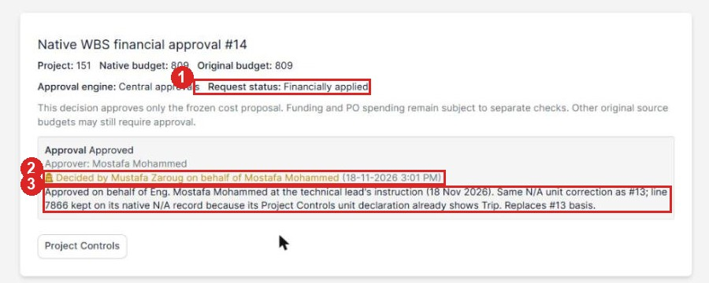
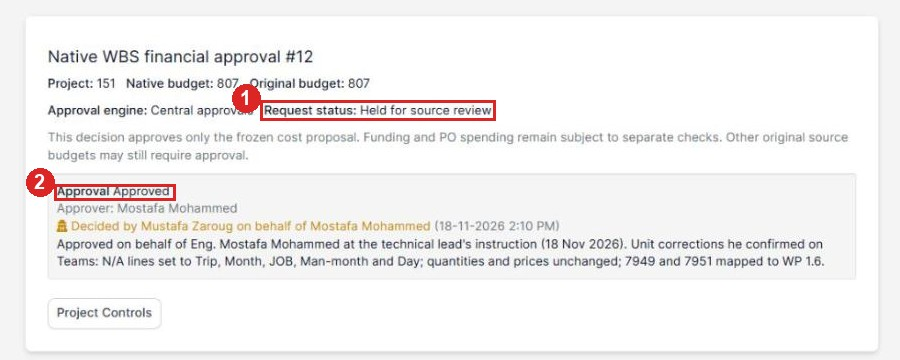

# ضوابط المشروع (Project Controls)

ضوابط المشروع هي مساحة العمل على مستوى المشروع من **Projects ← (المشروع) ← Project Controls**. تضم Plan و WBS & Progress و QS Support و Cost Plan و Approval review و Funding. هذه الصفحة تشرح الخطوات العملية للإجراءات الإدارية والمالية فيها.

## 1. السلسلة المالية باختصار

أي تغيير في سطر ميزانية معتمد (سعر جديد، كمية جديدة، سطر جديد) لا يصل للمشتريات وحده. نفّذ الخطوات بالترتيب:

1. **خطة التكلفة (Cost Plan)** — اربط السطر واضغط **Save**.
2. **الميزانية الأصلية** — **Compile native draft**.
3. **مراجعة الاعتماد** — **Submit for review**.
4. **اعتماد التكلفة** — **Submit cost approval**، ثم يقرر المعتمد.
5. **تسوية التمويل** — **Submit worksheet** ثم **Approve submitted worksheet**.

إلى أن تكتمل السلسلة تبقى طلبات الموارد وطلبات الشراء وأوامر الشراء في المشروع موقوفة. المربع الأصفر (القسم 2) يوضح الخطوة المتبقية.

## 2. المربع الأصفر "مطلوب خطوة في ضوابط المشروع"

عندما تكون بوابة الصرف للمشروع مقفولة، تظهر في صفحات طلب الموارد وطلب الشراء والميزانية وأمر الشراء علبة صفراء أعلى الصفحة.

1. اقرأ الجملة (1): تذكر الخطوة الوحيدة المتبقية.
2. اضغط الزر (2): يفتح صفحة الخطوة في تبويب جديد.
3. نفّذ الخطوة، ثم ارجع واضغط **تحديث / Refresh** (3). يظهر المربع بالخطوة التالية، أو يختفي إذا انتهى كل شيء.

| المربع يقول | افعل |
|---|---|
| تغيّر سطر في الميزانية بعد آخر اعتماد تكلفة | في خطة التكلفة اضغط **تحديث على الميزانية الحالية** (4). إذا زادت كمية، اربط الكمية الزائدة في سطرها ثم **Save**. |
| اعتُمدت ميزانية إضافية جديدة | تظهر سطورها غير مربوطة في خطة التكلفة. اربط كل سطر مثل نفس البند في باقي المشروع (3.1)، اضغط **Save**، ثم تابع المربع. حتى يتم ذلك يوقف المربع كل أوامر الشراء في المشروع، حتى للبنود المربوطة أصلًا. |
| الميزانية الأصلية لم تُجمّع بعد | اضغط **Compile native draft** (5). |
| في سطر ميزانية كميته أكبر من الموزّع في خطة التكلفة | ضع الزيادة في صف حزمة العمل لذلك البند، اضغط **Save** ثم **Compile native draft**. |
| أرسل المراجعة واعتماد التكلفة | في مراجعة الاعتماد اضغط **Submit for review** ثم **Submit cost approval**. |
| اعتماد التكلفة ينتظر المعتمد | الزر يفتح الطلب: اكتب السبب واضغط **Approve**. |
| يجب تسجيل تسوية التمويل من جديد | الزر يفتح سجل التمويل: أرسلها واعتمدها (القسم 6). |

## 3. خطة التكلفة

**المكان:** المشروع ← **Project Controls ← Finance ← Budget & deployment ← Draft WBS cost plan**.

### 3.1 ربط سطر ميزانية

1. ابحث عن السطر في خطة التكلفة.
2. اختر حزمة العمل (لا يُختار إلا حزمة عمل ليس تحتها عناصر)، وكود CBS، ونوع المورد.
3. أدخل الكمية المربوطة، واربط كامل كمية السطر.
4. اضغط **Save**.

اربط السطر الجديد بنفس طريقة ربط البند المشابه في ميزانيات المشروع الأخرى (المواد المشتركة على مخزون المشروع، والخدمات على حزم الخدمات، وهكذا).

### 3.2 سطر وحدته N/A

السطر الذي وحدته N/A لا يظهر عند عمل طلب موارد، ولا يُعتمد بالكمية.

1. اطلب من مهندس المشروع الوحدة الصحيحة لكل سطر من هذا النوع (رحلة، شهر، يوم، عملية، عامل في الشهر، وهكذا). اقترح وحدة من وصف البند وسعره، ودع المهندس يؤكدها كتابةً (مثلًا عبر Microsoft Teams).
2. أرسل الوحدات المؤكدة للفريق التقني. يصحّحون الوحدة في سطر الميزانية وفي سطور طلبات الموارد القديمة عليه؛ الكمية والسعر لا يتغيران.
3. بعض السطور القديمة تبقى N/A عن قصد لأن Project Controls يعطيها وحدة خاصة به (تعريف وحدة من عرض سعر، أو تصحيح عمالة بالساعات). يتحقق الفريق التقني من ذلك أولًا ويترك هذه السطور كما هي.
4. في خطة التكلفة اسحب حجز المخصص المالي لكل سطر مصحّح (3.3)، واربط السطر (3.1) واضغط **Save**.
5. أكمل السلسلة: التجميع، المراجعة، اعتماد التكلفة، التمويل.

إلى أن تُصحّح الوحدة، لا يمكن تسجيل السطر إلا كمبلغ مالي للسطر كاملًا.

### 3.3 سطر محجوز كمخصص مالي فقط ولم يعد مطابقًا

عندما يتغير سطر محجوز كمخصص مالي فقط (سعر أو كمية جديدة)، يذكر حفظ خطة التكلفة أن المخصص لم يعد يطابق سطره.

1. افتح مخصص مصدر السطر في خطة التكلفة.
2. اضغط **Withdraw** واكتب السبب.
3. اربط السطر (3.1) واضغط **Save**.
4. أكمل السلسلة من الخطوة 2 في القسم 1.

السحب وحده يترك السطر غير موزّع، ويظل يوقف الصرف حتى يُربط.

قد يكون السطر مربوطًا **و**ما زال يحمل حجز مخصص مالي قديم من الوقت الذي لم تكن له وحدة. بعد تصحيح وحدته لا يعود الحجز مطابقًا، فيتوقف اعتماد التكلفة (5). اسحب كل حجز من هذا النوع قبل التجميع.

### 3.4 التوزيعات الفعلية بعد مراجعة نطاق جديدة

بعد تسجيل مراجعة Governing Scope جديدة، افتح **QS Support ← Planning Review ← Plan operation allocations**، واحفظ صفوف التوزيع لكل حزمة عمل من جديد، ثم أكّد مراجعة التخطيط. بعدها استخدم **Review source reconciliation** في خطة التكلفة.

### 3.5 قاموس رموز التكلفة (Cost-code dictionary)

**المكان:** خطة التكلفة ← **Cost-code dictionary**.

1. تحت **Add a code**، أدخل رمز التكلفة، تسميته بالإنجليزية والعربية، التصنيف الأصل (أو الجذر)، حالة الاختيار، وعائلات الموارد المسموحة (Manpower / Materials / Plant / Services / Other).
2. اختر قرار المراجعة: **Draft** أو **Approved**. أدخل مرجع المصدر/المراجعة والسبب.
3. اضغط **Preview dictionary impact**، ثم أكّد.

كل تأكيد ينشئ نسخة جديدة من القاموس. التوزيعات (3.1) يمكنها استخدام رموز من نسخة **معتمدة (approved)** فقط؛ وبدون ذلك ترفض خطة التكلفة بـ**"Select an active approved code compatible with the resource family"**. إذا لم يكن لعائلة سطر تكلفة (Manpower أو Plant أو Service أو Material أو Other) رمز بعد، أضف رمزًا هنا واعتمده قبل التوزيع عليه.

## 4. الميزانية الأصلية ومراجعة الاعتماد

قبل أن تُعتمد الميزانية الأصلية، يجب أن تكون بوابة الاعتماد خالية: لكل سطر ميزانية شركة مالكة (أعلن شركة المشروع عندما لا يكون للميزانية المصدر شركة)، وكل سطر موزّع في خطة التكلفة على حزمة عمل (3.1)، ولكل سطر وحدة حقيقية (N/A ليست وحدة، 3.2)، والميزانية مُرسلة للمراجعة.

1. في خطة التكلفة اضغط **Compile native draft**. تظهر المسودة الجديدة تحت **Latest proposal**.
2. اضغط **Approval review** واقرأ القيود. صفوف "Spending only" عادية وتعالجها خطوة التمويل.
3. اضغط **Submit for review**. يصبح الزر **Review submitted**.

إذا ظهر `PROJECT_COMPANY_SOURCE_INVALID`، حدّد شركة المشروع من نموذج تعديل المشروع (نفس شركة الميزانية)، ثم أرسل من جديد.

الميزانية الأصلية للمشروع تحتاج WBS واحدًا بالضبط للمشروع. إذا كان للمشروع أكثر من WBS، أو لم يكن له أي WBS، فإن **Compile native draft** تُظهر: *"The budget needs exactly one project WBS. This project has more than one WBS, or none. Keep one WBS for the project, then compile the budget again."* وعندما يكون للمشروع أكثر من WBS، فإن Project Controls (التوزيعات التجارية، التنفيذ، والجاهزية) يعمل دائمًا على الأحدث منها.

## 5. اعتماد التكلفة

1. في مراجعة الاعتماد اضغط **Submit cost approval**.
2. يظهر زر جديد **Central approvals … Pending approval**. اضغطه.
3. اكتب السبب في **Decision reason**: ما الذي تغيّر ومن قرر.
4. اضغط **Approve** أو **Reject**. الموافقة تجعل الحالة **Financially applied**.

إذا لم تكن أنت المعتمد يسجّل النظام القرار **نيابة عن** المعتمد. لا تسجّل قرارًا بالنيابة إلا إذا وافق المعتمد (مثلًا عبر Microsoft Teams) أو قرر صاحب المشروع، واذكر ذلك في السبب.

1. **Request status: Financially applied**: انتهى الاعتماد.
2. **Decided by … on behalf of …**: يوضح النظام من ضغط **Approve** ونيابةً عن من.
3. السبب: ما الذي تغيّر ومن قرر.

### 5.1 الاعتماد متوقف

1. **Request status: Held for source review** تعني أن القرار سُجّل لكن النظام لم يطبّقه.
2. الخطوة نفسها تظهر **Approved**، فلا تعتمدها مرة أخرى.

السبب المعتاد سطر ما زال يحمل حجز مخصص مالي قديم (3.3). اسحب الحجز، وجمّع من جديد، وأرسل المراجعة واعتماد تكلفة جديد، ثم اعتمد الطلب الجديد. يبقى الطلب المتوقف في السجل.

## 6. تسوية التمويل

تلزم من جديد بعد **كل** اعتماد تكلفة جديد.

1. في المشروع اضغط **Funding trail**. تظهر رسالة **Source changed — review a new worksheet** (أو **Stale**).
2. قارن الـ worksheet المقترح بآخر نسخة معتمدة.
3. إذا كانت المبالغ كما في المرة السابقة: اكتب السبب، علّم على التأكيد، واضغط **Submit worksheet**.
4. اكتب سبب الاعتماد، علّم على التأكيد، واضغط **Approve submitted worksheet**.
5. تظهر رسالة **Funding reconciliation approved**.

إذا أظهر الـ worksheet تغييرًا حقيقيًا (مبلغ محرر جديد، أو مبلغ مختلف، أو سحب زائد جديد) فتوقف: صاحب المشروع يقرر أولًا.

عند اعتماد التمويل يختفي المربع الأصفر، ويستطيع معتمد أمر الشراء اعتماده.

1. ختم المعتمد **Approved** على أمر الشراء.
2. تاريخ ووقت الاعتماد.

### الخطوات بالصور

كل رقم أحمر هو الخانة التي تضغطها بالترتيب.

## 7. تعديل سطر ميزانية (سعر أو كمية)

تعديل سطر ميزانية مربوط في خطة التكلفة ينشئ **تعديل سطر ميزانية** يحتاج اعتمادًا.

### 7.1 طلب التعديل

1. افتح الميزانية ← السطر ← **Revise**.
2. أدخل الكمية وسعر الوحدة الجديدين والسبب ← **Save**.
3. يذهب التعديل لمعتمديه.

### 7.2 اعتماد التعديل

1. افتح التعديل من مربع **Approvals still open** أعلى صفحة الميزانية أو طلب الموارد.
2. تظهر في الشاشة **Waiting for** واسم المعتمد.
3. يكتب المعتمد السبب ويضغط **Approve** أو **Reject**.
4. عند الاعتماد النهائي تُكتب الكمية والسعر الجديدان في سطر الميزانية. للتعديل المعتمد سابقًا اضغط **Apply to budget line**.

**بالنيابة:** يستطيع المدير (Admin) اعتماد التعديل أو رفضه نيابة عن المعتمد مع سبب. تظهر عندها **On behalf of** مع اسم المعتمد، ويُسجَّل في سجل النشاط. من طلب التعديل لا يستطيع اعتماده إلا إذا كان الاعتماد الذاتي مسموحًا في إعدادات الاعتمادات.

### 7.3 تعديل عالق

التعديل الذي لا يمكن اعتماده أو تطبيقه (تغيّر سطره أو خط أساس تكلفته بعد الاعتماد، أو ليس له معتمدون) لا يقفل السطر. افتح نموذج تعديل السطر: يظهر **This change can no longer be decided or applied. Submitting a new change replaces it.** أدخل التعديل من جديد واضغط **Save**. يظهر التعديل القديم **Replaced by a newer change** ويحتفظ بسجله.

### 7.4 بعد اعتماد التعديل

نفّذ السلسلة المالية كاملة (القسم 1). ثم:

- **طلب الموارد يحتفظ بسعره.** كل طلب موارد موجود يحتفظ بالسعر الذي أُنشئ به، والطلبات الجديدة فقط تأخذ السعر الجديد.
- لا يجوز أن تقل الكمية الجديدة عن المحجوز في طلبات الموارد.
- لاستخدام السعر الجديد في طلب مفتوح، أغلقه وافتح طلبًا جديدًا.

## 8. إنشاء طلب موارد

1. افتح **New** ← نوع الطلب: Material أو Manpower أو Equipment أو Service (و Labour – External للعمالة الخارجية مثل بدل الأكل).
2. **Budget:** اختر الميزانية الرئيسية للمشروع، وليس **WBS budget draft**.
3. **Budget / additional budgets:** اختر الميزانية التي فيها البند.
4. **Budget Items:** اختر البنود ثم **Add selected items**.
5. أدخل الكميات ← **Save draft** ← **Submit for approval**.

إذا لم يظهر بند، راجع المربع الأصفر (القسم 2) أو هل السطر محجوز كمخصص مالي فقط (القسم 3.3).

## 9. توقف اعتماد أمر الشراء

الضغط على **Approved** في أمر الشراء قد يتوقف. المربع أعلى أمر الشراء يسمّي الحالة وفيه زر يفتح الصفحة التي تحل المشكلة. لا يُحفظ شيء أثناء التوقف.

| الكود | الحالة | اذهب إلى |
|---|---|---|
| `PURCHASE_SOURCE_SPENDING_HELD` | **أ. التمويل** — اعتماد تكلفة جديد جعل تسوية التمويل قديمة. | سجل التمويل (القسم 6) |
| `PURCHASE_SOURCE_CHANGED` | **ب. طلب الشراء أو طلب الموارد تغيّر** — بند أُلغي أو رُفض أو حُذف أو عُدّل، أو طلب الشراء غير معتمد بالكامل. | طلب الشراء المرتبط |

### الحالة أ — التمويل

1. اضغط **فتح سجل التمويل في ضوابط المشروع** في المربع.
2. نفّذ تسوية التمويل (القسم 6).
3. ارجع لأمر الشراء ← **Approved**.

### الحالة ب — طلب الشراء أو طلب الموارد تغيّر

1. اضغط **فتح طلب الشراء المرتبط** في المربع.
2. تأكد أن طلب الشراء **Approved** وأن كل خطواته معتمدة. إذا بقيت خطوة مفتوحة فأكملها ثم اعتمد أمر الشراء من جديد.
3. افتح كل طلب موارد مذكور في طلب الشراء، وتأكد أن كل بند يستخدمه طلب الشراء حالته **Approved**.
4. إذا أُلغي بند يستخدمه أو رُفض أو تغيّر، جهّز طلب شراء جديدًا من طلب الموارد الحالي واعمل أمر الشراء منه.

بنود نفس طلب الموارد التي لا يستخدمها طلب الشراء لا توقف أمر الشراء.

## 10. سجل الجاهزية (Readiness register)

استخدم هذا عندما تحتاج حزمة عمل شرطًا يُستوفى قبل أن تبدأ (مثل اعتماد رسم، أو توريد مادة، أو تصريح).

**المكان:** Project Controls ← Plan ← **Activities**. في صف العمل، افتح رابط **Readiness checks** الخاص به (يظهر "No readiness review recorded" عندما لا يوجد شيء).

1. اختر نطاق العمل المرتبط والمسؤول عن المتابعة (موظف نشط).
2. اكتب الشرط المطلوب قبل أن يبدأ العمل.
3. حدد **Required by** (تاريخ الحاجة في التخطيط)، وتاريخ التحرير المتوقع إن كان معروفًا.
4. اكتب السبب أو مسار التقييم.
5. اضغط **Record condition**.

يحصل الشرط على مرجع ويظهر بحالة **Open**. تعرض النافذة بعدها **Save revision** و**Propose clearance** (مع أدلة داعمة) و**Withdraw condition**. شبكة Activities تُظهر المرجع تحت **Readiness checks**. وما دام الشرط مفتوحًا، تُظهر الخطة اليومية العمل بحالة **Awaiting release**.

### 10.1 تصفية شرط جاهزية

1. افتح الشرط من رابط **Readiness checks** الخاص به. اضغط **Update proposal** إذا كان هناك اقتراح محفوظ مسبقًا.
2. املأ تقييم التصفية، وتاريخ التصفية الفعلي (لا يجوز أن يكون في المستقبل)، و**Valid until**، والدليل. يُختار الدليل من الملفات المرفقة بالمهمة المرتبطة، لذا أرفق التصريح أو المستند بالمهمة أولًا.
3. اكتب السبب واضغط **Propose clearance**.
4. اضغط **Verify saved proposal**. يصبح الشرط **Readiness verified**. يبقى **Reopen / reconfirm** و**Withdraw condition** متاحين بعد ذلك.

باختصار، ينتقل الشرط من **Open** ← (يقترحه المسؤول عن المتابعة أو المخطط) ← **In review** ← (يتحقق منه مخطط) ← **Cleared**. يمكن إعادة فتحه أو سحبه في أي وقت، ويبقى سجله التاريخي محفوظًا.

وما دام الشرط مفتوحًا، يبقى **Site ready** في الخطة اليومية مقفلًا ويظهر العمل بحالة **Awaiting release**. الشرط المفتوح والمستحق يُبقي عمله خارج مقترح الخطة اليومية.

### 10.2 تعديل الشرط أو سحبه أو إعادة فتحه

- **Save revision** — غيّر التاريخ أو المسؤول. يعيد هذا الشرط إلى حالة **Open**.
- **Withdraw condition** — استخدمه عندما لا يعود الشرط مطلوبًا. يتوقف عن إيقاف العمل، ويمكن إعادة فتحه لاحقًا إن تبيّن أنه لا يزال مطلوبًا.
- **Reopen / reconfirm** — يعيد فتح شرط سبق أن أصبح **Cleared**، مثل تصريح انتهت صلاحيته.

كل تغيير من هذه يطلب سببًا مختصرًا، ويبقى محفوظًا في سجل الشرط التاريخي.

## 11. الخطة اليومية (Daily plan)

**المكان:** Project Controls ← Plan ← **Daily plan**.

1. اختر اليوم من شريط التاريخ. اليوم غير العامل حسب تقويم المشروع يظهر **Nonworking day**.
2. بدّل بين **Ticked activities only** و**All remaining activities**، علّم أعمال اليوم، ثم اضغط **Save plan draft**. تظهر الصفحة **Draft saved**. حفظ المسودة لا يسجل أي منجز فعلي ولا ينشر أي طاقم أبدًا.
3. اضغط **Review & issue** لتمر بأربع خطوات: **1 Work selection**، **2 Crew & readiness** (الطاقم، تشكيلة طاقم المهمة، سجل الجاهزية، واحتياج المواد للعمل المختار)، **3 Checks & warnings**، **4 Confirm issue**.

الخطوة 3 تسرد كل عائق. لا يمكن إصدار الخطة ما دام أي منها باقيًا: شرط جاهزية مفتوح، جاهزية موقع غير مؤكدة، لا يوجد طاقم مهمة محدد، أو لا يوجد نشر لليوم المختار.

### 11.1 تسمية طاقم المهمة

لا يظهر الأشخاص في قائمة الطاقم إلا إذا كانوا مسجلين في **People** ولديهم نشر مؤرخ للمشروع في ذلك اليوم. قائمة الأدوار تُظهر سطور عمالة الميزانية التي يقبلها إعداد Project Controls للمشروع كأدوار طاقم.

1. افتح **Activities**، اختر المهمة، ثم **Task crew lineup**.
2. أدخل اسم الطاقم.
3. لكل عضو اضغط **Add crew member**، ثم اختر الشخص من قوة العمل والدور / مورد الميزانية المسند إليه، وأدخل الساعات المدفوعة المخططة والساعات المنتجة المخططة. العدد المخطط للطاقم يُملأ تلقائيًا من الأعضاء المضافين. المهارات المطلوبة إقرارات اختيارية.
4. اضغط **Save crew lineup**؛ قبل نشر الأشخاص يقرأ الزر **Save proposed lineup**.

عمود **Task crew lineup** يُظهر اسم الطاقم. رأس الخطة اليومية يُظهر **Crew available** و**Allocated to selected work** بساعات العمل. هدف الإنتاج لكل يوم عمل يأتي من المهمة نفسها؛ الساعات المنفذة فعليًا تُدخل لاحقًا، في يوم الطاقم المشترك، وليس هنا.

يمكن أيضًا البدء من الخطة اليومية نفسها: إذا لم تكن المهمة معلّمة لذلك اليوم، بدّل أولًا إلى **All remaining activities**، ثم انقر صف المهمة لاختياره (اختيار أكثر من صف، أو عدم اختيار أي صف، يُظهر "Select one linked task first")، ثم **Crew ← Task crew lineup**. من هناك أدخل اسم الطاقم، أضف سطرًا لكل شخص (الشخص، دوره أو مورد الميزانية، الساعات المدفوعة المخططة والساعات المنتجة)، ثم **Save proposed lineup**.

الساعات المدفوعة الزائدة عن حد يوم التخطيط لشخص ما (حسب تقويم المشروع) توقف الإصدار كـ**تعارض ساعات مدفوعة**. قلّل الساعات لتناسب اليوم.

حفظ تشكيلة الطاقم يضع على الخطة علامة **"Sources changed"**؛ اضغط **Save plan draft** مرة أخرى في الخطة اليومية لإزالتها.

اختر الأشخاص المنشورين في المشروع، بمن فيهم عمال المقاولين من الباطن، وأسند لكل منهم سطر الدور في الميزانية الذي يعمل عليه. دور الشخص يظهر في أيام الطاقم (12.2) وفي التقرير اليومي (12.1) فقط عندما يأتي من تشكيلة الطاقم. الأشخاص المختارون مباشرة في يوم الطاقم، خارج تشكيلة الطاقم، يُسجَّلون بالاسم فقط، ويظهر دورهم كـ**غير مؤكد (unconfirmed)**. أيام الطاقم المحفوظة مسبقًا تحتفظ بالأشخاص والأدوار التي حُفظت بها.

### 11.2 أساس المورد (طاقم موقع مسمّى)

في الخطة اليومية، ملاحظة **"Resource checks"** بجانب نشاط تعني أن أساس موارده لم يُعلن بعد.

1. افتح **Activities**، اختر المهمة، ثم زر أساس المورد الخاص بها (أو افتحه مباشرة من ملاحظة "Resource checks" في الخطة اليومية).
2. اختر **Named site crew required** (أو **Named crew present throughout the working periods** أو **No named site crew required** أو **Withdraw**).
3. أدخل أساس التخطيط أو المرجع وسبب انطباقه.
4. اضغط **Preview impact**، اقرأ الفحوصات قبل/بعد، علّم **"I reviewed this resource basis…"**، ثم اضغط **Apply local declaration**.

تُظهر النافذة بعدها الإعلان الذي تمت مراجعته ومراجعته (revision)، والنتيجة تقرأ **"Local declaration recorded"**. الأساس غير المُعلن يظهر كـ**"Resource applicability needs reconciliation"** ويوقف الإصدار.

بعد ذلك اضغط **Save plan draft** مرة أخرى في الخطة اليومية — فـ**Review & issue** يتحقق من المسودة مقابل الإعلان الجديد، وليس الإعلان الذي كان قائمًا قبله.

### 11.3 إصدار الخطة اليومية

1. بعد الخطوات أعلاه: علّم **Site ready**، اضغط **Save plan draft**، ثم **Review & issue** ← **Check selected plan**. يجب أن يُظهر **Crew & readiness** و**Checks & warnings** كلاهما **0 checks to review**، ويُظهر **Confirm issue** حالة **Checked**.
2. اضغط **Issue day plan** (الخطوة 4). تظهر الصفحة **Plan issued** ويتغير الزر إلى **Review daily plan**.

يعيد الخادم فحص الخطة والصلاحيات ونسخة المصدر لحظة الإصدار. اعتماد الصرف واعتماد الحشد (mobilisation) يبقيان منفصلين عن إصدار الخطة.

**ما تتحقق منه الفحوصات:**

- **تعارض ساعات مدفوعة** — نفس الشخص مخطط له في نشاطين يتجاوز حد يوم التخطيط (مثلًا 8 ساعات + 8 ساعات في يوم مدته 8 ساعات) يوقف الإصدار. أزل أحد النشاطين من اليوم، أو قسّم الساعات.
- **الهدف أعلى من طاقة الطاقم** — خفّض هدف اليوم (عدّل خلية **Day target** ثم اضغط **Save plan draft**) حتى يناسب ساعات الطاقم المتاحة.
- يجب تعليم **Site ready** لكل نشاط.
- لا يمكن إصدار إلا يوم العمل التالي بعد آخر يوم مُبلّغ. يمكن حفظ تاريخ لاحق كمسودة، لكنه يُظهر **"Schedule readiness needs review"** حتى تُبلّغ الأيام السابقة. لا يمكن إدخال تقرير يومي لتاريخ مستقبلي.

### 11.4 توزيع المواد في الخطة اليومية

عندما تربط خطة التكلفة سطور ميزانية مواد بنشاط (3.1)، فإن اختيار ذلك النشاط في الخطة اليومية يُظهر **"Current allocation revision"**، ولكل بند الكمية المخصصة، وسجلات الطلب/الاستدعاء المرتبطة، ومستلمات المواد.

- **"Activity allowance — takeoff not established"** تعني أن الكمية المعروضة مخصص تقديري (allowance)؛ اربط حصر كمية (takeoff) للنشاط قبل اشتقاق كميات المواد منه.
- بدون ربط، تذكر اللوحة أنه لا يوجد توزيع مواد مرتبط؛ ويستمر التقرير اليومي بالعمل رغم ذلك.

### 11.5 النظرة المستقبلية للجدول الزمني (Schedule look-ahead — L5)

اختيار **Plan period** (أسبوع، أسبوعين، 3 أسابيع، أو شهر) يفتح **Schedule look-ahead (L5)** بدءًا من التاريخ المختار. يسرد بنود العمل لكل حزمة عمل، مع **Checks before daily issue**، والأهداف اليومية المحفوظة، وحالة النافذة الزمنية.

النظرة المستقبلية شاشة متعددة الأيام للقراءة فقط — مسودات الخطة اليومية لكل يوم لا تزال تُحفظ يومًا بيوم من **Daily plan** نفسها.

## 12. التقرير اليومي (Daily return)

**المكان:** Project Controls ← Work ← **Daily return**، بجانب **Daily plan** و**Daily reports** — أو **Record actuals** من الخطة اليومية. تغيير التاريخ يبقيك داخل المشروع.

لجدول العمل شريط أدوات قياسي فوقه، مثل باقي جداول Project Controls: **Theme**، **Switch to Dark**، **Search**، و**Reset Columns**. **Search** يبحث في حزم العمل والأنشطة معًا.

1. اختر التاريخ.
2. تحت **Add activities** اختر النشاط ثم **Add activities** (أو أضف حزمة عمل كاملة). وسّع حزمة العمل لرؤية أنشطتها.
3. لكل نشاط اختر **Outcome**: **Partial** أو **Completed** أو **Not done**. أدخل **Today** — الكمية المُنجزة ذلك اليوم؛ تتحدّث **Cumulative** و**Balance** تلقائيًا. أبقِ الحالة **Partial** حتى يكتمل النطاق؛ حالة Partial تحتاج قيمة **Completed to date**.
4. استخدم **Details / crew** لتسجيل الساعات والملاحظات والأدلة.
5. اضغط **Submit daily return**. **Save entered drafts** تبقي التقرير غير مُرسل.

تظهر الصفحة **"Daily return saved"**. تُظهر حزمة العمل نسبتها المُبلّغة، وتُظهر شاشة Activities **Today** وتاريخ آخر تقرير مُرسل والمتبقي.

إذا لم تكن الخطة اليومية لذلك اليوم قد صدرت بعد، تقول الصفحة إن الخطة **بانتظار الإصدار (awaiting issue)**. التبليغ يعمل رغم ذلك: تحت **Add activities**، اختر الأنشطة التي عمل عليها الطاقم فعليًا، اضغط **Add activities**، افتح حزمة العمل، ثم استخدم **Details / crew** على النشاط — يظهر السطر عندها بحالة **"Added work"**.

بلّغ عن كل نشاط مخطط لذلك اليوم، حتى لو لم يتم فيه أي عمل: استخدم **Add activities** لإضافة أي نشاط مستحق أو جارٍ ولم يكن ضمن الخطة الصادرة، ثم اختر **Not done** كحالته. السطر المفقود يُعامَل كعمل غير معروف، لا كصفر — فهذا يبقي التوقع مبدئيًا (provisional) ويوقف خطة اليوم التالي ("Schedule readiness needs review").

أدلة الصور يجب أن تُرفق أولًا بالمهمة نفسها (افتح نافذة المهمة وأسقط الملف فيها) — فالتقرير اليومي لا يقبل رفعًا جديدًا. بعدها، في **Notes & evidence**، اختر ذلك المرفق واحفظ أو أرسل التقرير مرة أخرى؛ يحصل التقرير على مراجعة جديدة تحمل الدليل. لا يمكن اختيار ملفات مرفقة بمهام أخرى.

خطط القياس لحزمة عمل تحتاج أنشطتها أن تُعلَن عبر **Declare activity & reporting task**؛ إعلان نشاط جديد يحتاج سطرًا من جدول الدفعات المعتمد من العميل.

### 12.1 كيف يغذي التقرير اليومي التقرير اليومي في Prizm Reports

إرسال تقرير يومي (Daily return) ينشئ أو يحدّث أيضًا **التقرير اليومي** لذلك اليوم للمشروع في Prizm Reports. رقم سجله يبدأ برمز المشروع المحلي والتاريخ. افتحه من Project Controls ← Work ← **Daily reports ← Daily records**.

ضغط **Submit construction claim** في لوحة النشاط يُظهر رقم سجل العمل اليومي، وعبارة **"Construction claim submitted"**، والتقرير اليومي المسودة المرتبط به.

- كل نشاط مُبلّغ يصبح سطر عمل ("done") بحالته (جزئي / مكتمل). ساعات الطاقم المُدخلة في **Details / crew** بالتقرير اليومي تُضاف كسطور عمالة.
- يبدأ التقرير كمسودة، باعتماد الشركة والعميل بانتظاره. تفاصيل التقرير تُظهر السلسلة من صف العمل إلى المهمة والنشاط وحزمة العمل، وتضع الكمية كمطالبة إنشائية (construction claim) فقط — لا يُفترض فيها فحص الجودة (QC) أو قبول العميل.
- في قسم **Crew, resources & site conditions** بالتقرير، لكل طاقم عمل ذلك اليوم سطره الخاص باسم الطاقم، وعدد الأشخاص، وكل دور في الطاقم، وساعاته المدفوعة وغير المدفوعة. أسماء الطاقم تظهر في التقرير الداخلي فقط — معاينة العميل تُظهر عدد الأشخاص والأدوار دون أسماء الطواقم.
- في Daily records، التقرير المُنشأ من تقارير يومية يظهر بعلامة **"linked activities"**. التقارير القديمة المكتوبة يدويًا تظهر بعلامة **"No current activity links"** وتنبيهات مثل عدم وجود عدد طاقم أو عدم ربط بحزمة عمل/نشاط.
- يمكن إدخال تقرير يومي ليوم ماضٍ حتى لو لم تُصدر له خطة؛ تذكر الصفحة ذلك ("No issued plan for this date…").

### 12.2 تسجيل يوم الطاقم (ساعات الطاقم في التقرير اليومي)

1. احفظ أو أرسل إدخالات اليوم أولًا. **Details / crew** لا يفتح إلا إذا لم يكن في الجدول إدخالات غير محفوظة؛ وإلا تظهر ملاحظة قصيرة "unsaved" بجانب الجدول.
2. **Details / crew** يفتح لوحة أسفل الجدول، وليس نافذة. في **Shared crew day** اضغط **Manage crew day**. (يمكن الوصول لنفس اللوحة من تبويب **Daily Execution** الخاص بالمهمة نفسها.)
3. املأ: اسم طاقم المشروع، العدد الفعلي، الطاقم الفعلي (الأشخاص المنشورون ذلك اليوم، كل واحد بدوره)، وتشكيلة الفريق المُعلنة (إلزامية). يبدأ الطاقم الفعلي مملوءًا مسبقًا من تشكيلة طاقم المهمة المخطط لها (11.1)؛ إن عمل أشخاص مختلفون، اختر من عمل فعليًا بدلًا منهم — يمكن اختيار عمال المقاولين من الباطن (supplier-supplied) المنشورين في المشروع بنفس طريقة اختيار الموظفين المباشرين.
4. أدخل ساعات العمل لـ**كل** شخص في الطاقم الفعلي — إدخال الإجماليات فقط (Working MH / Total paid MH) مرفوض؛ يجب أن تجمع ساعات الأفراد إلى هذه الإجماليات.
5. لتسجيل الوقت الضائع اضغط **Add delay**، اختر السبب وأدخل ساعات التأخير وملاحظة. يُظهر جدول الأفراد بعدها عمود تأخير: قسّم ساعات كل شخص بين العمل والتأخير.
6. القاعدة: **Total paid MH** = Working MH + ساعات التأخير المسجَّلة + أي ساعات معلّقة (pending). **"Paid hours · classification pending"** هي فقط وقت الدفع الإضافي غير المصنَّف بعد (مثل وقت الانتظار) — وليست إجمالي الساعات المدفوعة للشخص. اكتب السبب في الملاحظات كلما أُدخل وقت معلّق. الاستراحة غير المدفوعة منفصلة.
7. لا تلغِ تعليم **"Actual roster incomplete"** إلا بعد إدراج كل من عمل ذلك اليوم.
8. اضغط **Save shared crew day** (وليس **Save draft**).

لا يمكن حجز شخص واحد في طاقمين في نفس اليوم: حفظ الطاقم الثاني يُرفض ويطلب منك اختيار الأشخاص الفعليين. يمكن لعدة طاقمات العمل على مهام مختلفة في نفس اليوم، طالما أن كل شخص في طاقم واحد فقط.

تُظهر اللوحة بعدها يوم الطاقم المشترك بأرقام Working وDelay وPaid، وسبب التأخير، وأي تنبيهات تسوية (مثل غياب ربط بميزانية عمالة). يحصل التقرير اليومي لذلك اليوم بعدها على سطر عمالة باسم الطاقم وعدده.

### 12.3 إغلاق مهمة تحتاج قبول المسؤول عنها

المهمة التي أُبلغت كميتها بالكامل لا يمكن إغلاقها مباشرة عندما تحتاج إلى قبول من المسؤول عنها (owner acceptance): يقدّمها المكلّف بها أولًا للمراجعة، ثم يعتمدها المسؤول عنها ويغلقها.

### 12.4 قاموس أسباب التأخير (للمسؤولين الإداريين)

**المكان:** Prizm Reports ← Daily execution ← **Delay catalogue**.

أضف كل سبب باسم وعلّمه **نشط (active)**. الأسباب لا تُحذف أبدًا — عطّل أي سبب بجعله غير نشط، ويبقى سجله. يصبح **Add delay** في يوم الطاقم المشترك (12.2) متاحًا فقط بعد اكتمال تحميل اليوم، وفقط عندما يحتوي القاموس على سبب نشط واحد على الأقل.

## 13. شاشات أخرى في Project Controls / WBS

- **BOQ Mapping** — تبويبا **Available BOQ items** و**Mapped**؛ **Map** على السطر يحدّث القيمة المتبقية.
- **Procurement packages** — **Manage** لعناصر WBS **Mapped** و**Available** في الباقة.
- **Calendars** — تقويمات المشروع وعطلاتها.
- **Baselines** — قارن **View** لخط أساس بالخطة الحالية.
- **Activity outline** — افتح اللوحة الجانبية لحزمة عمل لرؤية تفصيل أنشطتها.

### 13.1 تنبيهات التوريد طويل المهلة (Procurement ← Long-Lead Alerts)

تظهر حزمة العمل في هذه القائمة عندما يمر تاريخ "order-by" الخاص بها، أو يقع خلال الـ14 يومًا القادمة، وهي غير معلّمة **Ordered**. تاريخ order-by هو تاريخ الحاجة في الموقع ناقص مدة التوريد.

- حدد **مدة التوريد** (بالأسابيع) و**تاريخ الحاجة في الموقع** على حزمة العمل في WBS builder.
- التنبيه يُظهر مدة التوريد، وتاريخ الحاجة في الموقع، وتاريخ order-by، وعدد أيام التأخير.
- تعليم حزمة العمل بـ**Ordered** يزيلها من التنبيهات.

### 13.2 تقرير EVM (صفحة WBS ← EVM Report)

- **Budget at completion** و**planned value** يأتيان من ميزانية كل حزمة عمل وتاريخَي بدايتها ونهايتها المخططين، مقارنة بآخر **Project baseline**. **Earned value** هو الميزانية × نسبة الإنجاز. خذ baseline جديدًا بعد إضافة حزم عمل أو تغيير ميزانيات حتى تُحتسب.
- في مشروع يستخدم Project Controls، التقارير اليومية لا تغيّر نسبة إنجاز WBS من تلقاء نفسها — تقرير EVM يقرأ تقدم WBS.
- إذا ظهر التقرير بأصفار فور فتح الصفحة، انتظر حتى ينتهي تحميل المشروع؛ التبويب الآن يحدّث نفسه تلقائيًا بعد اكتمال تحميل WBS.

### 13.3 بناء العرض المرئي لحزمة العمل (WP visual — Prepare build)

**المكان:** WP visual ← **Prepare build**.

1. ارفع حزمة البناء بصيغة JSON، ثم اضغط **Validate and prepare candidate**. تفتح مراجعة الاقتراح المرئي بالأجزاء والأبعاد.
2. تحت **Decision**، اختر **Accept illustrative display** (أو **Hold visual**)، اكتب سبب المراجعة، علّم الإقرارات الأربعة ومربع "راجعتُ هذا شخصيًا".
3. اضغط **Record local decision**، ثم **Confirm local decision**.

تُظهر الصفحة بعدها **"Illustrative display accepted"**، مع حفظ المراجعة في السجل التاريخي. هذا يعتمد العرض التوضيحي فقط — وليس المخططات، أو الكميات، أو فحص الجودة (QC)، أو قبول العميل، أو الفوترة.

محرر **material** داخل WP visual يحدد فقط مادة العرض (render material) لكل جزء؛ وهو ليس مادة الشراء.

أي تغيير يحتاج مراجعة جديدة: إضافة أجزاء للعرض التوضيحي، أو تطبيق مراجعة مواد العرض (أدناه)، يعلّم العرض المرئي بـ**"Changed proposal · review required"**. سجّل القرار من جديد (**Accept illustrative display**) لجعله ساريًا.

#### تغيير مواد العرض (Render materials)

**المكان:** صفحة مراجعة الاقتراح المرئي ← تبويب **Materials** ← **Change render materials**.

1. لكل جزء اختر مادة وأساسًا (توضيحي أو مرجعي لمخطط)، واذكر المصدر، واكتب السبب.
2. اضغط **Prepare**، ثم راجع المسودة (القديم ← الجديد لكل جزء).
3. علّم التأكيد واضغط **Apply material revision**.

هذا يغيّر فقط طريقة رسم الأجزاء — ولا يمس الهندسة، أو الكميات، أو العمل، أو الأسعار.

### 13.4 القيمة المكتسبة على أساس التكلفة (Cost-based EV)

فقط سطور التكلفة المرتبطة بنشاط في الجدول الزمني يمكن أن تكتسب (earn). في خطة التكلفة، اربط كل توزيع (3.1) بنشاط حزمة عمله.

1. في **Cost-based EV**، اختر أساس الإثبات (مطالبة إنشائية، فحص جودة داخلي، أو العميل).
2. اختر السطور المؤهلة وسجّل مراجعة اكتساب (earning revision).

تُظهر الشاشة القيمة المكتسبة المعروفة على أساس التكلفة والميزانية المقدّرة عند الإنجاز (assessed budget at completion).

إذا تغيّرت خطة التكلفة المعتمدة لاحقًا، أعد تجميع واعتماد الميزانية الأصلية (4، 5) قبل أن يستخدم Cost-based EV ذلك التغيير.

### 13.5 تقارير العهدة النقدية (Advance cash reports)

**المكان:** Project Budget Management ← Advance Cash ← **Reports**.

لا تفتح هذه الصفحة إلا لمن يملك صلاحية عرض الميزانية (Budget view) أو المدراء، لأنها تغطي كل طلبات العهدة النقدية في الشركة.

الصفحة فيها تبويب لكل تقرير:

- **Custody** — لكل طلب: المصروف، المسدَّد، والمتبقي؛ فلترة حسب الموظف، القسم، حالة العهدة، والتواريخ. **Details** يفتح طلبات الصرف الخاصة بالطلب.
- **By status**، **By department**، **By project**، **By requester** — تبويبات ملخّصة تُظهر عدد الطلبات والمبلغ الإجمالي والمتوسط لكل مجموعة، مع الإجماليات أسفلها. أسماء المشاريع والطالبين والميزانيات تفتح سجلاتها.
- **Budget use** — الميزانيات المعتمدة التي سُحبت منها عهدة نقدية معتمدة: مبلغ الميزانية، العهدة المسحوبة، المتبقي، ونسبة الاستخدام (باللون الأحمر فوق 90%، والكهرماني فوق 75%).

التبويب المفتوح يُحفظ في عنوان الصفحة، فإعادة التحميل أو مشاركة الرابط يبقيان على نفس التبويب. أعمدة جدول Custody أصبحت قابلة للفرز والفلترة.

### 13.6 مراجعة التكلفة (التكلفة الفعلية)

تكاليف الموردين المسجَّلة من النظام المحاسبي تظهر هنا كسطور تكلفة للمشروع. لكل سطر، يعاينه المراجع، ويختار حساب تكلفة حزمة العمل الذي ينتمي إليه، ثم يطبّقه. السطور المعترف بها تُحتسب بعدها كتكلفة فعلية للمشروع.

## 14. أدوات الجدول الزمني (Schedule tools)

**المكان:** Schedule ← **Planning tools**.

### 14.1 إيقاف بداية نشاط (Activity constraint)

1. اختر النشاط ونوع القيد، مثلًا **"start no earlier than"**، ثم التاريخ.
2. اكتب السبب وعلّم على التأكيد. **Apply** يبقى معطلًا حتى تتم الخطوتان.
3. اضغط **Apply**.

القاعدة التي لا تحرّك شيئًا تُظهر **"0 affected"** — اختر تاريخًا يغيّر البرنامج فعلًا. الحفظ ينشئ نسخة برنامج محلية جديدة؛ خط الأساس والفعلي يبقيان كما هما.

### 14.2 تحديد وقت عمل النشاط (Working time)

1. اختر النشاط، وتاريخ ووقت البداية، وساعات العمل المطلوبة.
2. لكل تقويم في القائمة **دون استثناء**، أدخل فترات العمل لكل يوم من أيام الأسبوع (مثلًا `07:00-12:00,13:00-17:00`). اترك اليوم فارغًا إن كان يوم راحة. **Preview** يبقى معطلًا حتى تمتلك كل التقاويم فتراتها؛ العداد يُظهر **"n/n calendars have explicit periods"**.
3. اضغط **Preview impact**. يسرد الأنشطة المتأثرة، والساعات المطلوبة والمحسوبة، ونهاية المشروع الجديدة. لا شيء محفوظ بعد.
4. اكتب السبب، علّم على التأكيد، ثم اضغط **Apply local programme**.

تُحفظ نسخة برنامج محلية جديدة؛ خط الأساس والفعلي يبقيان كما هما.

## 15. الفحوصات (Inspections)

**المكان:** Work ← **Work & inspections** ← **Inspect an activity**. الصفحة فيها ثلاثة تبويبات: **Inspection**، **Preparations**، و**Outcomes**.

### 15.1 طلب فحص لعمل مُبلّغ

1. اختر عملية مُبلّغة (تاريخ، حزمة عمل، نشاط). تُظهر الصفحة تفاصيلها.
2. أدخل تاريخ الفحص المطلوب، ومن يقوم بالفحص (**Client** أو **Internal QC**)، وملاحظات الجاهزية.
3. اضغط **Prepare local operation IR draft**.

يظهر الطلب تحت **Preparations**، مسجَّلًا كمسودة في Project QMS (16). التقرير والقياسات الأصلية لا تتغير، والطلب لا يؤكد أي كمية ولا يمنح أي اعتماد أو استحقاق دفع.

### 15.2 تسجيل نتيجة الفحص

**المكان:** **Preparations** ← **Record inspected scope**.

1. أدخل النطاق المفحوص ومعيار القبول الذي تم التحقق منه (مثلًا درجة خشونة السطح blast profile المطلوبة أو سماكة الطلاء)، ورقم السجل، والتاريخ الملاحظ (لا يكون في المستقبل)، والموقّع، والجهة، مع ملاحظات اختيارية.
2. اختر النتيجة (**Accepted scope** أو **Rejected**) وأرفق ملف IR الموقّع بصيغة PDF (حتى 10 ميغابايت) أو أعطِ رابطه على SharePoint الخاص بالشركة. يحتفظ النظام ببصمته.

تظهر النتيجة تحت **Outcomes** بحالة **"Awaiting independent review"**. يجب أن يتخذ القرار مراجع مختلف ومخوَّل — لا يستطيع من سجّلها اتخاذ القرار.

### 15.3 مراجعة النتيجة (مراجع مستقل)

**المكان:** **Outcomes**.

يقوم المراجع بـ**Verify** أو **Reject** للسجل. **Verify** يؤكد صحة السجل؛ **Reject** يعيده مع سبب (مثلًا موقّع خاطئ أو ورقة فحص ناقصة). النتيجة التي تم التحقق منها (verified) يمكن لاحقًا سحبها (revoke) مع ذكر سبب.

النتيجة المرفوضة (Rejected) يمكن مع ذلك أن تُحقَّق (Verified) — فالتحقق يعني أن السجل نفسه صحيح، وليس أن العمل المفحوص قد نجح.

## 16. نظام إدارة الجودة للمشروع (Project QMS)

يمكن للمشروع أن يحمل عملياته الخاصة بالجودة:

- **Processes** — لكل عملية خطوات مرتبة، ولكل خطوة RACI (من هو **R**esponsible المسؤول التنفيذي، **A**ccountable صاحب القرار، **C**onsulted يُستشار، و**I**nformed يُبلَّغ).
- **Findings** و**catches** — الـ catch هو مشكلة أُمسكت قبل أن تصل إلى العميل.
- **Definition of Done sets** — كل بند Definition of Done يحتاج وصفًا وقاعدة قبول؛ بدونهما لا يُحفظ.

الالتزامات (Obligations) تحتاج أولًا مراجعة SOP سارية.

## 17. أدوات مساحة عمل Project Controls — قائمة المزيد (More)

هذه الصفحات تُفتح من قائمة **More** في مساحة عمل Project Controls (شاشات الخطة اليومية / الجدول الزمني)، باستثناء **Copy original report** التي تقع تحت **Prizm Reports**. الصفحات المعلَّمة بـ**(admin)** تظهر فقط للمدراء الذين يملكون صلاحية تعديل Project Controls.

### 17.1 إصلاح تقاويم الأنشطة (Repair activity calendars)

تظهر فقط عندما يكون توقع سابق قد ثبّت أنشطة على تقويم المشروع، مما يُبقي تواريخ التوقع ويمنع إصدار الخطة اليومية. ضغطة واحدة تعيد بالضبط تلك الأنشطة إلى تقويمها الموروث وتحرّر تواريخ التوقع. إن لم يكن هناك ما يحتاج إصلاحًا، تقول ذلك.

### 17.2 سجلات الموقع أو البروفة (Site or rehearsal records) (admin)

التبويبات: **Daily returns**، **Crew days**، **Daily plans**. كل سطر يُظهر التاريخ، السجل، غرضه الحالي (**Site record** / **Rehearsal** / لم تتم مراجعته)، والسبب الأخير.

لتغيير الغرض: اختر **Site** أو **Rehearsal**، اكتب سببًا (6 أحرف فأكثر)، ثم احفظ.

البروفة تبقى في السجل لكنها تُستبعد من إجماليات الموقع والتوزيع التجاري والتخطيط. السجل نفسه لا يُعدَّل أبدًا.

### 17.3 العوائد المشمولة بالافتتاح (Returns covered by the opening)

تُفتح من سطر الافتتاح في صفحة قياس الملاحظة الخاصة بالمهمة.

تُظهر كمية وتاريخ الافتتاح المُراجَع للمهمة، والعوائد اليومية المعلّقة المؤرخة في تاريخ الافتتاح أو قبله.

علّم العوائد التي يشملها الافتتاح أصلًا، اكتب مرجعًا وسببًا، اضغط **Preview**، ثم **Apply**. تلك العوائد لا تُقاس بعدها أبدًا مرة أخرى. لا تُضاف أي كمية.

### 17.4 إصلاح تاريخ القياس (Measurement history repair)

تُظهر كل إصدار من خطة القياس لكل حزمة عمل وما إذا كان مرتبطًا بالإصدار السابق (**First version** / **Linked** / **Linked by review** / **Broken link**).

إذا انكسرت الروابط بعد ترحيل معرّفات المهام، ارفع أرشيف (JSON) للإصدارات الأصلية مع مرجع وسبب، اضغط **Preview**، ثم **Apply**. الخطط والكميات الأصلية لا تتغير أبدًا.

### 17.5 فحص جاهزية الخطوة (Step release check) (للقراءة فقط)

اختر يومًا: لكل نشاط تُظهر **Status** (**Ready** / **Start held** / **Finish held** / **Complete**)، **May start**، **May finish**، أقرب بداية/نهاية، وما الذي ينتظره (لا سابق مُعلَن، السابق لم يبدأ/ينتهِ، المهلة لم تنقضِ).

لا تغيّر شيئًا والتقارير لا تعتمد عليها أبدًا. تحتاج إعلان ساعات عمل التقويم.

### 17.6 صلاحية تخطيط العمالة (Labour planning authority) (admin)

تُظهر القرار الحالي وتاريخه.

سجّل قرارًا: **"Provisional reservation allowed"** (الخطط اليومية يمكنها حجز عمالة قبل تسوية التمويل) أو **"Funding activation required"**، مع تاريخ سريان وسبب. آخر قرار هو الساري. لا يمنح أبدًا صلاحية إنفاق أو نشر.

### 17.7 مصدر ميزانية طلب الموارد (Resource request budget source) (admin)

تسرد سطور طلب الموارد المعتمدة مع مصدر ميزانيتها الحالي وعدد سطور الميزانية المطابقة الأخرى.

لتغيير المصدر: اختر سطر ميزانية بنفس الصنف والوحدة والسعر، اضغط **Preview** لرؤية الكمية المحجوزة قبل/بعد، اكتب سببًا، ثم **Move** السطر. الكميات والأسعار والاعتمادات لا تتغير.

### 17.8 نسخ التقرير الأصلي (Copy original report) (admin)

**المكان:** Prizm Reports ← Project review ← **Copy original report**.

تسرد حزم التقارير المُصدَّرة من نظام ERP الإنتاجي للمشروع.

اختر واحدة، اكتب سببًا (10 أحرف فأكثر)، اضغط **Preview** لرؤية عدد الأقسام وما إذا كانت **Ready** أو **Already copied** أو بها تعارض في أرقام الصفوف، ثم **Copy the report**.

النسخ لا يمنح أي اعتماد، ولا قبول عميل، ولا أي إجراء مالي. التقارير التي تحتوي صورًا لا يمكن نسخها بعد.

## 18. ممارسات جيدة

- اكتب سببًا واضحًا في كل قرار: ما الذي تغيّر ومن قرر.
- لا تعتمد ورقة التمويل كتكرار إذا تغيّر أي مبلغ.
- كل تعديل سطر يكرر السلسلة كاملة: خطة التكلفة ← التجميع ← المراجعة ← اعتماد التكلفة ← التمويل.
- استخدم المربع الأصفر بدل تخمين الخطوة التالية.
