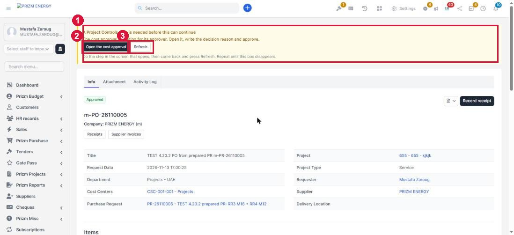
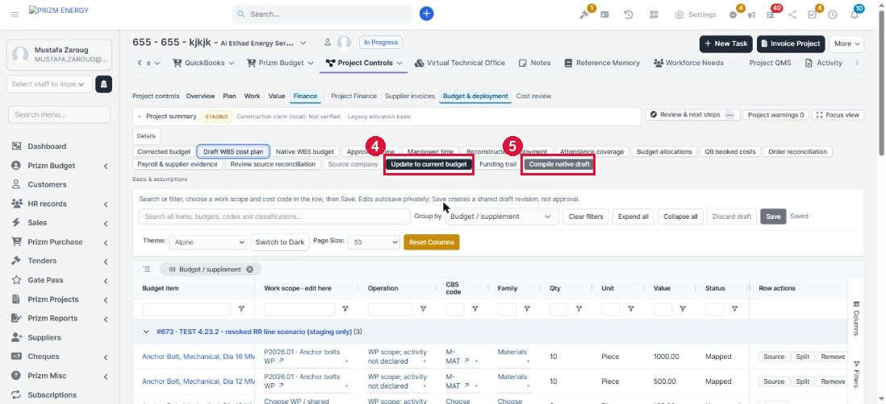

# ضوابط المشروع (Project Controls)

ضوابط المشروع هي مساحة العمل على مستوى المشروع من **Projects ← (المشروع) ← Project Controls**. تضم Plan و WBS & Progress و QS Support و Cost Plan و Approval review و Funding. هذه الصفحة تشرح الخطوات العملية للإجراءات الإدارية والمالية فيها.

## 1. السلسلة المالية باختصار

أي تغيير في سطر ميزانية معتمد (سعر جديد، كمية جديدة، سطر جديد) لا يصل للمشتريات وحده. نفّذ الخطوات بالترتيب:

1. **خطة التكلفة (Cost Plan)** — اربط السطر واضغط **Save**.
2. **الميزانية الأصلية** — **Compile native draft**.
3. **مراجعة الاعتماد** — **Submit for review**.
4. **اعتماد التكلفة** — **Submit cost approval**، ثم يقرر المعتمد.
5. **تسوية التمويل** — **Submit worksheet** ثم **Approve submitted worksheet**.

إلى أن تكتمل السلسلة تبقى طلبات الموارد وطلبات الشراء وأوامر الشراء في المشروع موقوفة. المربع الأصفر (القسم 2) يوضح الخطوة المتبقية.

## 2. المربع الأصفر "مطلوب خطوة في ضوابط المشروع"

عندما تكون بوابة الصرف للمشروع مقفولة، تظهر في صفحات طلب الموارد وطلب الشراء والميزانية وأمر الشراء علبة صفراء أعلى الصفحة.

1. اقرأ الجملة (1): تذكر الخطوة الوحيدة المتبقية.
2. اضغط الزر (2): يفتح صفحة الخطوة في تبويب جديد.
3. نفّذ الخطوة، ثم ارجع واضغط **تحديث / Refresh** (3). يظهر المربع بالخطوة التالية، أو يختفي إذا انتهى كل شيء.

| المربع يقول | افعل |
|---|---|
| تغيّر سطر في الميزانية بعد آخر اعتماد تكلفة | في خطة التكلفة اضغط **تحديث على الميزانية الحالية** (4). إذا زادت كمية، اربط الكمية الزائدة في سطرها ثم **Save**. |
| اعتُمدت ميزانية إضافية جديدة | تظهر سطورها غير مربوطة في خطة التكلفة. اربط كل سطر مثل نفس البند في باقي المشروع (3.1)، اضغط **Save**، ثم تابع المربع. حتى يتم ذلك يوقف المربع كل أوامر الشراء في المشروع، حتى للبنود المربوطة أصلًا. |
| الميزانية الأصلية لم تُجمّع بعد | اضغط **Compile native draft** (5). |
| في سطر ميزانية كميته أكبر من الموزّع في خطة التكلفة | ضع الزيادة في صف حزمة العمل لذلك البند، اضغط **Save** ثم **Compile native draft**. |
| أرسل المراجعة واعتماد التكلفة | في مراجعة الاعتماد اضغط **Submit for review** ثم **Submit cost approval**. |
| اعتماد التكلفة ينتظر المعتمد | الزر يفتح الطلب: اكتب السبب واضغط **Approve**. |
| يجب تسجيل تسوية التمويل من جديد | الزر يفتح سجل التمويل: أرسلها واعتمدها (القسم 6). |

## 3. خطة التكلفة

**المكان:** المشروع ← **Project Controls ← Finance ← Budget & deployment ← Draft WBS cost plan**.

### 3.1 ربط سطر ميزانية

1. ابحث عن السطر في خطة التكلفة.
2. اختر حزمة العمل (لا يُختار إلا حزمة عمل ليس تحتها عناصر)، وكود CBS، ونوع المورد.
3. أدخل الكمية المربوطة، واربط كامل كمية السطر.
4. اضغط **Save**.

اربط السطر الجديد بنفس طريقة ربط البند المشابه في ميزانيات المشروع الأخرى (المواد المشتركة على مخزون المشروع، والخدمات على حزم الخدمات، وهكذا).

### 3.2 سطر وحدته N/A

السطر الذي وحدته N/A لا يُعتمد بالكمية. سجّله كمبلغ مالي للسطر كاملًا، بنفس طريقة تسجيل البنود المقطوعة الأخرى في المشروع، وأبقِه مربوطًا بحزمة عمله.

### 3.3 سطر محجوز كمخصص مالي فقط ولم يعد مطابقًا

عندما يتغير سطر محجوز كمخصص مالي فقط (سعر أو كمية جديدة)، يذكر حفظ خطة التكلفة أن المخصص لم يعد يطابق سطره.

1. افتح مخصص مصدر السطر في خطة التكلفة.
2. اضغط **Withdraw** واكتب السبب.
3. اربط السطر (3.1) واضغط **Save**.
4. أكمل السلسلة من الخطوة 2 في القسم 1.

السحب وحده يترك السطر غير موزّع، ويظل يوقف الصرف حتى يُربط.

### 3.4 التوزيعات الفعلية بعد مراجعة نطاق جديدة

بعد تسجيل مراجعة Governing Scope جديدة، افتح **QS Support ← Planning Review ← Plan operation allocations**، واحفظ صفوف التوزيع لكل حزمة عمل من جديد، ثم أكّد مراجعة التخطيط. بعدها استخدم **Review source reconciliation** في خطة التكلفة.

## 4. الميزانية الأصلية ومراجعة الاعتماد

1. في خطة التكلفة اضغط **Compile native draft**. تظهر المسودة الجديدة تحت **Latest proposal**.
2. اضغط **Approval review** واقرأ القيود. صفوف "Spending only" عادية وتعالجها خطوة التمويل.
3. اضغط **Submit for review**. يصبح الزر **Review submitted**.

إذا ظهر `PROJECT_COMPANY_SOURCE_INVALID`، حدّد شركة المشروع من نموذج تعديل المشروع (نفس شركة الميزانية)، ثم أرسل من جديد.

## 5. اعتماد التكلفة

1. في مراجعة الاعتماد اضغط **Submit cost approval**.
2. يظهر زر جديد **Central approvals … Pending approval**. اضغطه.
3. اكتب السبب في **Decision reason**: ما الذي تغيّر ومن قرر.
4. اضغط **Approve**. تصبح الحالة **Financially applied**.

إذا لم تكن أنت المعتمد يسجّل النظام القرار **نيابة عن** المعتمد. لا تسجّل قرارًا بالنيابة إلا إذا وافق المعتمد (مثلًا عبر Microsoft Teams) أو قرر صاحب المشروع، واذكر ذلك في السبب.

## 6. تسوية التمويل

تلزم من جديد بعد **كل** اعتماد تكلفة جديد.

1. في المشروع اضغط **Funding trail**. تظهر رسالة **Source changed — review a new worksheet** (أو **Stale**).
2. قارن الـ worksheet المقترح بآخر نسخة معتمدة.
3. إذا كانت المبالغ كما في المرة السابقة: اكتب السبب، علّم على التأكيد، واضغط **Submit worksheet**.
4. اكتب سبب الاعتماد، علّم على التأكيد، واضغط **Approve submitted worksheet**.
5. تظهر رسالة **Funding reconciliation approved**.

إذا أظهر الـ worksheet تغييرًا حقيقيًا (مبلغ محرر جديد، أو مبلغ مختلف، أو سحب زائد جديد) فتوقف: صاحب المشروع يقرر أولًا.

### الخطوات بالصور

كل رقم أحمر هو الخانة التي تضغطها بالترتيب.

## 7. تعديل سطر ميزانية (سعر أو كمية)

تعديل سطر ميزانية مربوط في خطة التكلفة ينشئ **تعديل سطر ميزانية** يحتاج اعتمادًا.

### 7.1 طلب التعديل

1. افتح الميزانية ← السطر ← **Revise**.
2. أدخل الكمية وسعر الوحدة الجديدين والسبب ← **Save**.
3. يذهب التعديل لمعتمديه.

### 7.2 اعتماد التعديل

1. افتح التعديل من مربع **Approvals still open** أعلى صفحة الميزانية أو طلب الموارد.
2. تظهر في الشاشة **Waiting for** واسم المعتمد.
3. يكتب المعتمد السبب ويضغط **Approve** أو **Reject**.
4. عند الاعتماد النهائي تُكتب الكمية والسعر الجديدان في سطر الميزانية. للتعديل المعتمد سابقًا اضغط **Apply to budget line**.

**بالنيابة:** يستطيع المدير (Admin) اعتماد التعديل أو رفضه نيابة عن المعتمد مع سبب. تظهر عندها **On behalf of** مع اسم المعتمد، ويُسجَّل في سجل النشاط. من طلب التعديل لا يستطيع اعتماده إلا إذا كان الاعتماد الذاتي مسموحًا في إعدادات الاعتمادات.

### 7.3 تعديل عالق

التعديل الذي لا يمكن اعتماده أو تطبيقه (تغيّر سطره أو خط أساس تكلفته بعد الاعتماد، أو ليس له معتمدون) لا يقفل السطر. افتح نموذج تعديل السطر: يظهر **This change can no longer be decided or applied. Submitting a new change replaces it.** أدخل التعديل من جديد واضغط **Save**. يظهر التعديل القديم **Replaced by a newer change** ويحتفظ بسجله.

### 7.4 بعد اعتماد التعديل

نفّذ السلسلة المالية كاملة (القسم 1). ثم:

- **طلب الموارد يحتفظ بسعره.** كل طلب موارد موجود يحتفظ بالسعر الذي أُنشئ به، والطلبات الجديدة فقط تأخذ السعر الجديد.
- لا يجوز أن تقل الكمية الجديدة عن المحجوز في طلبات الموارد.
- لاستخدام السعر الجديد في طلب مفتوح، أغلقه وافتح طلبًا جديدًا.

## 8. إنشاء طلب موارد

1. افتح **New** ← نوع الطلب: Material أو Manpower أو Equipment أو Service (و Labour – External للعمالة الخارجية مثل بدل الأكل).
2. **Budget:** اختر الميزانية الرئيسية للمشروع، وليس **WBS budget draft**.
3. **Budget / additional budgets:** اختر الميزانية التي فيها البند.
4. **Budget Items:** اختر البنود ثم **Add selected items**.
5. أدخل الكميات ← **Save draft** ← **Submit for approval**.

إذا لم يظهر بند، راجع المربع الأصفر (القسم 2) أو هل السطر محجوز كمخصص مالي فقط (القسم 3.3).

## 9. توقف اعتماد أمر الشراء

الضغط على **Approved** في أمر الشراء قد يتوقف. المربع أعلى أمر الشراء يسمّي الحالة وفيه زر يفتح الصفحة التي تحل المشكلة. لا يُحفظ شيء أثناء التوقف.

| الكود | الحالة | اذهب إلى |
|---|---|---|
| `PURCHASE_SOURCE_SPENDING_HELD` | **أ. التمويل** — اعتماد تكلفة جديد جعل تسوية التمويل قديمة. | سجل التمويل (القسم 6) |
| `PURCHASE_SOURCE_CHANGED` | **ب. طلب الشراء أو طلب الموارد تغيّر** — بند أُلغي أو رُفض أو حُذف أو عُدّل، أو طلب الشراء غير معتمد بالكامل. | طلب الشراء المرتبط |

### الحالة أ — التمويل

1. اضغط **فتح سجل التمويل في ضوابط المشروع** في المربع.
2. نفّذ تسوية التمويل (القسم 6).
3. ارجع لأمر الشراء ← **Approved**.

### الحالة ب — طلب الشراء أو طلب الموارد تغيّر

1. اضغط **فتح طلب الشراء المرتبط** في المربع.
2. تأكد أن طلب الشراء **Approved** وأن كل خطواته معتمدة. إذا بقيت خطوة مفتوحة فأكملها ثم اعتمد أمر الشراء من جديد.
3. افتح كل طلب موارد مذكور في طلب الشراء، وتأكد أن كل بند يستخدمه طلب الشراء حالته **Approved**.
4. إذا أُلغي بند يستخدمه أو رُفض أو تغيّر، جهّز طلب شراء جديدًا من طلب الموارد الحالي واعمل أمر الشراء منه.

بنود نفس طلب الموارد التي لا يستخدمها طلب الشراء لا توقف أمر الشراء.

## 10. التقرير اليومي (Daily return)

**المكان:** Project Controls ← Work ← **Daily return**، بجانب **Daily plan** و **Daily reports**. تغيير التاريخ يبقيك داخل المشروع، والحفظ والإرسال كما كانا.

## 11. ممارسات جيدة

- اكتب سببًا واضحًا في كل قرار: ما الذي تغيّر ومن قرر.
- لا تعتمد ورقة التمويل كتكرار إذا تغيّر أي مبلغ.
- كل تعديل سطر يكرر السلسلة كاملة: خطة التكلفة ← التجميع ← المراجعة ← اعتماد التكلفة ← التمويل.
- استخدم المربع الأصفر بدل تخمين الخطوة التالية.
