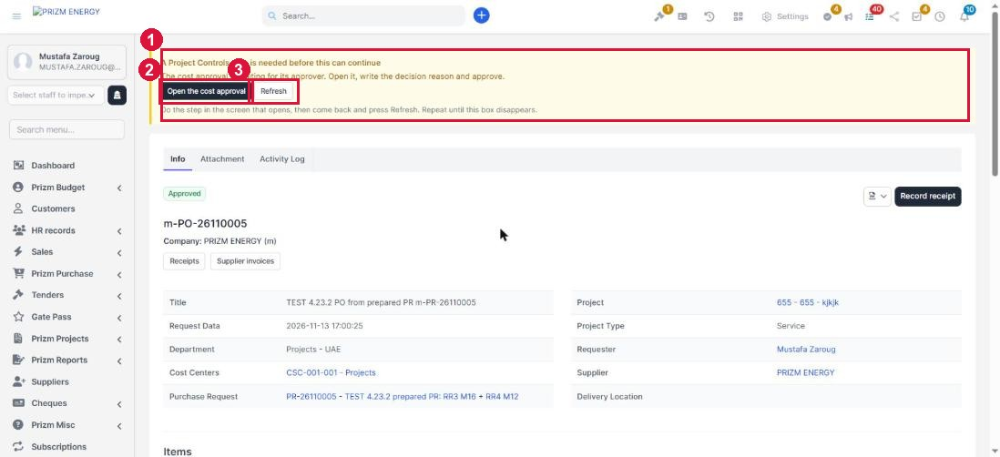
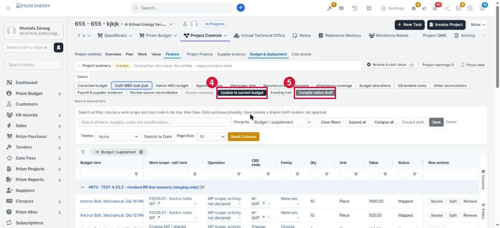
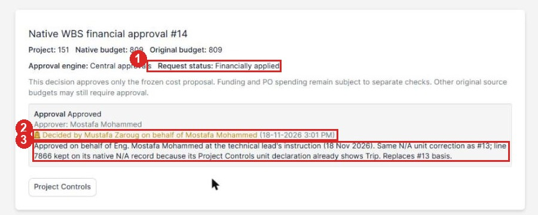
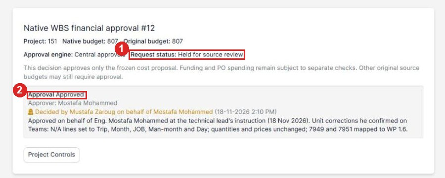
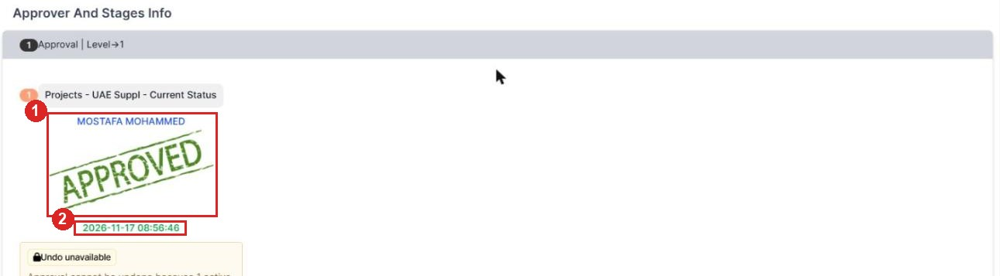

# Project Controls

Project Controls is the project-level workspace under **Projects → (project) → Project Controls**. It groups Plan, WBS & Progress, QS Support, Cost Plan, Approval review and Funding. This page gives the practical steps for the administrative and financial work done there.

## 1. The financial chain at a glance

Any change to an approved budget line (a new price, a new quantity, a new line) does not reach purchasing by itself. Do these steps in order:

1. **Cost Plan** — map the line and **Save**.
2. **Native budget** — **Compile native draft**.
3. **Approval review** — **Submit for review**.
4. **Cost approval** — **Submit cost approval**, then the approver decides.
5. **Funding reconciliation** — **Submit worksheet**, then **Approve submitted worksheet**.

Until the chain is finished, resource requests, purchase requests and purchase orders on the project are held. The yellow box (section 2) tells you which step is still open.

## 2. The yellow box "A Project Controls step is needed"

When a project's spending gate is closed, its resource request, purchase request, budget and purchase order pages show a yellow box at the top.

1. Read the sentence (1). It names the one step that is still open.
2. Press the button (2). It opens that step's screen in a new tab.
3. Do the step, come back and press **Refresh** (3). The box shows the next step, or disappears when everything is done.

| The box says | Do this |
|---|---|
| A budget line changed after the last cost approval | In the Cost Plan press **Update to current budget** (4). If a quantity grew, map the extra quantity on its row and **Save**. |
| A new additional budget was approved | Its lines show as unmapped in the Cost Plan. Map each one like the same item elsewhere in the project (3.1), **Save**, then follow the box. Until then the box holds every PO in the project, even for items that are already mapped. |
| The native budget has not been compiled yet | Press **Compile native draft** (5). |
| A budget line has more quantity than the Cost Plan maps | Put the extra quantity on the work package row of that item, press **Save**, then **Compile native draft**. |
| Submit the review and cost approval | In the approval review press **Submit for review**, then **Submit cost approval**. |
| The cost approval is waiting for its approver | The button opens the request: write the reason and **Approve**. |
| The funding reconciliation must be recorded again | The button opens the funding trail: submit and approve it (section 6). |

## 3. Cost Plan

**Where:** Project → **Project Controls → Finance → Budget & deployment → Draft WBS cost plan**.

### 3.1 Map a budget line

1. Find the line in the Cost Plan.
2. Choose the work package (only a work package with no children can be chosen), the CBS code and the resource family.
3. Enter the quantity to map. Map the full quantity of the line.
4. Press **Save**.

Map a new line the same way the same kind of item is already mapped in the project's other budgets (shared materials to the project pools, services to the service packages, and so on).

### 3.2 A line whose unit is N/A

A line whose unit is N/A does not appear when you make a resource request, and it cannot be approved by quantity.

1. Ask the project engineer for the real unit of each such line (trip, month, day, job, man-month and so on). Suggest a unit from the item description and the price, and let the engineer confirm it in writing (for example on Microsoft Teams).
2. Send the confirmed units to the technical team. They correct the unit on the budget line and on its old resource request lines; quantity and price stay the same.
3. Some old lines keep N/A on purpose because Project Controls already gives them a unit of its own (a unit declaration from a quotation, or a labour correction in hours). The technical team checks this first and leaves those lines as they are.
4. In the Cost Plan, withdraw the money-only hold of each corrected line (3.3), map the line (3.1) and **Save**.
5. Continue the chain: compile, review, cost approval, funding.

Until the unit is corrected, the line can only be recorded as a whole-line money amount.

### 3.3 A line held as money-only that no longer matches

When a line held as a money-only allowance changes (new price or quantity), saving the Cost Plan says the allowance no longer matches its line.

1. Open the line's source allowance in the Cost Plan.
2. Press **Withdraw** and write the reason.
3. Map the line (3.1) and **Save**.
4. Continue the chain from step 2 of section 1.

Withdrawing alone leaves the line unallocated; it still blocks spending until it is mapped.

A line can be mapped **and** still carry an old money-only hold from the time it had no unit. After its unit is corrected that hold no longer matches, and the cost approval is held (5). Withdraw every such hold before you compile.

### 3.4 Physical allocations after a new governing scope

After a new Governing Scope review is recorded, open **QS Support → Planning Review → Plan operation allocations**, save each work package's allocation rows again, then confirm the planning review. Then use **Review source reconciliation** in the Cost Plan.

### 3.5 Cost-code dictionary

**Where:** Cost Plan → **Cost-code dictionary**.

1. Under **Add a code**, enter the cost code, its English and Arabic labels, the parent classification (or root), the selection status, and the permitted resource families (Manpower / Materials / Plant / Services / Other).
2. Choose the review decision: **Draft** or **Approved**. Enter the source / review reference and the reason.
3. Press **Preview dictionary impact**, then confirm.

Each confirmation creates a new dictionary version. Allocations (3.1) can use only codes from an **approved** version; without one, the Cost Plan refuses with **"Select an active approved code compatible with the resource family"**.

## 4. Native budget and approval review

1. In the Cost Plan press **Compile native draft**. The new draft opens under **Latest proposal**.
2. Press **Approval review** and read the holds. "Spending only" rows are normal; the funding step handles them.
3. Press **Submit for review**. The button changes to **Review submitted**.

If the review shows `PROJECT_COMPANY_SOURCE_INVALID`, set the project's company in the project edit form (the same company as its budget), then submit again.

## 5. Cost approval

1. In the approval review press **Submit cost approval**.
2. A new button appears: **Central approvals … Pending approval**. Press it.
3. Write the reason in **Decision reason**: what changed and who decided.
4. Press **Approve**. The status becomes **Financially applied**.

If you are not the approver, the system records the decision **on behalf of** the approver. Record an on-behalf decision only when the approver has agreed (for example on Microsoft Teams) or the project owner decided, and say which in the reason.

1. **Request status: Financially applied**: the approval is done.
2. **Decided by … on behalf of …**: the system shows who pressed **Approve** and for whom.
3. The reason: what changed and who decided.

### 5.1 The approval is held

1. **Request status: Held for source review** means the decision was recorded but the system did not apply it.
2. The step itself shows **Approved**, so do not approve it again.

The usual cause is a line that still carries an old money-only hold (3.3). Withdraw the hold, compile again, submit the review and a new cost approval, and approve the new request. The held request stays in the history.

## 6. Funding reconciliation

This is needed again after **every** new cost approval.

1. On the project press **Funding trail**. It shows **Source changed — review a new worksheet** (or **Stale**).
2. Compare the suggested worksheet with the last approved version.
3. If the amounts are the same as last time: write the reason, tick the confirmation and press **Submit worksheet**.
4. Write the approval reason, tick the confirmation and press **Approve submitted worksheet**.
5. The window shows **Funding reconciliation approved**.

If the worksheet shows a real change (a new release, a different amount, a new overdraw), stop: the project owner decides first.

When the funding is approved, the yellow box disappears and the purchase order approver can approve the order.

1. The approver's stamp **Approved** on the purchase order.
2. The date and time of the approval.

### Step-by-step pictures

Each red number is the box to press, in order.

## 7. Changing a budget line (price or quantity)

Editing a budget line that is mapped in the Cost Plan creates a **budget line change** that needs approval.

### 7.1 Request the change

1. Open the budget → the line → **Revise**.
2. Enter the new quantity and unit price and the reason → **Save**.
3. The change goes to its approvers.

### 7.2 Approve the change

1. Open the change from the **Approvals still open** box at the top of the budget or resource request page.
2. The screen shows **Waiting for** and the approver's name.
3. The approver writes the reason and presses **Approve** or **Reject**.
4. On final approval the new quantity and price are written to the budget line. For a change approved earlier, press **Apply to budget line**.

**On behalf:** an administrator can approve or reject on the approver's behalf, with a reason. The screen then shows **On behalf of** with the approver's name, and the Activity Log records it. The person who requested the change cannot approve it unless self-approval is allowed in Approvals settings.

### 7.3 A change that is stuck

A change that can never be decided or applied (its line or cost baseline changed after approval, or it has no approvers) does not block the line. Open the line's change form: it says **This change can no longer be decided or applied. Submitting a new change replaces it.** Enter the change again and **Save**. The old change shows **Replaced by a newer change** and keeps its history.

### 7.4 After the change is approved

Run the whole financial chain (section 1). Then:

- **Resource requests keep their price.** Each existing resource request keeps the price it was made at; only new requests take the new price.
- The new quantity cannot be less than what resource requests already hold.
- To use the new price on an open request, close it and open a new one.

## 8. Creating a resource request

1. Open **New** → the request type: Material, Manpower, Equipment or Service (Labour – External for subcontracted labour such as food allowances).
2. **Budget:** choose the project's main budget, not a **WBS budget draft**.
3. **Budget / additional budgets:** choose the budget that holds the item.
4. **Budget Items:** select the items, then **Add selected items**.
5. Enter the quantities → **Save draft** → **Submit for approval**.

If an item does not appear, check the yellow box (section 2) or whether the line is held as money-only (section 3.3).

## 9. A purchase order approval is held

Pressing **Approved** on a purchase order can be held. The box at the top of the PO names the case and has a button that opens the page where you fix it. Nothing is saved while it is held.

| Code | Case | Go to |
|---|---|---|
| `PURCHASE_SOURCE_SPENDING_HELD` | **A. Funding** — a new cost approval made the funding reconciliation stale. | Funding trail (section 6) |
| `PURCHASE_SOURCE_CHANGED` | **B. The purchase request or resource request changed** — a line was revoked, rejected, deleted or edited, or the purchase request is not fully approved. | The linked purchase request |

### Case A — funding

1. Press **Open the Project Controls funding trail** in the box.
2. Do the funding reconciliation (section 6).
3. Go back to the purchase order → **Approved**.

### Case B — the purchase request or resource request changed

1. Press **Open the linked PR** in the box.
2. Check the purchase request is **Approved** and every step is approved. If a step is open, finish it, then approve the PO again.
3. Open each resource request listed on the purchase request. Check every line the purchase request uses is **Approved**.
4. If a line it uses was revoked, rejected or changed, prepare a new purchase request from the current resource request and make the PO from it.

Lines of the same resource request that the purchase request does not use do not hold the PO.

## 10. Readiness register

Use this when a work package needs a condition met before it can start (for example a drawing approval, a material delivery or a permit).

**Where:** Project Controls → Plan → **Activities**. In the work's row, open its **Readiness checks** link (it shows "No readiness review recorded" when there is none).

1. Choose the linked work scope and an accountable owner (an active staff member).
2. Write the condition required before the work can proceed.
3. Set **Required by** (the planning need date) and, if known, the expected release date.
4. Write the reason or the assessment trail.
5. Press **Record condition**.

The condition gets a reference and shows as **Open**. The window then offers **Save revision**, **Propose clearance** (with supporting evidence) and **Withdraw condition**. The Activities grid shows the reference under **Readiness checks**. While a condition is open, the day plan shows the work as **Awaiting release**.

### 10.1 Clearing a readiness condition

1. Open the condition from its **Readiness checks** link. Press **Update proposal** if a proposal is already saved.
2. Fill in the clearance assessment, the actual clearance date (it cannot be in the future), **Valid until**, and the evidence. Evidence is picked from files attached to the linked task, so attach the permit or document to the task first.
3. Write the reason and press **Propose clearance**.
4. Press **Verify saved proposal**. The condition becomes **Readiness verified**. **Reopen / reconfirm** and **Withdraw condition** stay available afterwards.

In short, a condition moves **Open** → (proposed by the owner or the planner) → **In review** → (verified by a planner) → **Cleared**. It can be reopened or withdrawn at any point, and its history is kept.

While a condition is open, **Site ready** in the daily plan is locked and the work shows **Awaiting release**. A condition that is open and due holds its work out of the daily proposal.

## 11. Daily plan

**Where:** Project Controls → Plan → **Daily plan**.

1. Pick the day in the date strip. A non-working day on the project calendar shows **Nonworking day**.
2. Switch between **Ticked activities only** and **All remaining activities**, tick the work planned for the day, then press **Save plan draft**. The page shows **Draft saved**. Saving a draft never posts actuals or deploys people.
3. Press **Review & issue** to go through four steps: **1 Work selection**, **2 Crew & readiness** (crew, the task crew lineup, the readiness register, and material needs for the selected work), **3 Checks & warnings**, **4 Confirm issue**.

Step 3 lists every blocker. The plan cannot be issued while any remain: an open readiness condition, site readiness not confirmed, no named task crew, or no deployment for the selected day.

### 11.1 Naming the task crew

People appear in the crew list only when they are registered in **People** and have a dated deployment to the project for that day. The role list shows the budget's labour lines that the project's Project Controls setup accepts as crew roles.

1. Open **Activities**, select the task, then **Task crew lineup**.
2. Enter the crew name.
3. For each member, press **Add crew member**, then pick the workforce person and the assigned role / budget resource, and enter the planned paid hours and planned productive hours. The planned crew count fills itself from the members added. Required skills are optional declarations.
4. Press **Save crew lineup**; before people are deployed, the button reads **Save proposed lineup**.

The **Task crew lineup** column shows the crew name. The daily plan header shows **Crew available** and **Allocated to selected work** in person-hours. The production target per workday comes from the task itself; hours actually worked are entered later, in the shared crew day, not here.

You can also start this from the daily plan itself: if the task is not ticked for the day, switch to **All remaining activities** first, then click its row to select it (selecting more than one row, or none, shows "Select one linked task first"), then **Crew → Task crew lineup**. From there, enter the crew name, add one line per person (the person, their role or budget resource, planned paid hours and productive hours), then **Save proposed lineup**.

Paid hours above the planning day's limit for a person (from the project calendar) block the issue as a **paid-hour conflict**. Lower the hours to fit the day.

Saving the lineup marks the plan **"Sources changed"**; press **Save plan draft** again on the daily plan to clear it.

### 11.2 Resource basis (named site crew)

In the daily plan, a **"Resource checks"** note next to an activity means its resource basis has not been declared yet.

1. Open **Activities**, select the task, then its resource basis button (or open it directly from the daily plan's "Resource checks" note).
2. Choose **Named site crew required** (or **Named crew present throughout the working periods**, **No named site crew required**, or **Withdraw**).
3. Enter the planning basis or reference and why it applies.
4. Press **Preview impact**, read the before/after checks, tick **"I reviewed this resource basis…"**, then press **Apply local declaration**.

The window then shows the reviewed declaration and its revision, and the result reads **"Local declaration recorded"**. An undeclared basis is reported as **"Resource applicability needs reconciliation"** and blocks the issue.

Afterwards, press **Save plan draft** again on the daily plan — **Review & issue** checks the draft against the new declaration, not the one it had before.

### 11.3 Issuing the daily plan

1. After the steps above: tick **Site ready**, **Save plan draft**, then **Review & issue** → **Check selected plan**. **Crew & readiness** and **Checks & warnings** must both show **0 checks to review**, and **Confirm issue** shows **Checked**.
2. Press **Issue day plan** (step 4). The page shows **Plan issued** and the button changes to **Review daily plan**.

The server rechecks the plan, permissions and source version at the moment of issue. Spending approval and mobilisation approval stay separate from issuing the plan.

**What the checks look for:**

- **Paid-hour conflict** — the same person planned on two activities beyond the planning day's limit (for example 8 hours plus 8 hours on an 8-hour day) blocks the issue. Remove one activity from the day, or split the hours.
- **Target above crew capacity** — lower the day target (edit the **Day target** cell, then **Save plan draft**) until it fits the crew hours available.
- **Site ready** must be ticked per activity.
- Only the next working day after the last reported day can be issued. A later date can be saved as a draft, but it shows **"Schedule readiness needs review"** until the earlier days are reported. A daily return cannot be entered for a future date.

### 11.4 Material allocation in the daily plan

When the Cost Plan maps material budget lines to an activity (3.1), selecting that activity in the daily plan shows **"Current allocation revision"**, and for each item the allocated quantity, the linked request / requisition records, and material receipts.

- **"Activity allowance — takeoff not established"** means the quantity shown is an allowance; link an activity takeoff before deriving material quantities from it.
- Without a mapping, the panel reports no material allocation is linked; daily reporting still works.

### 11.5 Schedule look-ahead (L5)

Choosing a **Plan period** (1 week, 2 weeks, 3 weeks or a month) opens the **Schedule look-ahead (L5)** from the chosen date. It lists the work items per work package, with **Checks before daily issue**, the saved daily targets and the window status.

The look-ahead is a read-only, multi-day view — daily drafts for each day are still saved one date at a time from the **Daily plan** itself.

## 12. Daily return (report project work)

**Where:** Project Controls → Work → **Daily return**, next to **Daily plan** and **Daily reports** — or **Record actuals** from the daily plan. Changing the date keeps you inside the project.

1. Pick the date.
2. Under **Add activities**, choose the activity, then **Add activities** (or add a whole work package). Expand the work package to see its activities.
3. For each activity choose the **Outcome**: **Partial**, **Completed** or **Not done**. A Partial outcome needs a **Completed to date** value.
4. Use **Details / crew** to record hours, notes and evidence.
5. Press **Submit daily return**. **Save entered drafts** keeps it unsubmitted.

The page shows **"Daily return saved"**. The work package shows its reported percentage, and the Activities view shows **Today**, the last submitted return date and the balance remaining.

Report every planned activity for the day, even when no work happened on it: use **Add activities** to add any activity that is due or in progress but was not on the issued plan, then choose **Not done** as its outcome. A missing entry is treated as unknown work, not as zero — it keeps the forecast provisional and holds back the next day's plan (**"Schedule readiness needs review"**).

Photo evidence must first be attached to the task itself (open the task window and drop the file there) — the daily return cannot take a new upload. Then, in **Notes & evidence**, pick that attachment and save or submit again; the return gets a new revision that carries the evidence. Files attached to other tasks cannot be chosen.

### 12.1 How the daily return feeds the daily report

Submitting a daily return also creates or updates that day's **daily report** for the project in Prizm Reports. Its record number starts with the project's local code and the date. Open it under Project Controls → Work → **Daily reports → Daily records**.

- Each reported activity becomes a work line ("done") with its outcome (partial / completed). Crew hours entered in the return's **Details / crew** are added as manpower lines.
- The report starts as a draft, with company and client approval pending. The report details show the chain from work row to task, activity and work package, and mark the quantity as a construction claim only — QC and client acceptance are not inferred.
- In Daily records, a report created from returns shows **"linked activities"**. Older hand-written reports show **"No current activity links"** and flags such as no crew count or no WP/activity link.
- A return can be entered for a past day even when no plan was issued for it; the page says so ("No issued plan for this date…").

### 12.2 Recording the crew day (crew hours into the daily report)

1. Save or submit the day's entries first. **Details / crew** opens only when the table has no unsaved entries; otherwise it shows a short "unsaved" note next to the table.
2. **Details / crew** opens a panel below the table, not a window. In **Shared crew day**, press **Manage crew day**. (The same block is reached from the task's own **Daily Execution** tab.)
3. Fill in: the project crew name, the actual headcount, the actual crew (the people deployed that day, each with their role), and the declared team lineup (required).
4. Enter working hours for **each** person listed in the actual crew — entering only the totals (Working MH / Total paid MH) is refused; the person-level hours must add up to them.
5. To record lost time, press **Add delay**, choose the reason and enter the delay hours and a note. The per-person table then shows a delay column: split each person's hours between working and delay.
6. Rule: working hours plus delay hours must equal total paid hours; the unpaid break is separate.
7. Untick **"Actual roster incomplete"** only once everyone who worked that day is listed.
8. Press **Save shared crew day** (not **Save draft**).

The block then shows the shared crew day with its Working, Delay and Paid figures, the delay reason, and any reconciliation flags (for example a missing manpower budget link). The day's daily report then gets a manpower line with the crew name and headcount.

### 12.3 Delay reasons catalogue (administrators)

**Where:** Prizm Reports → Daily execution → **Delay catalogue**.

Add each reason with a name and mark it **active**. Reasons are never deleted — retire one by making it inactive; its history stays. While the catalogue has no active reason, **Add delay** in the shared crew day (12.2) is disabled.

## 13. Other Project Controls / WBS screens

- **BOQ Mapping** — the **Available BOQ items** and **Mapped** tabs; **Map** a line to update the remaining value.
- **Procurement packages** — **Manage** the **Mapped** and **Available** WBS elements of a package.
- **Calendars** — the project's calendars and their holidays.
- **Baselines** — compare a baseline **View** against the current plan.
- **Activity outline** — open a work package's side panel to see its activity breakdown.

### 13.1 Long-lead alerts (Procurement → Long-Lead Alerts)

A work package appears in this list when its order-by date has passed, or falls within the next 14 days, and it is not marked **Ordered**. The order-by date is the required on-site date minus the lead time.

- Set the **lead time** (in weeks) and the **required on-site date** on the work package in the WBS builder.
- The alert shows the lead time, the required on-site date, the order-by date, and how many days it is overdue.
- Marking the work package as **Ordered** removes it from the alerts.

### 13.2 EVM report (WBS page → EVM Report)

- **Budget at completion** and **planned value** come from each work package's budget and its planned start and finish, measured against the latest **Project baseline**. **Earned value** is budget × percent complete. Take a new baseline after adding work packages or changing budgets, so they are included.
- On a project with Project Controls, daily returns do not change the WBS percent complete by themselves — the EVM report reads the WBS progress.
- If the report shows zeros right after the page opens, wait for the project to finish loading; the tab now refreshes itself once the WBS has loaded.

### 13.3 WP visual build (Prepare build)

**Where:** WP visual → **Prepare build**.

1. Upload the JSON build bundle, then press **Validate and prepare candidate**. The visual proposal review opens with the parts and dimensions.
2. Under **Decision**, choose **Accept illustrative display** (or **Hold visual**), write the review reason, tick the four acknowledgements and the personal-review box.
3. Press **Record local decision**, then **Confirm local decision**.

The page then shows **"Illustrative display accepted"**, with the review kept in history. This approves only the illustrative display — not drawings, quantities, QC, client acceptance or billing.

The **material** editor inside the WP visual sets only the render material of each part; it is not purchasing material.

Any change needs a new review: adding illustrative display parts, or applying a render-material revision (below), marks the visual **"Changed proposal · review required"**. Record the decision again (**Accept illustrative display**) to make it current.

#### Changing render materials

**Where:** the visual proposal review page → **Materials** tab → **Change render materials**.

1. For each part, choose a material and a basis (illustrative or drawing-referenced), cite the source, and write the reason.
2. Press **Prepare**, then check the draft (old → new per part).
3. Tick the confirmation and press **Apply material revision**.

This changes only how parts are drawn — no geometry, quantities, work or prices.

## 14. Schedule tools

**Where:** Schedule → **Planning tools**.

### 14.1 Hold an activity's start (Activity constraint)

1. Choose the activity and the constraint type, for example **"start no earlier than"**, then the date.
2. Write a reason and tick the confirmation. **Apply** stays disabled until both are done.
3. Press **Apply**.

A rule that does not move anything reports **"0 affected"** — choose a date that really changes the programme. Saving creates a new local programme revision; the baseline and actuals are kept.

### 14.2 Set an activity's working time (Working time)

1. Choose the activity, the start date and time, and the working hours needed.
2. For **every** calendar in the list, enter the working periods per weekday (for example `07:00-12:00,13:00-17:00`). Leave a day empty when it is a rest day. **Preview** stays disabled until every calendar has periods; the counter shows **"n/n calendars have explicit periods"**.
3. Press **Preview impact**. It lists the affected activities, the requested and calculated hours, and the new project finish. Nothing is saved yet.
4. Write a reason, tick the confirmation, then press **Apply local programme**.

A new local revision is saved; the baseline and actuals are kept.

## 15. Inspections

### 15.1 Request an inspection of reported work

**Where:** Work → **Work & inspections** → **Inspect an activity**.

1. Choose a reported operation (date, work package, activity). The page shows its details.
2. Enter the requested inspection date, who is inspecting (**Client** or **Internal QC**) and readiness notes.
3. Press **Prepare local operation IR draft**.

The request appears under **Preparations**. It asserts no quantity and gives no approval or payment credit.

### 15.2 Record the inspection result

**Where:** **Preparations** → **Record inspected scope**.

1. Enter the inspected scope and acceptance criterion, the inspection reference, the date, the signatory and the organisation.
2. Choose the outcome (**Accepted scope** or **Rejected**) and upload the signed IR PDF (up to 10 MB). The system keeps its fingerprint.

The result appears under **Outcomes** as **"Awaiting independent review"**. A different, authorised reviewer must make that decision — the person who recorded it cannot.

## 16. Good practice

- Write a clear reason on every decision: what changed and who decided.
- Do not approve a funding worksheet as a repeat if any amount changed.
- Each line change repeats the full chain: Cost Plan → compile → review → cost approval → funding.
- Use the yellow box instead of guessing the next step.
