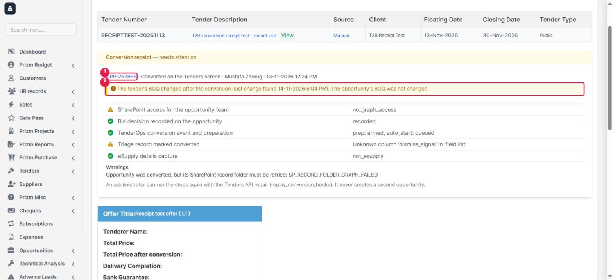
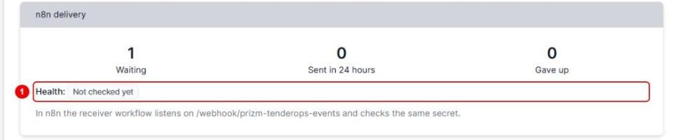

# من العطاء إلى العرض (T2B)

## المقدمة

**من العطاء إلى العرض (T2B)** ينقل العطاء من مستنداته إلى عرض مُقدَّم داخل بوابة PRIZM ENERGY. يتم
العمل في **فريق العطاءات الافتراضي** للفرصة: فريق من وكلاء الذكاء الاصطناعي يُعدّ كل مرحلة من مراحل
العرض (الملخص التنفيذي، والتفكيك، والحل الفني، والمخاطر، والمقارنة المرجعية، والتسعير، والجوانب
القانونية، والعرض، وفحص الجودة قبل التقديم)، ويعتمد الأشخاص النتيجة عند نقاط تحكم متفق عليها.

هذا الدليل موجّه إلى:

- مديري العطاءات والعروض
- فرق تطوير الأعمال
- المهندسين والمقدّرين الذين يراجعون مخرجات المراحل
- المديرين الذين يعتمدون العروض

يكبر هذا الدليل مع البرنامج. كلما اكتمل جزء، تُكتب هنا الخطوات التي يضيفها لك.

## تقدم البرنامج

| الجزء | ما يقدّمه | الحالة |
|---|---|---|
| **إصلاح الضوابط** | التوقيعات البشرية النهائية لا يمكن تحويلها إلى Auto، ونقطة التوقف لا تُفك إلا بموافقة حقيقية في التشغيل الحالي. | ✅ مكتمل |
| **التشخيص وتجميد المواصفات** | يوضح أين تنتظر العروض فعلاً وعند من، مع مواصفات مجمّدة. | ✅ مكتمل |
| المعتمد الصحيح والانتظار الصحيح | يصل كل قرار إلى الشخص الصحيح مع مدة انتظار واضحة. | قيد التنفيذ |
| **الأتمتة (الأساس)** | يبدأ التشغيل تلقائياً، وتنبّه القرارات الأشخاص داخل النظام، ويتبع فرز العطاءات وتحويلها قواعد واحدة، ولا تُفهرس مستندات العطاء إلا بعد موافقة شخص، ويبقى العطاء هو المصدر وتملك الفرصة جدول كمياتها، وتعرض كل مرحلة عمل مراحل فريق الذكاء الاصطناعي التي تغذّيها، ويُنبَّه المديرون عند توقف الإرسال إلى n8n. | ✅ مكتمل |
| مراحل العرض | المستندات، وتجزئة العمل، والمشتريات، والتسعير، والاعتمادات، والتقديم، والترسية. | قيد التنفيذ: تُحفظ كل نسخ المستندات، وتُعلَّم المخرجات المبنية على نسخة قديمة، وتُسجَّل المستندات وتُعلَّم جاهزة، وتُسجَّل المشكلات في سجل خاص |

## افتح فريق العطاءات الافتراضي

1. افتح فرصة.
2. اختر تبويب **Virtual Tendering Team**.
3. اختر **Run Opportunity** لبدء تشغيل. يعمل الفريق الافتراضي على المراحل بالترتيب ولا يتوقف إلا عندما
   يجب على شخص أن يقرر.

- **Intake & Documents** و**Scope Gate & ITP** و**Briefs** تحتوي إعداد الفرصة.
- تحتها تبويب لكل مرحلة يعرض مخرجاتها، و**Decisions** يعرض ما ينتظرك.

## إصلاح الضوابط

تضمن هذه التغييرات ألا يتجاوز أي عرض شخصاً يجب أن يعتمده.

### اضبط وضع التحكم لمرحلة

1. افتح **Scope Gate & ITP → ITP control matrix**.
2. اختر لكل ضابط وضعاً:

   | الوضع | المعنى |
   |---|---|
   | **Auto** | يستمر الفريق الافتراضي دون توقف. |
   | **WP** (نقطة شهود) | يستمر الفريق الافتراضي ويُبلغ المالك. |
   | **HP** (نقطة توقف) | يتوقف التشغيل حتى يعتمد شخص. |
   | **NR** | يُتخطّى الضابط. |

3. لضبط ضوابط كثيرة مرة واحدة، اختر إعداداً جاهزاً في الأعلى: **All Hold** أو **Conservative** أو
   **Witness-heavy** أو **Full Auto**. توضح العدادات على اليمين عدد الضوابط في كل وضع.

### التوقيعات النهائية تبقى دائماً على Hold

التوقيعات البشرية النهائية تبقى على **HP** في كل الإعدادات الجاهزة، بما فيها **Full Auto**، ولا
يمكن تغييرها واحداً واحداً:

| المرحلة | الضابط |
|---|---|
| Executive Summary | Human acceptance |
| Benchmarking | Accept benchmarks |
| Pricing / RFQ | Margin and contingency gate |
| Proposal | Human acceptance |
| Submit QA | Human sign-off (statutory gate) |

يُسجَّل في سجل تدقيق TenderOps كل تغيير لوضع ضابط، وكل محاولة مرفوضة لإخراج توقيع نهائي من Hold.

### فُك نقطة توقف

1. عندما يصل التشغيل إلى نقطة توقف، افتح **Decisions**.
2. اختر **Release hold — continue**.
3. اختر **Submit decisions**.

تذكّر:

- الموافقة تخص **ذلك التشغيل فقط**. إذا شُغّلت الفرصة مرة أخرى، توقف نفس النقطة التشغيل الجديد وتطلب
  الموافقة من جديد.
- لا يُحتسب إلا **Release hold** صريح. **Keep on hold** لا يفك شيئاً أبداً.
- قد تكون للمرحلة عدة نقاط توقف. فك واحدة يُظهر التالية؛ لا تُفك معاً.

### "Re-approval required after control fix"

الموافقات التي أُعطيت قبل إصلاح الضوابط لم تكن مربوطة بتشغيل، لذلك لم تعد تفك نقطة التوقف. عندما تعود
نقطة توقف كهذه، ينتهي عنوانها بعبارة **"Re-approval required after control fix"** ويذكر نصها القرار
السابق.

1. اقرأ القرار السابق المذكور في النص.
2. اعتمد نقطة التوقف مرة أخرى للمتابعة.

يحدث هذا مرة واحدة لكل ضابط وفرصة؛ بعدها تظهر نقاط التوقف بشكلها العادي.

### الرد على القرارات

1. افتح تبويب **Decisions**. يوضح العداد عدد القرارات المنتظرة.
2. لكل قرار تريد حسمه، اختر إجابة واحدة وأضف ملاحظة إن لزم.
3. اختر **Submit decisions** مرة واحدة. تُرسل كل إجاباتك معاً.

| النوع | متى يظهر | الإجابات |
|---|---|---|
| **Blocker** (نقطة توقف) | وصل التشغيل إلى نقطة توقف. | Release hold — continue · Provide input and re-run this stage · Keep on hold |
| **Escalation** | لم يستطع الفريق الافتراضي سد كل الفجوات بنفسه، مثل ادعاءات بلا مصدر. | Provide missing input — re-run stage · Waive gaps and continue with documented risk · Hold pursuit pending clarification |
| **Send this fault to IT?** | فشلت مرحلة بسبب عطل تقني وجهّز النظام مسودة تذكرة دعم. | Send this ticket to IT · Not a technical fault — send to the stage owner · Keep the run on hold |
| **Technical fault — IT** | أُرسلت تذكرة الدعم، أو تعذّر إرسالها. موجّه لفريق تقنية المعلومات. | Fault fixed — re-run the stage · Not a technical fault — send to the stage owner · Keep the run on hold |

**من يستطيع الرد:** الشخص المسند إليه القرار، وأي مدير.

## أين تنتظر العروض

توضح هذه الشاشة أين تنتظر العروض وعند من.

### اقرأ شاشة "Where bids wait"

1. افتح **Opportunities → Where bids wait** من القائمة الجانبية. الشاشة للقراءة فقط، وتظهر للمديرين
   وللموظفين الذين لديهم صلاحية TenderOps *view audit*.
2. اختر تاريخ بداية الفترة التي تريد رؤيتها.
3. اقرأ البطاقات في الأعلى:
   - **Waits**، وكم منها ما زال مفتوحاً؛
   - **Median wait**، بالأيام؛
   - **الأعطال التقنية التي ذهبت لصاحب العمل**: أعطال الـ worker والإعدادات التي انتظرت شخصاً بدلاً من
     قسم IT؛
   - **أجاب عنها شخص آخر**: قرارات أجاب عنها غير صاحبها، غالباً مدير.
4. استخدم الجدولين الصغيرين لتجميع حالات الانتظار **حسب النوع** و**حسب المالك**.
5. في الجدول الكبير، اختر فرصة لفتحها.

حالة الانتظار هي قرار ينتظر شخصاً، أو تشغيل فشل دون أن يرفع قراراً، أو مراجعة مرحلة لم يعتمدها أو
يرفضها أحد بعد. لكل حالة نوع عائق:

| النوع | المعنى |
|---|---|
| **H** | على شخص أن يتصرف: نقطة توقف، أو مخرجات ذكاء اصطناعي تنتظر المراجعة، أو مراجعة مرحلة، أو توقيع ناقص. |
| **E** | دليل: عائق علامة حمراء. |
| **W** | عطل في الـ worker أو البرنامج. |
| **C** | مشكلة إعدادات أو اتصال، مثل مزوّد الذكاء الاصطناعي. |

التشغيل الفاشل يتوقف فوراً، لذلك مدة انتظاره غير معروفة: يُعرض في القائمة، لكنه لا يدخل في حساب الوسيط.

### حوّل عطاءً مرفوضاً

العطاء **المرفوض** في الفرز لا يمكن تحويله أو تسجيله كمحوَّل.

1. أعد فتح العطاء في الفرز.
2. حوّله كالمعتاد.

يبقى الرفض وسببه في السجل.

### أقل عرض سعر يُختار من العروض المؤهلة

في مقارنة عروض الأسعار، يأتي **أقل** عرض ودرجة السعر من العروض القابلة للاختيار فقط. العرض الأرخص
المنتهي أو غير المطابق لم يعد يُنقص درجة العروض المطابقة، ويمكن اختيار المتصدر المطابق تلقائياً.

## الأتمتة

تجعل الأتمتة العرض يتحرك وحده ولا يتوقف إلا حيث يجب على شخص أن يقرر.

### التشغيل يبدأ تلقائياً

عندما يُحوَّل عطاء ويُقرَّر دخوله، يبدأ Opportunity Run وحده بمجرد نجاح فحوصاته. لا تحتاج إلى الضغط
على **Run Opportunity**. التوقيعات النهائية ما زالت تنتظر شخصاً. وإذا لم يبدأ التشغيل خلال مدة الانتظار
المحددة، تذهب المشكلة إلى قسم IT أو إلى مالك الفرصة.

### رُدّ على تنبيه قرار

عندما يحتاج الفريق الافتراضي إلى قرار، يصلك تنبيه داخل النظام. لا تحتاج إلى Teams.

| من | أين يظهر التنبيه |
|---|---|
| **الشخص المسؤول** عن الفرصة (أو مالكها إذا كان المسؤول غير نشط) | جرس **Opportunities** (أيقونة مكبّر الصوت) في الشريط العلوي |
| **صاحب الصلاحية** المسمّى في القرار، أي الشخص الذي يجوز له الرد | جرس **Opportunities** |
| **المديرون** | جرس **Tender Alerts** (أيقونة المطرقة)، بعنوان *TenderOps · decision requested* |

يذكر التنبيه الفرصة والسؤال وموعده النهائي، ويأتي من **Prizm automation**.

1. اختر التنبيه. يفتح تبويب **Decisions** في الفرصة والقرار ينتظر.
2. رُدّ عليه كما في *الرد على القرارات* واختر **Submit decisions**.
3. يُعلَّم التنبيه كمقروء لكل من وصله، فلا يعرض الجرس إلا ما زال ينتظر.

إذا كان الشخص المسؤول هو نفسه صاحب الصلاحية، يصله تنبيه واحد لا اثنان. ويُبلَّغ المسؤول حتى عندما لا
يجوز الرد إلا لصاحب الصلاحية أو للمدير.

### غيّر إعدادات TenderOps (للمديرين)

1. افتح **Opportunities → Settings → TenderOps**. يجب أن تكون مديراً، أو لديك صلاحية TenderOps
   *manage settings*.
2. اختر قسماً: الأتمتة، أو الاعتمادات والبوابات، أو التسعير والموردين، أو مراجعة الذكاء الاصطناعي، أو
   التكاملات، أو الأشخاص، أو العرض.
3. غيّر الإعداد واحفظ.

- **Decision alerts inside the ERP** في قسم الأتمتة يشغّل تنبيهات القرارات أو يوقفها. وهو مفعّل
  افتراضياً.
- إرسال الأحداث إلى n8n، مثل بطاقات Teams، اختياري ويُضبط في نفس القسم. عند إعداده، يُنبَّه المديرون إذا
  توقف الإرسال (انظر *يصلك تنبيه عندما يتوقف n8n عن استقبال الأحداث*).
- **IT ticket department** و**IT ticket priority** في قسم التكاملات يحددان القسم الذي تذهب إليه تذكرة
  العطل التقني ودرجة استعجالها. إذا تُركا فارغين، تذهب التذكرة إلى قسم *Information Technology* بأولوية
  *Medium* (انظر *أرسل عطلاً تقنياً إلى تقنية المعلومات*).

### حوّل عطاءً: عطاء واحد، فرصة واحدة

يمكن تحويل العطاء من شاشة العطاء، أو عبر الـ API، أو من إضافة eSupply.

1. اختر **Convert** في العطاء.
2. إذا حوّل شخص آخر نفس العطاء في نفس اللحظة، تظهر لك *"Tender already exists in opportunities"*. افتح
   العطاء للوصول إلى الفرصة.
3. إذا ظهرت لك *"This tender is being converted by another request. Wait a moment and try again."*،
   انتظر قليلاً وأعد المحاولة. ستصل إلى نفس الفرصة.

### راجع إيصال التحويل

كل تحويل يترك **إيصال تحويل** يوضح هل اكتملت الخطوات التي تليه.

1. افتح العطاء المحوَّل.
2. في تبويب **Main**، اقرأ الإيصال:
   - من حوّل العطاء ومتى وكيف: *Converted on the Tenders screen* أو *Converted through the Tenders API*
     أو *Converted from the eSupply extension*؛
   - علامة لكل خطوة: ✓ تمت، ⚠ تحتاج نظرة، ✗ فشلت؛
   - **Warnings** الخاصة بالتحويل، مثل تعذّر تجهيز مجلد السجل في SharePoint.
3. إذا قال الإيصال **needs attention**، انظر إلى الخطوة المعلَّمة ⚠ أو ✗ وأبلغ مديراً. يمكنه تشغيل
   الخطوات مرة أخرى؛ وهذا لا يُنشئ فرصة ثانية أبداً.

| الخطوة | ماذا تفعل |
|---|---|
| SharePoint access for the opportunity team | تمنح فريق الفرصة صلاحية الوصول إلى مجلد العرض. |
| Bid decision recorded on the opportunity | تسجل أن تحويل العطاء كان قرار الدخول في العرض. |
| Triage record marked converted | تنقل العطاء إلى *Converted* في فرز العطاءات. |
| eSupply details capture | تجمع تفاصيل العطاء الكاملة من eSupply (لعطاءات eSupply فقط). |
| TenderOps conversion event and preparation | تجهّز الفرصة لفريق العطاءات الافتراضي. |

الإيصال الذي يحتاج انتباهاً يرفع أيضاً **Tender Alert** واحداً (أيقونة المطرقة). اختره لفتح العطاء.
العطاءات المحوَّلة قبل وجود الإيصال ليس لها إيصال.

### اربط عطاءً مختاراً يطابق أكثر من فرصة

يفحص النظام بانتظام العطاءات المعلَّمة **Pursue** في الفرز، ولا ينقل العطاء إلى **Converted** وحده إلا
عندما تطابق رقمه فرصة واحدة **بالضبط**، غير محذوفة ولا يملكها عطاء آخر.

عندما تطابقه أكثر من فرصة، يصلك **Tender Alert** واحد يعرض الفرص المرشحة.

1. اختر التنبيه وافتح الفرص المرشحة.
2. قرّر أيها عرض هذا العطاء.
3. في الفرز، استخدم **Link opportunity** لربطها يدوياً.

كل عطاء يسجّله النظام كمحوَّل يُكتب في سجل النشاط.

### اعمل في فرز العطاءات

يمنح المدير الصلاحية:

1. افتح **Setup → Staff → Roles** (أو صفحة الموظف).
2. تحت **Tenders - Tender Triage**، اختر الصلاحية:

   | الصلاحية | ما يمكنك فعله |
   |---|---|
   | **View** | فتح **Tenders → Triage** وقراءة القائمة وتفاصيل كل عطاء. بلا أزرار إجراءات. |
   | **Edit** | كل ما في View، إضافة إلى **Pursue** و**Watch** و**To inbox** و**Dismiss** و**Reopen** و**Link opportunity** و**Not converted** و**Undo**. |

3. احفظ.

المديرون يستطيعون كل شيء دائماً. كتم جهة أو قسم فرعي يبقى للمديرين، لأنه يخفي كل عطاءاتها القادمة.

كل إجراء متاح فقط من الحالة الصحيحة، في شاشة الفرز وفي تطبيق الجوال:

| الإجراء | متاح عندما يكون العطاء في |
|---|---|
| Pursue | Inbox، Watch |
| Watch | Inbox |
| To inbox | Watch |
| Dismiss | Inbox، Watch، Pursue |
| Reopen | Dismissed |
| Link opportunity (تسجيل كمحوَّل) | Pursue |
| Not converted | Converted |

- **Link opportunity** يحتاج فرصة غير محذوفة لهذا العطاء لا يرتبط بها عطاء آخر.
- **Not converted** يُرفض إذا كان العطاء قد حُوّل فعلاً إلى تلك الفرصة. لكنه يزيل الربط الخاطئ الذي تم
  يدوياً أو بالفحص الدوري.
- **Undo** يعكس آخر قرار فقط، ولا يستطيعه إلا من اتخذه أو مدير.
- إذا ظهرت لك *"This item was changed elsewhere in the meantime. Refresh the page and try again."*، فلم
  يتغير شيء: حدّث الصفحة وانظر مرة أخرى.

كل قرار، وكل محاولة مرفوضة، يُكتب في سجل النشاط.

### افهرس مستندات عطاء

تُفهرس مستندات العطاء لفريق العطاءات الافتراضي **فقط بعد موافقة شخص**. العطاءات التي فُهرست قبل هذه
القاعدة تستمر في العمل.

1. افتح **Tenders → Tender Indexing**. لكل عطاء محوَّل صف واحد.
2. استخدم فلتر **Indexing status** لعرض حالة واحدة، مثل *Not approved* أو *Failed*.
3. لفهرسة عطاء واحد، اختر **Index now** في صفه.
4. لفهرسة عدة عطاءات، علّم عليها واختر **Index selected**.
5. اختر عدد المستندات في عطاء لترى حالة كل ملف.

الضغط على **Index now** أو **Index selected** هو الموافقة. تُسجَّل باسمك ووقتها، وبعدها يُتابَع أي
تغيير في ملفات العطاء تلقائياً. العطاء الذي تنتظر مهمته لا يُضاف إلى الطابور مرتين.

| الحالة | المعنى |
|---|---|
| **Not approved** | لم يوافق أحد على فهرسة هذا العطاء بعد. لا يُفهرس شيء تلقائياً. |
| **Queued** | تمت الموافقة؛ مهمة الفهرسة تنتظر جهاز الفهرسة. |
| **In progress** | تُفهرس المستندات الآن. |
| **Indexed** / **Partly indexed** | فُهرست كل المستندات أو بعضها ولم يُتحقق منها بعد. |
| **Verified** | كل مستند مفهرس ومطابق للملفات الحالية. |
| **Files changed** | تغيرت الملفات بعد آخر تحقق؛ تُعاد فهرستها تلقائياً. |
| **Failed** | فشل آخر تشغيل. عمود **Last error** يوضح السبب؛ اضغط **Index now** لإعادة المحاولة. |

توضح العناصر المعلَّمة فرصة العطاء، وحالة فهرسة كل ملف، والوحدات والمتجهات الناتجة من كل ملف.

تعرض صفحة العطاء الحالة أيضاً بجانب زر **Opportunities**. اخترها لفتح فهرسة العطاءات:

لمنح الصلاحية، يفتح المدير **Setup → Staff → Roles** ويختار تحت **Tender Indexing**:

- **View (Global)**: فتح الشاشة ورؤية حالة كل عطاء ومستنداته.
- **Approve and start indexing**: كل ما في View، إضافة إلى **Index now** و**Index selected**.

المديرون يستطيعون الاثنين دائماً. كل موافقة وكل مهمة فهرسة تُكتب في سجل النشاط. العطاءات التي لم تُحوَّل
إلى فرصة لا تظهر في القائمة بعد.

### راجع تغيّر العطاء بعد التحويل

التحويل ينسخ جدول كميات العطاء إلى الفرصة. يحتفظ العطاء بجدول كمياته، وأي تغيير لاحق في العطاء (رفع
جدول كميات، أو مستند RFQ، أو تحديث من البوابة) يغيّر العطاء فقط.

عندما يتغير جدول كميات العطاء بعد التحويل، يصل إشعار للشخص المسؤول عن الفرصة ويُرفع Tender Alert.

1. افتح العطاء. يذكر إيصال التحويل الفرصة ومتى اكتُشف آخر تغيير.
2. افتح الفرصة وقارن جدولي الكميات.
3. حدّث جدول كميات الفرصة إن احتجت.

البوابة التي تعيد إرسال نفس البنود لا تُعد تغييراً. كل تغيير جديد ينبّه مرة واحدة.

- **العطاء يرتبط بفرصته فقط.** التحويل يُنشئ فرصة العطاء الخاصة، إلا إذا طابقت رقمه فرصة واحدة بالضبط
  أقدم وغير محذوفة وليس لها عطاء.
- **مستندات العطاء تبقى في مجلد الفرصة.** التحويل ينقل مجلد العطاء في SharePoint إلى مجلد الفرصة.
  المزامنات اللاحقة وملفات Outlook والرفع وبوابات العطاءات تضع كل ما كان للمجلد القديم في مجلد الفرصة،
  فتبقى كل الملفات في مكان واحد.

### املأ جدول كميات فرصة فارغاً من عطائها

فتح أي تبويب لا يغيّر جدول كميات الفرصة أبداً؛ أنت من يقرر متى يُملأ.

1. افتح تبويب **BOQ** في الفرصة. يعرض صندوق **BOQ source** في الأعلى العطاء وبنود جدول كمياته.
2. اختر **Copy BOQ from tender**. يظهر فقط ما دام جدول كميات الفرصة فارغاً، وفقط للموظفين المسموح لهم
   بتعديل جداول الكميات.

النسخ يعمل مرة واحدة: جدول الكميات الذي فيه بنود لا يُنسخ فوقه أبداً. تحويل العطاء ينسخ بنوده تلقائياً؛
الزر للفرصة التي وصل جدول كميات عطائها لاحقاً.

### راجع تغيّر العطاء في جدول كميات الفرصة

1. اقرأ التحذير في صندوق **BOQ source**: تغيّر جدول كميات العطاء بعد آخر مراجعة. جدول كميات الفرصة لم
   يتغير.
2. قارن الجدولين وحدّث جدول كميات الفرصة إن احتجت.
3. اكتب ما راجعته.
4. اختر **I reviewed the change**. تُحفظ مراجعتك كمراجعة جديدة ويختفي التحذير.
5. اقرأ قائمة المراجعات: أول نسخة من جدول كميات العطاء، ثم كل تغيير تمت مراجعته، مع من ومتى والملاحظة.

التحذير للعلم فقط؛ لا يوقف شيئاً. كل نسخ وكل مراجعة يُكتب في سجل النشاط.

### اعرف مراحل فريق الذكاء الاصطناعي التي تغذّي مرحلة العمل

مراحل العمل في الفرصة ومراحل فريق الذكاء الاصطناعي مربوطة بخريطة ثابتة واحدة.

1. في الخط الزمني للمتابعة، اقرأ عداد **AI** تحت مرحلة العمل: كم من مراحل الفريق التي تغذّيها اكتمل.
   يصبح غامقاً عندما تكتمل كلها. لا يراه إلا من يُسمح له برؤية عمل الفريق.
2. المراحل التي بلا عداد (**Site Visit** و**Client Evaluation** و**Outcome**) لا تغذّيها أي مرحلة من
   مراحل الفريق.
3. اختر مرحلة لترى تحت فحوصاتها **AI team stages for this stage**، كل منها بحالتها. المرحلة الفاشلة
   باللون الأحمر.

4. في تبويب **AI Team** في الخط الزمني، تُجمَّع مراحل الفريق تحت مرحلة العمل التي تغذّيها، بترتيب خط
   العمل. الفاشلة باللون الأحمر.

5. في تبويب **Virtual Tendering Team**، تعرض كل مرحلة من مراحل الفريق **Feeds: …**، أي مرحلة العمل التي
   يذهب إليها عملها. مثلاً *Benchmark* تغذّي *Resource Pricing*.

| مرحلة العمل | مراحل الفريق التي تغذّيها |
|---|---|
| Opportunity Init | Prep، Parse |
| Scope & Solution | Executive، Decompose، Technical |
| Site Visit | لا شيء |
| Resource Pricing | Benchmark |
| Commercial Estimate | Risk، Pricing |
| Proposal Review | Legal، Proposal |
| Submission | Submit QA |
| Client Evaluation | لا شيء |
| Outcome | لا شيء |

العدادات للعلم فقط؛ لا تُكمل مرحلة العمل ولا توقفها. عند تحويل عطاء مع مسؤولي المراحل، تُقرأ أسماء
المراحل من نفس الخريطة. والمرحلة التي ليس لها مسؤول في الفرصة تُرفض مع سبب واضح.

### يصلك تنبيه عندما يتوقف n8n عن استقبال الأحداث

يفحص النظام بانتظام هل ما زالت أحداثه تصل إلى n8n، فلا يحتاج المديرون إلى فتح الإعدادات لاكتشاف أن
الإرسال توقف. يعمل الفحص فقط حيث يكون n8n مُعدّاً (العنوان والسر مُدخلان، و**Send events to n8n**
مفعّل).

1. افتح **Opportunities → Settings → TenderOps**، قسم الأتمتة.
2. اقرأ **Health**:
   - **Healthy**: الأحداث تصل إلى n8n.
   - **Down**: الأسباب مذكورة تحته: حدث انتظر أكثر من المدة المحددة، أو حدث يتكرر فشله، أو حدث تُخلّي
     عنه، أو توقف n8n عن الرد على فحص صحته.
   - **Not checked yet**: لم يجرِ أي فحص منذ تفعيل الإعداد.
   - **Not checked**: أحداث n8n موقوفة أو غير مُعدّة.

3. أبقِ **Alert when n8n delivery is down** مفعّلاً (الوضع الافتراضي). يصل للمديرين Tender Alert واحد
   عندما يتوقف الإرسال وواحد عندما يعود. كل تنبيه يفتح صفحة الإعدادات هذه.
4. اضبط **Waiting time before the alert**. يُعد الإرسال متوقفاً عندما يكون أقدم حدث منتظر أقدم من هذه
   المدة.
5. احفظ.

أثناء توقف الإرسال لا يضيع شيء: تنتظر الأحداث وتُرسل مرة أخرى عندما يرد n8n.

### أرسل عطلاً تقنياً إلى تقنية المعلومات

عندما تفشل مرحلة باستمرار بسبب عطل تقني (عامل الذكاء الاصطناعي، أو البرنامج، أو مزوّد خدمة، أو إعداد)،
لا يرسله النظام إلى تقنية المعلومات مباشرة. بل يجهّز مسودة تذكرة دعم أولاً ويطلب من صاحب صلاحية المرحلة
اعتمادها.

**بصفتك صاحب صلاحية المرحلة**

1. افتح تبويب **Decisions** في الفرصة وابحث عن **Send this fault to IT?**. تعرض المسودة الفرصة والمرحلة
   والتشغيل والخطأ (بعد حذف أي بيانات سرية) ورابطاً للعودة.
2. اختر إجابة واحدة:
   - **Send this ticket to IT**: أضف ملاحظة إذا احتاج فريق تقنية المعلومات إلى سياق أكثر. تظهر ملاحظتك
     في أعلى التذكرة.
   - **Not a technical fault — send to the stage owner**: يستلم مالك المرحلة العطل بدلاً من ذلك.
   - **Keep the run on hold**: لا يُرسل شيء ويبقى التشغيل متوقفاً.
3. اختر **Submit decisions**.

إذا لم يرد أحد، لا يُرسل شيء إلى تقنية المعلومات.

**ما يستلمه فريق تقنية المعلومات**

- تذكرة دعم في قسم تقنية المعلومات، مسندة إلى رئيس القسم. إذا لم يكن للقسم رئيس، يُبلَّغ القسم كله وتذكر
  بطاقة القرار ذلك.
- قرار **Technical fault — IT** في الفرصة، مع رابط للتذكرة. يصلح الفريق العطل، ثم يجيب
  **Fault fixed — re-run the stage** لتشغيل المرحلة مرة أخرى.
- إذا فشلت المرحلة نفسها مرة أخرى والتذكرة مفتوحة، يُضاف الفشل الجديد إلى التذكرة نفسها كرد. لا تُفتح
  تذكرة ثانية.
- إغلاق التذكرة يُسجَّل في بطاقة القرار، لكنه لا يعيد تشغيل أي شيء. القرار وحده يفعل ذلك.

**إذا تعذّر إرسال التذكرة**

تعرض بطاقة القرار **لم تُرسل** والسبب، ويستلم فريق تقنية المعلومات قراره رغم ذلك. أصلح السبب، مثلاً اختر
قسم تذاكر تقنية المعلومات في الإعدادات، ثم اختر **إعادة الإرسال** في البطاقة. يستطيع صاحب صلاحية القرار
أو أي مدير إعادة الإرسال.

**قبل الاعتماد عليها (للمديرين)**

- تأكد من أن لقسم تقنية المعلومات رئيساً محدداً في **HR Profile → Departments**.
- إذا كان يجب أن تذهب تذاكر تقنية المعلومات إلى قسم آخر أو بأولوية أخرى، اضبط **IT ticket department**
  و**IT ticket priority** في إعدادات TenderOps.

## مراحل العرض

### تابع مستندات العطاء

افتح تبويب **Virtual Tendering Team** في الفرصة، ثم **Documents**. يعرض كل مستندات العطاء مع جهة إصدار
كل مستند، ومراجعته، وتواريخه، ومدى إلزامه، وهل هو جاهز. ويعرض تبويب ثانٍ، **Issues**، المشكلات
المكتشفة في المستندات.

**عندما يعيد العميل إصدار مستند**

يحتفظ النظام بكل النسخ. يصبح الملف المعاد إصداره نسخة جديدة (v2، v3، …)، وتبقى النسخة القديمة في سجل
المستند. ولا يُعلَّم كقديم إلا العمل الذي بناه فريق الذكاء الاصطناعي من النسخة القديمة، مع السبب، مثل
"Source changed: BOQ.xlsx v1 → v2". أعد تشغيل تلك المراحل. والعمل الذي لم يستخدم ذلك المستند لا يتأثر.
والملف الذي يختفي من مجلد العطاء يُعلَّم **Withdrawn**.

**سجّل مستنداً وعلّمه جاهزاً** (يتطلب صلاحية *Edit opportunity documents*)

1. في **Documents**، اختر **Details** في صف المستند.
2. راجع الحقول. يقترح النظام مدى إلزام المستند وتاريخ استلامه:
   - **Issuer**: جهة الإصدار، مثل العميل أو استشاريه.
   - **Client revision**: المراجعة المكتوبة على المستند، مثل B.
   - **Authority**: **Contractual** (ملزم: الشروط، والمواصفات، وجدول الكميات، والملاحق)، أو
     **Informative** (رسومات للعلم، وتقارير)، أو **Reference** (معايير، وعروض سابقة).
   - **Received on**، و**Effective from** إذا ذكره المستند.
3. اختر **Confirm fields**. يصبح المستند **Registered**.
4. عندما يمكن الاعتماد على المستند، اختر **Mark ready**. يصبح **Ready**.

يعود المستند المعاد إصداره إلى **Received** لكي يُراجَع من جديد. ولا ينتظر التشغيل جاهزية المستندات؛
يعرض تبويب **Documents** عدد المستندات غير الجاهزة بعد.

**أبلغ عن مشكلة في مستند** (لكل من يستطيع عرض الفرصة)

1. افتح **Details** الخاصة بالمستند.
2. تحت **Raise issue**، اختر النوع (صفحات ناقصة، أو تعارض مع مستند آخر، أو غموض، أو غير مقروء، أو أخرى)
   واكتب ما المشكلة وأين.
3. اختر **Raise issue**. تُربط المشكلة بالنسخة التي تعرضها.

يحلّها من لديه صلاحية *Edit opportunity documents* من تبويب **Issues** باختيار **Resolve** وكتابة كيف حُلَّت.

## أسئلة شائعة

**لماذا عُلّمت بعض المراحل كقديمة بعد تغيّر مستند؟**
لأنها استخدمت النسخة القديمة من ذلك المستند. أعد تشغيلها لتستخدم النسخة الجديدة. والمراحل التي لم
تستخدم المستند لا تُعلَّم.

**هل أستطيع حذف نسخة قديمة من مستند؟**
لا. تُحفظ كل النسخ لكي تعرف دائماً على ماذا بُني أي مخرج سابق.

**أستطيع فتح فرز العطاءات لكن لا توجد أزرار إجراءات.**
لديك صلاحية **View** فقط. اطلب من مدير صلاحية **Edit** تحت *Tenders - Tender Triage*.

**لماذا لا أستطيع التراجع عن قرار؟**
لا يستطيع التراجع إلا من اتخذ آخر قرار، أو مدير.

**وافقت على نقطة التوقف هذه من قبل. لماذا تطلب الموافقة مرة أخرى؟**
إما أن الفرصة شُغّلت مرة أخرى (كل تشغيل يحتاج موافقته)، أو أن موافقتك أُعطيت قبل إصلاح الضوابط (وعندها
تقول نقطة التوقف "Re-approval required after control fix").

**هل أستطيع جعل التوقيعات النهائية Auto لتوفير الوقت؟**
لا. التوقيعات النهائية تبقى على Hold في كل الإعدادات الجاهزة. وهذا مقصود.

**ماذا يحدث إذا اخترت "Keep on hold"؟**
يبقى التشغيل متوقفاً. لا يتحرك شيء حتى يفك أحد نقطة التوقف.

**لا أرى "Where bids wait" في القائمة.**
تظهر للمديرين وللموظفين الذين لديهم صلاحية TenderOps *view audit*. اطلب الصلاحية من مدير.

**وصلني تنبيه قرار لكن لا أستطيع الرد عليه.**
لا يرد على القرار إلا صاحب الصلاحية المسمّى فيه والمديرون. بصفتك المسؤول، تُبلَّغ لتعرف أن العرض ينتظر.
تابع مع صاحب الصلاحية المذكور في القرار.

**تم الرد على القرار. لماذا لم أعد أرى التنبيه؟**
بمجرد الرد على القرار تُعلَّم تنبيهاته كمقروءة تلقائياً. يبقى الرد في تبويب **Decisions**.

**فشلت المرحلة بسبب عطل تقني. لماذا لا توجد تذكرة عند تقنية المعلومات بعد؟**
تُرسل التذكرة فقط بعد أن يجيب صاحب صلاحية المرحلة على **Send this fault to IT?** بـ **Send this ticket to
IT**. راجع تبويب **Decisions** في الفرصة. إذا عرضت البطاقة **لم تُرسل**، اقرأ السبب واستخدم **إعادة
الإرسال**.

**ضغطت Convert وظهرت لي "This tender is being converted by another request".**
شخص آخر، أو الـ API، يحوّل نفس العطاء الآن. انتظر قليلاً وأعد المحاولة؛ ستصل إلى نفس الفرصة.

**الإيصال يقول "needs attention". ماذا أفعل؟**
انظر إلى الخطوة المعلَّمة ⚠ أو ✗ وإلى التحذيرات، وأبلغ مديراً. يمكنه تشغيل الخطوات مرة أخرى دون إنشاء
فرصة ثانية.

**لماذا لم ينتقل عطائي المختار إلى Converted وحده؟**
إما لا توجد فرصة تحمل رقمه بعد، أو توجد أكثر من واحدة. في الحالة الثانية يصلك Tender Alert بها؛ اربط
الصحيحة يدوياً.

**لماذا يظهر التشغيل الفاشل بمدة انتظار غير معروفة؟**
التشغيل الفاشل يتوقف فوراً، ولا شيء يسجّل متى تحرك العرض مرة أخرى، لذلك لا يمكن قياس مدة انتظاره.
يُحتسب في العدد لكنه لا يدخل في حساب الوسيط.
