# من العطاء إلى العرض (T2B)

## المقدمة

**من العطاء إلى العرض (T2B)** ينقل العطاء من مستنداته إلى عرض مُقدَّم داخل بوابة PRIZM ENERGY. يتم
العمل في **فريق العطاءات الافتراضي** للفرصة: فريق من وكلاء الذكاء الاصطناعي يُعدّ كل مرحلة من مراحل
العرض (الملخص التنفيذي، والتفكيك، والحل الفني، والمخاطر، والمقارنة المرجعية، والتسعير، والجوانب
القانونية، والعرض، وفحص الجودة قبل التقديم)، ويعتمد الأشخاص النتيجة عند نقاط تحكم متفق عليها.

هذا الدليل موجّه إلى:

- مديري العطاءات والعروض
- فرق تطوير الأعمال
- المهندسين والمقدّرين الذين يراجعون مخرجات المراحل
- المديرين الذين يعتمدون العروض

يكبر هذا الدليل مع البرنامج. كلما اكتمل جزء، تُكتب هنا الخطوات التي يضيفها لك.

## تقدم البرنامج

| الجزء | ما يقدّمه | الحالة |
|---|---|---|
| **إصلاح الضوابط** | التوقيعات البشرية النهائية لا يمكن تحويلها إلى Auto، ونقطة التوقف لا تُفك إلا بموافقة حقيقية في التشغيل الحالي. | ✅ مكتمل |
| **التشخيص وتجميد المواصفات** | يوضح أين تنتظر العروض فعلاً وعند من، مع مواصفات مجمّدة. | ✅ مكتمل |
| المعتمد الصحيح والانتظار الصحيح | يصل كل قرار إلى الشخص الصحيح مع مدة انتظار واضحة. | قيد التنفيذ |
| **الأتمتة (الأساس)** | يبدأ التشغيل تلقائياً، وتنبّه القرارات الأشخاص داخل النظام، ويتبع فرز العطاءات وتحويلها قواعد واحدة، ولا تُفهرس مستندات العطاء إلا بعد موافقة شخص، ويبقى العطاء هو المصدر وتملك الفرصة جدول كمياتها، وتعرض كل مرحلة عمل مراحل فريق الذكاء الاصطناعي التي تغذّيها، ويُنبَّه المديرون عند توقف الإرسال إلى n8n. | ✅ مكتمل |
| مراحل العرض | المستندات، وتجزئة العمل، والمشتريات، والتسعير، والاعتمادات، والتقديم، والترسية. | قيد التنفيذ: تُحفظ كل نسخ المستندات، وتُعلَّم المخرجات المبنية على نسخة قديمة، وتُسجَّل المستندات وتُعلَّم جاهزة، وتُسجَّل المشكلات في سجل خاص؛ وتُجمَّع البنود التي تحتاج سعر مورد في حزم طلبات أسعار، طلب أسعار لكل تخصص مورد (على ms_dev منذ 26 نوفمبر 2026)؛ وكل حزمة تُسعَّر من فائز طلب أسعارها، وتُعرض بنود العطاء المسعّرة مع المورد وعرض السعر (جُرِّب محلياً) |

## افتح فريق العطاءات الافتراضي

1. افتح فرصة.
2. اختر تبويب **Virtual Tendering Team**.
3. اختر **Run Opportunity** لبدء تشغيل. يعمل الفريق الافتراضي على المراحل بالترتيب ولا يتوقف إلا عندما
   يجب على شخص أن يقرر.

- **Intake & Documents** و**Scope Gate & ITP** و**Briefs** تحتوي إعداد الفرصة.
- تحتها تبويب لكل مرحلة يعرض مخرجاتها، و**Decisions** يعرض ما ينتظرك.

## إصلاح الضوابط

تضمن هذه التغييرات ألا يتجاوز أي عرض شخصاً يجب أن يعتمده.

### اضبط وضع التحكم لمرحلة

1. افتح **Scope Gate & ITP → ITP control matrix**.
2. اختر لكل ضابط وضعاً:

   | الوضع | المعنى |
   |---|---|
   | **Auto** | يستمر الفريق الافتراضي دون توقف. |
   | **WP** (نقطة شهود) | يستمر الفريق الافتراضي ويُبلغ المالك. |
   | **HP** (نقطة توقف) | يتوقف التشغيل حتى يعتمد شخص. |
   | **NR** | يُتخطّى الضابط. |

3. لضبط ضوابط كثيرة مرة واحدة، اختر إعداداً جاهزاً في الأعلى: **All Hold** أو **Conservative** أو
   **Witness-heavy** أو **Full Auto**. توضح العدادات على اليمين عدد الضوابط في كل وضع.

### التوقيعات النهائية تبقى دائماً على Hold

التوقيعات البشرية النهائية تبقى على **HP** في كل الإعدادات الجاهزة، بما فيها **Full Auto**، ولا
يمكن تغييرها واحداً واحداً:

| المرحلة | الضابط |
|---|---|
| Executive Summary | Human acceptance |
| Benchmarking | Accept benchmarks |
| Pricing / RFQ | Margin and contingency gate |
| Proposal | Human acceptance |
| Submit QA | Human sign-off (statutory gate) |

يُسجَّل في سجل تدقيق TenderOps كل تغيير لوضع ضابط، وكل محاولة مرفوضة لإخراج توقيع نهائي من Hold.

### فُك نقطة توقف

1. عندما يصل التشغيل إلى نقطة توقف، افتح **Decisions**.
2. اختر **Release hold — continue**.
3. اختر **Submit decisions**.

تذكّر:

- الموافقة تخص **ذلك التشغيل فقط**. إذا شُغّلت الفرصة مرة أخرى، توقف نفس النقطة التشغيل الجديد وتطلب
  الموافقة من جديد.
- لا يُحتسب إلا **Release hold** صريح. **Keep on hold** لا يفك شيئاً أبداً.
- قد تكون للمرحلة عدة نقاط توقف. فك واحدة يُظهر التالية؛ لا تُفك معاً.

### "Re-approval required after control fix"

الموافقات التي أُعطيت قبل إصلاح الضوابط لم تكن مربوطة بتشغيل، لذلك لم تعد تفك نقطة التوقف. عندما تعود
نقطة توقف كهذه، ينتهي عنوانها بعبارة **"Re-approval required after control fix"** ويذكر نصها القرار
السابق.

1. اقرأ القرار السابق المذكور في النص.
2. اعتمد نقطة التوقف مرة أخرى للمتابعة.

يحدث هذا مرة واحدة لكل ضابط وفرصة؛ بعدها تظهر نقاط التوقف بشكلها العادي.

### الرد على القرارات

1. افتح تبويب **Decisions**. يوضح العداد عدد القرارات المنتظرة.
2. لكل قرار تريد حسمه، اختر إجابة واحدة وأضف ملاحظة إن لزم.
3. اختر **Submit decisions** مرة واحدة. تُرسل كل إجاباتك معاً.

| النوع | متى يظهر | الإجابات |
|---|---|---|
| **Blocker** (نقطة توقف) | وصل التشغيل إلى نقطة توقف. | Release hold — continue · Provide input and re-run this stage · Keep on hold |
| **Escalation** | لم يستطع الفريق الافتراضي سد كل الفجوات بنفسه، مثل ادعاءات بلا مصدر. | Provide missing input — re-run stage · Waive gaps and continue with documented risk · Hold pursuit pending clarification |
| **Send this fault to IT?** | فشلت مرحلة بسبب عطل تقني وجهّز النظام مسودة تذكرة دعم. | Send this ticket to IT · Not a technical fault — send to the stage owner · Keep the run on hold |
| **Technical fault — IT** | أُرسلت تذكرة الدعم، أو تعذّر إرسالها. موجّه لفريق تقنية المعلومات. | Fault fixed — re-run the stage · Not a technical fault — send to the stage owner · Keep the run on hold |

**من يستطيع الرد:** الشخص المسند إليه القرار، وأي مدير.

## أين تنتظر العروض

توضح هذه الشاشة أين تنتظر العروض وعند من.

### اقرأ شاشة "Where bids wait"

1. افتح **Opportunities → Where bids wait** من القائمة الجانبية. الشاشة للقراءة فقط، وتظهر للمديرين
   وللموظفين الذين لديهم صلاحية TenderOps *view audit*.
2. اختر تاريخ بداية الفترة التي تريد رؤيتها.
3. اقرأ البطاقات في الأعلى:
   - **Waits**، وكم منها ما زال مفتوحاً؛
   - **Median wait**، بالأيام؛
   - **الأعطال التقنية التي ذهبت لصاحب العمل**: أعطال الـ worker والإعدادات التي انتظرت شخصاً بدلاً من
     قسم IT؛
   - **أجاب عنها شخص آخر**: قرارات أجاب عنها غير صاحبها، غالباً مدير.
4. تحت البطاقات، اختر تبويباً. في كل تبويب جدول واحد:
   - **Every wait**: صف لكل حالة انتظار. اختر الفرصة أو المسؤول أو من أجاب لفتحه.
   - **By blocker class**: عدد حالات الانتظار في كل نوع، والمفتوح منها، ووسيط الأيام.
   - **By owner**: نفس الأرقام لكل مسؤول، مع أقدم حالة مفتوحة.
   - **AI worker availability (last 14 days)**: هل كل عامل ذكاء اصطناعي يعمل الآن، وكم كان متوفراً خلال
     آخر 14 يوماً. هدف المرحلة PH1 هو 95%.
5. صفِّ أي عمود أو رتّبه، أو ابحث فوق الجدول. يبقى التبويب المفتوح في رابط الصفحة، فيمكنك إرسال الرابط
   أو إعادة تحميل الصفحة والعودة إلى نفس التبويب.

حالة الانتظار هي قرار ينتظر شخصاً، أو تشغيل فشل دون أن يرفع قراراً، أو مراجعة مرحلة لم يعتمدها أو
يرفضها أحد بعد. لكل حالة نوع عائق:

| النوع | المعنى |
|---|---|
| **H** | على شخص أن يتصرف: نقطة توقف، أو مخرجات ذكاء اصطناعي تنتظر المراجعة، أو مراجعة مرحلة، أو توقيع ناقص. |
| **E** | دليل: عائق علامة حمراء. |
| **W** | عطل في الـ worker أو البرنامج. |
| **C** | مشكلة إعدادات أو اتصال، مثل مزوّد الذكاء الاصطناعي. |

التشغيل الفاشل يتوقف فوراً، لذلك مدة انتظاره غير معروفة: يُعرض في القائمة، لكنه لا يدخل في حساب الوسيط.

### حوّل عطاءً مرفوضاً

العطاء **المرفوض** في الفرز لا يمكن تحويله أو تسجيله كمحوَّل.

1. أعد فتح العطاء في الفرز.
2. حوّله كالمعتاد.

يبقى الرفض وسببه في السجل.

### أقل عرض سعر يُختار من العروض المؤهلة

في مقارنة عروض الأسعار، يأتي **أقل** عرض ودرجة السعر من العروض القابلة للاختيار فقط. العرض الأرخص
المنتهي أو غير المطابق لم يعد يُنقص درجة العروض المطابقة، ويمكن اختيار المتصدر المطابق تلقائياً.

## الأتمتة

تجعل الأتمتة العرض يتحرك وحده ولا يتوقف إلا حيث يجب على شخص أن يقرر.

### التشغيل يبدأ تلقائياً

عندما يُحوَّل عطاء ويُقرَّر دخوله، يبدأ Opportunity Run وحده بمجرد نجاح فحوصاته. لا تحتاج إلى الضغط
على **Run Opportunity**. التوقيعات النهائية ما زالت تنتظر شخصاً. وإذا لم يبدأ التشغيل خلال مدة الانتظار
المحددة، تذهب المشكلة إلى قسم IT أو إلى مالك الفرصة.

### رُدّ على تنبيه قرار

عندما يحتاج الفريق الافتراضي إلى قرار، يصلك تنبيه داخل النظام. لا تحتاج إلى Teams.

| من | أين يظهر التنبيه |
|---|---|
| **الشخص المسؤول** عن الفرصة (أو مالكها إذا كان المسؤول غير نشط) | جرس **Opportunities** (أيقونة مكبّر الصوت) في الشريط العلوي |
| **صاحب الصلاحية** المسمّى في القرار، أي الشخص الذي يجوز له الرد | جرس **Opportunities** |
| **المديرون** | جرس **Tender Alerts** (أيقونة المطرقة)، بعنوان *TenderOps · decision requested* |

يذكر التنبيه الفرصة والسؤال وموعده النهائي، ويأتي من **Prizm automation**.

1. اختر التنبيه. يفتح تبويب **Decisions** في الفرصة والقرار ينتظر.
2. رُدّ عليه كما في *الرد على القرارات* واختر **Submit decisions**.
3. يُعلَّم التنبيه كمقروء لكل من وصله، فلا يعرض الجرس إلا ما زال ينتظر.

إذا كان الشخص المسؤول هو نفسه صاحب الصلاحية، يصله تنبيه واحد لا اثنان. ويُبلَّغ المسؤول حتى عندما لا
يجوز الرد إلا لصاحب الصلاحية أو للمدير.

### غيّر إعدادات TenderOps (للمديرين)

1. افتح **Opportunities → Settings → TenderOps**. يجب أن تكون مديراً، أو لديك صلاحية TenderOps
   *manage settings*.
2. اختر قسماً: الأتمتة، أو الاعتمادات والبوابات، أو التسعير والموردين، أو مراجعة الذكاء الاصطناعي، أو
   التكاملات، أو الأشخاص، أو العرض.
3. غيّر الإعداد واحفظ.

- **Decision alerts inside the ERP** في قسم الأتمتة يشغّل تنبيهات القرارات أو يوقفها. وهو مفعّل
  افتراضياً.
- إرسال الأحداث إلى n8n، مثل بطاقات Teams، اختياري ويُضبط في نفس القسم. عند إعداده، يُنبَّه المديرون إذا
  توقف الإرسال (انظر *يصلك تنبيه عندما يتوقف n8n عن استقبال الأحداث*).
- **IT ticket department** و**IT ticket priority** في قسم التكاملات يحددان القسم الذي تذهب إليه تذكرة
  العطل التقني ودرجة استعجالها. إذا تُركا فارغين، تذهب التذكرة إلى قسم *Information Technology* بأولوية
  *Medium* (انظر *أرسل عطلاً تقنياً إلى تقنية المعلومات*).

### حوّل عطاءً: عطاء واحد، فرصة واحدة

يمكن تحويل العطاء من شاشة العطاء، أو عبر الـ API، أو من إضافة eSupply.

1. اختر **Convert** في العطاء.
2. إذا حوّل شخص آخر نفس العطاء في نفس اللحظة، تظهر لك *"Tender already exists in opportunities"*. افتح
   العطاء للوصول إلى الفرصة.
3. إذا ظهرت لك *"This tender is being converted by another request. Wait a moment and try again."*،
   انتظر قليلاً وأعد المحاولة. ستصل إلى نفس الفرصة.

### راجع إيصال التحويل

كل تحويل يترك **إيصال تحويل** يوضح هل اكتملت الخطوات التي تليه.

1. افتح العطاء المحوَّل. في تبويب **Main** علامة توضح حالة التحويل (✓ اكتمل، ⚠ يحتاج متابعة)، ومعها
   الرابط **Conversion details in TenderOps**.
2. افتح تبويب **Activity Log**. يبدأ بالتحويل:
   - من حوّل العطاء ومتى، والفرصة التي أصبح عليها؛
   - كم خطوة اكتملت، وعلامة لكل خطوة: ✓ تمت، ⚠ تحتاج نظرة، ✗ لم ترسل نتيجتها. ضع المؤشر على الخطوة
     لترى ماذا فعلت؛
   - سطر إذا تغيّر جدول كميات العطاء بعد التحويل.
3. اختر **Details in TenderOps** لترى كل خطوة وما فعلته، وتحذيرات التحويل، وعندما يحتاج الإيصال
   متابعة، كيف يشغّل المدير الخطوات مرة أخرى. تشغيلها مرة أخرى لا يُنشئ فرصة ثانية أبداً.

| الخطوة | ماذا تفعل |
|---|---|
| SharePoint access for the opportunity team | تمنح فريق الفرصة صلاحية الوصول إلى مجلد العرض. |
| Bid decision recorded on the opportunity | تسجل أن تحويل العطاء كان قرار الدخول في العرض. |
| Triage record marked converted | تنقل العطاء إلى *Converted* في فرز العطاءات. |
| TenderOps conversion event and preparation | تجهّز الفرصة لفريق العطاءات الافتراضي. |

الإيصال الذي يحتاج انتباهاً يرفع أيضاً **Tender Alert** واحداً (أيقونة المطرقة). اختره لفتح العطاء.
العطاءات المحوَّلة قبل وجود الإيصال ليس لها إيصال.

### اربط عطاءً مختاراً يطابق أكثر من فرصة

يفحص النظام بانتظام العطاءات المعلَّمة **Pursue** في الفرز، ولا ينقل العطاء إلى **Converted** وحده إلا
عندما تطابق رقمه فرصة واحدة **بالضبط**، غير محذوفة ولا يملكها عطاء آخر.

عندما تطابقه أكثر من فرصة، يصلك **Tender Alert** واحد يعرض الفرص المرشحة.

1. اختر التنبيه وافتح الفرص المرشحة.
2. قرّر أيها عرض هذا العطاء.
3. في الفرز، استخدم **Link opportunity** لربطها يدوياً.

كل عطاء يسجّله النظام كمحوَّل يُكتب في سجل النشاط.

### اعمل في فرز العطاءات

يمنح المدير الصلاحية:

1. افتح **Setup → Staff → Roles** (أو صفحة الموظف).
2. تحت **Tenders - Tender Triage**، اختر الصلاحية:

   | الصلاحية | ما يمكنك فعله |
   |---|---|
   | **View** | فتح **Tenders → Triage** وقراءة القائمة وتفاصيل كل عطاء. بلا أزرار إجراءات. |
   | **Edit** | كل ما في View، إضافة إلى **Pursue** و**Watch** و**To inbox** و**Dismiss** و**Reopen** و**Link opportunity** و**Not converted** و**Undo**. |

3. احفظ.

المديرون يستطيعون كل شيء دائماً. كتم جهة أو قسم فرعي يبقى للمديرين، لأنه يخفي كل عطاءاتها القادمة.

كل إجراء متاح فقط من الحالة الصحيحة، في شاشة الفرز وفي تطبيق الجوال:

| الإجراء | متاح عندما يكون العطاء في |
|---|---|
| Pursue | Inbox، Watch |
| Watch | Inbox |
| To inbox | Watch |
| Dismiss | Inbox، Watch، Pursue |
| Reopen | Dismissed |
| Link opportunity (تسجيل كمحوَّل) | Pursue |
| Not converted | Converted |

- **Link opportunity** يحتاج فرصة غير محذوفة لهذا العطاء لا يرتبط بها عطاء آخر.
- **Not converted** يُرفض إذا كان العطاء قد حُوّل فعلاً إلى تلك الفرصة. لكنه يزيل الربط الخاطئ الذي تم
  يدوياً أو بالفحص الدوري.
- **Undo** يعكس آخر قرار فقط، ولا يستطيعه إلا من اتخذه أو مدير.
- إذا ظهرت لك *"This item was changed elsewhere in the meantime. Refresh the page and try again."*، فلم
  يتغير شيء: حدّث الصفحة وانظر مرة أخرى.

كل قرار، وكل محاولة مرفوضة، يُكتب في سجل النشاط.

### افهرس مستندات عطاء

تُفهرس مستندات العطاء لفريق العطاءات الافتراضي **فقط بعد موافقة شخص**. العطاءات التي فُهرست قبل هذه
القاعدة تستمر في العمل.

1. افتح **Tenders → Tender Indexing**. لكل عطاء محوَّل صف واحد.
2. استخدم فلتر **Indexing status** لعرض حالة واحدة، مثل *Not approved* أو *Failed*.
3. لفهرسة عطاء واحد، اختر **Index now** في صفه.
4. لفهرسة عدة عطاءات، علّم عليها واختر **Index selected**.
5. اختر عدد المستندات في عطاء لترى حالة كل ملف.

الضغط على **Index now** أو **Index selected** هو الموافقة. تُسجَّل باسمك ووقتها، وبعدها يُتابَع أي
تغيير في ملفات العطاء تلقائياً. العطاء الذي تنتظر مهمته لا يُضاف إلى الطابور مرتين.

| الحالة | المعنى |
|---|---|
| **Not approved** | لم يوافق أحد على فهرسة هذا العطاء بعد. لا يُفهرس شيء تلقائياً. |
| **Queued** | تمت الموافقة؛ مهمة الفهرسة تنتظر جهاز الفهرسة. |
| **In progress** | تُفهرس المستندات الآن. |
| **Indexed** / **Partly indexed** | فُهرست كل المستندات أو بعضها ولم يُتحقق منها بعد. |
| **Verified** | كل مستند مفهرس ومطابق للملفات الحالية. |
| **Files changed** | تغيرت الملفات بعد آخر تحقق؛ تُعاد فهرستها تلقائياً. |
| **Failed** | فشل آخر تشغيل. عمود **Last error** يوضح السبب؛ اضغط **Index now** لإعادة المحاولة. |

توضح العناصر المعلَّمة فرصة العطاء، وحالة فهرسة كل ملف، والوحدات والمتجهات الناتجة من كل ملف.

تعرض صفحة العطاء الحالة أيضاً بجانب زر **Opportunities**. اخترها لفتح فهرسة العطاءات:

لمنح الصلاحية، يفتح المدير **Setup → Staff → Roles** ويختار تحت **Tender Indexing**:

- **View (Global)**: فتح الشاشة ورؤية حالة كل عطاء ومستنداته.
- **Approve and start indexing**: كل ما في View، إضافة إلى **Index now** و**Index selected**.

المديرون يستطيعون الاثنين دائماً. كل موافقة وكل مهمة فهرسة تُكتب في سجل النشاط. العطاءات التي لم تُحوَّل
إلى فرصة لا تظهر في القائمة بعد.

### اقرأ المستندات المنتظرة للراق

قراءة ملفات العطاء للعرض لا تنتظر الفهرسة: الملفات تُقرأ مباشرة. أما الفهرسة لبحث فريق الذكاء الاصطناعي
(الراق) فهي خطوة إضافية تلحق عندما تعمل أجهزة الفهرسة. أعلى **Tenders → Tender Indexing** يوضح ما زال
ينتظر:

| المربع | ماذا يعدّ |
|---|---|
| **مستندات تنتظر الراق** | المستندات التي لم تُفهرس بعد، في كم عطاء، وكم منها فشل في آخر محاولة. |
| **معتمدة وتنتظر عاملاً** | مستندات العطاءات المعتمدة التي تنتظر جهاز فهرسة، وأقدمها. |
| **العطاء غير معتمد للفهرسة** | مستندات عطاءات لم يعتمدها أحد بعد. زر **Index now** يعتمدها. |
| **مهام embedding في الطابور** | مهام الفهرسة المنتظرة أو العاملة، وأقدمها. |

الرقم الكبير هنا لا يوقف العرض. معناه فقط أن بحث فريق الذكاء الاصطناعي لا يغطي هذه المستندات بعد.

### راجع تغيّر العطاء بعد التحويل

التحويل ينسخ جدول كميات العطاء إلى الفرصة. يحتفظ العطاء بجدول كمياته، وأي تغيير لاحق في العطاء (رفع
جدول كميات، أو مستند RFQ، أو تحديث من البوابة) يغيّر العطاء فقط.

عندما يتغير جدول كميات العطاء بعد التحويل، يصل إشعار للشخص المسؤول عن الفرصة ويُرفع Tender Alert.

1. افتح العطاء وتبويب **Activity Log**. تذكر مؤشرات التحويل الفرصة ومتى اكتُشف آخر تغيير.
2. افتح الفرصة وقارن جدولي الكميات.
3. حدّث جدول كميات الفرصة إن احتجت.

البوابة التي تعيد إرسال نفس البنود لا تُعد تغييراً. كل تغيير جديد ينبّه مرة واحدة.

- **العطاء يرتبط بفرصته فقط.** التحويل يُنشئ فرصة العطاء الخاصة، إلا إذا طابقت رقمه فرصة واحدة بالضبط
  أقدم وغير محذوفة وليس لها عطاء.
- **مستندات العطاء تبقى في مجلد الفرصة.** التحويل ينقل مجلد العطاء في SharePoint إلى مجلد الفرصة.
  المزامنات اللاحقة وملفات Outlook والرفع وبوابات العطاءات تضع كل ما كان للمجلد القديم في مجلد الفرصة،
  فتبقى كل الملفات في مكان واحد.

### املأ جدول كميات فرصة فارغاً من عطائها

فتح أي تبويب لا يغيّر جدول كميات الفرصة أبداً؛ أنت من يقرر متى يُملأ.

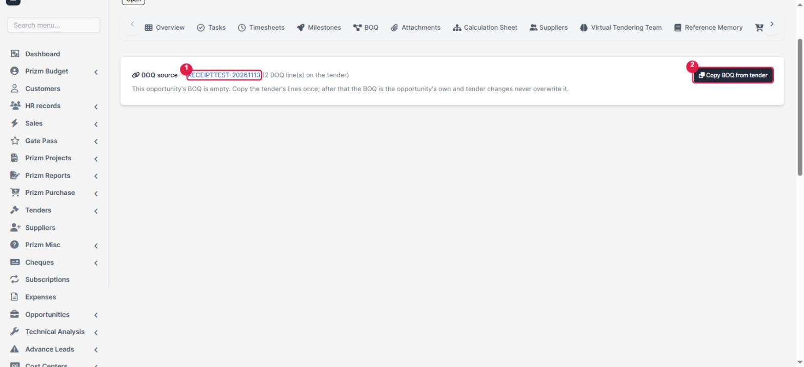

1. افتح تبويب **BOQ** في الفرصة. يعرض صندوق **BOQ source** في الأعلى العطاء وبنود جدول كمياته.
2. اختر **Copy BOQ from tender**. يظهر فقط ما دام جدول كميات الفرصة فارغاً، وفقط للموظفين المسموح لهم
   بتعديل جداول الكميات.

النسخ يعمل مرة واحدة: جدول الكميات الذي فيه بنود لا يُنسخ فوقه أبداً. تحويل العطاء ينسخ بنوده تلقائياً؛
الزر للفرصة التي وصل جدول كميات عطائها لاحقاً.

### راجع تغيّر العطاء في جدول كميات الفرصة

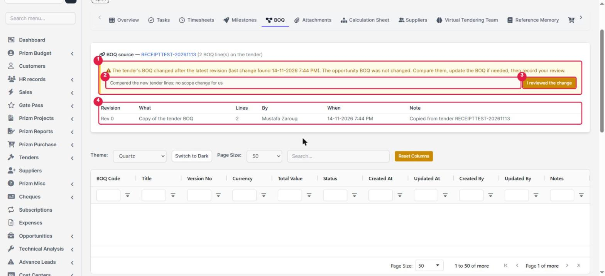

1. اقرأ التحذير في صندوق **BOQ source**: تغيّر جدول كميات العطاء بعد آخر مراجعة. جدول كميات الفرصة لم
   يتغير.
2. قارن الجدولين وحدّث جدول كميات الفرصة إن احتجت.
3. اكتب ما راجعته.
4. اختر **I reviewed the change**. تُحفظ مراجعتك كمراجعة جديدة ويختفي التحذير.
5. اقرأ قائمة المراجعات: أول نسخة من جدول كميات العطاء، ثم كل تغيير تمت مراجعته، مع من ومتى والملاحظة.

التحذير للعلم فقط؛ لا يوقف شيئاً. كل نسخ وكل مراجعة يُكتب في سجل النشاط.

### اعرف مراحل فريق الذكاء الاصطناعي التي تغذّي مرحلة العمل

مراحل العمل في الفرصة ومراحل فريق الذكاء الاصطناعي مربوطة بخريطة ثابتة واحدة.

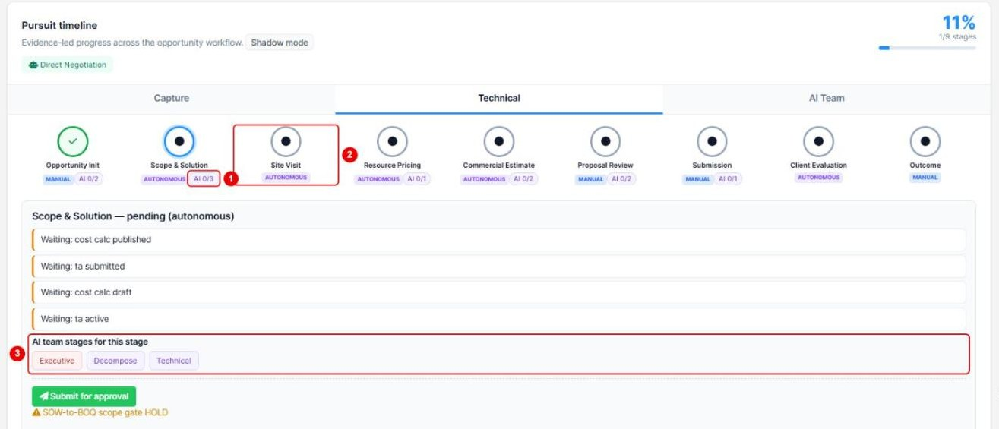

1. في الخط الزمني للمتابعة، اقرأ عداد **AI** تحت مرحلة العمل: كم من مراحل الفريق التي تغذّيها اكتمل.
   يصبح غامقاً عندما تكتمل كلها. لا يراه إلا من يُسمح له برؤية عمل الفريق.
2. المراحل التي بلا عداد (**Site Visit** و**Client Evaluation** و**Outcome**) لا تغذّيها أي مرحلة من
   مراحل الفريق.
3. اختر مرحلة لترى تحت فحوصاتها **AI team stages for this stage**، كل منها بحالتها. المرحلة الفاشلة
   باللون الأحمر.

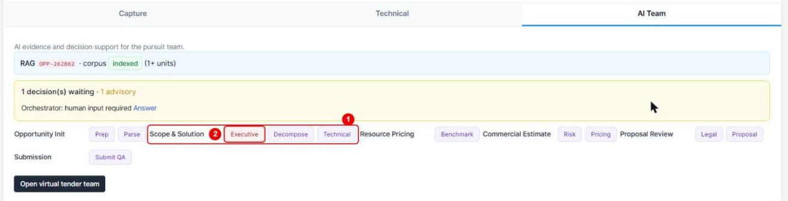

4. في تبويب **AI Team** في الخط الزمني، تُجمَّع مراحل الفريق تحت مرحلة العمل التي تغذّيها، بترتيب خط
   العمل. الفاشلة باللون الأحمر.

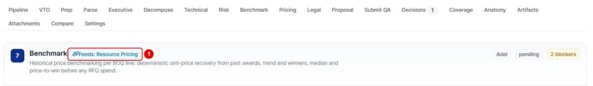

5. في تبويب **Virtual Tendering Team**، تعرض كل مرحلة من مراحل الفريق **Feeds: …**، أي مرحلة العمل التي
   يذهب إليها عملها. مثلاً *Benchmark* تغذّي *Resource Pricing*.

| مرحلة العمل | مراحل الفريق التي تغذّيها |
|---|---|
| Opportunity Init | Prep، Parse |
| Scope & Solution | Executive، Decompose، Technical |
| Site Visit | لا شيء |
| Resource Pricing | Benchmark |
| Commercial Estimate | Risk، Pricing |
| Proposal Review | Legal، Proposal |
| Submission | Submit QA |
| Client Evaluation | لا شيء |
| Outcome | لا شيء |

العدادات للعلم فقط؛ لا تُكمل مرحلة العمل ولا توقفها. عند تحويل عطاء مع مسؤولي المراحل، تُقرأ أسماء
المراحل من نفس الخريطة. والمرحلة التي ليس لها مسؤول في الفرصة تُرفض مع سبب واضح.

### يصلك تنبيه عندما يتوقف n8n عن استقبال الأحداث

يفحص النظام بانتظام هل ما زالت أحداثه تصل إلى n8n، فلا يحتاج المديرون إلى فتح الإعدادات لاكتشاف أن
الإرسال توقف. يعمل الفحص فقط حيث يكون n8n مُعدّاً (العنوان والسر مُدخلان، و**Send events to n8n**
مفعّل).

1. افتح **Opportunities → Settings → TenderOps**، قسم الأتمتة.
2. اقرأ **Health**:
   - **Healthy**: الأحداث تصل إلى n8n.
   - **Down**: الأسباب مذكورة تحته: حدث انتظر أكثر من المدة المحددة، أو حدث يتكرر فشله، أو حدث تُخلّي
     عنه، أو توقف n8n عن الرد على فحص صحته.
   - **Not checked yet**: لم يجرِ أي فحص منذ تفعيل الإعداد.
   - **Not checked**: أحداث n8n موقوفة أو غير مُعدّة.

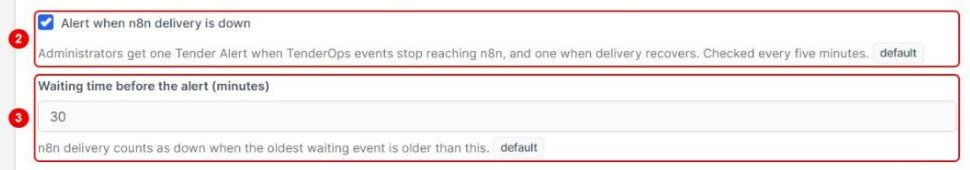

3. أبقِ **Alert when n8n delivery is down** مفعّلاً (الوضع الافتراضي). يصل للمديرين Tender Alert واحد
   عندما يتوقف الإرسال وواحد عندما يعود. كل تنبيه يفتح صفحة الإعدادات هذه.
4. اضبط **Waiting time before the alert**. يُعد الإرسال متوقفاً عندما يكون أقدم حدث منتظر أقدم من هذه
   المدة.
5. احفظ.

أثناء توقف الإرسال لا يضيع شيء: تنتظر الأحداث وتُرسل مرة أخرى عندما يرد n8n.

### أرسل عطلاً تقنياً إلى تقنية المعلومات

عندما تفشل مرحلة باستمرار بسبب عطل تقني (عامل الذكاء الاصطناعي، أو البرنامج، أو مزوّد خدمة، أو إعداد)،
لا يرسله النظام إلى تقنية المعلومات مباشرة. بل يجهّز مسودة تذكرة دعم أولاً ويطلب من صاحب صلاحية المرحلة
اعتمادها.

**بصفتك صاحب صلاحية المرحلة**

1. افتح تبويب **Decisions** في الفرصة وابحث عن **Send this fault to IT?**. تعرض المسودة الفرصة والمرحلة
   والتشغيل والخطأ (بعد حذف أي بيانات سرية) ورابطاً للعودة.
2. اختر إجابة واحدة:
   - **Send this ticket to IT**: أضف ملاحظة إذا احتاج فريق تقنية المعلومات إلى سياق أكثر. تظهر ملاحظتك
     في أعلى التذكرة.
   - **Not a technical fault — send to the stage owner**: يستلم مالك المرحلة العطل بدلاً من ذلك.
   - **Keep the run on hold**: لا يُرسل شيء ويبقى التشغيل متوقفاً.
3. اختر **Submit decisions**.

إذا لم يرد أحد، لا يُرسل شيء إلى تقنية المعلومات.

**ما يستلمه فريق تقنية المعلومات**

- تذكرة دعم في قسم تقنية المعلومات، مسندة إلى رئيس القسم. إذا لم يكن للقسم رئيس، يُبلَّغ القسم كله وتذكر
  بطاقة القرار ذلك.
- قرار **Technical fault — IT** في الفرصة، مع رابط للتذكرة. يصلح الفريق العطل، ثم يجيب
  **Fault fixed — re-run the stage** لتشغيل المرحلة مرة أخرى.
- إذا فشلت المرحلة نفسها مرة أخرى والتذكرة مفتوحة، يُضاف الفشل الجديد إلى التذكرة نفسها كرد. لا تُفتح
  تذكرة ثانية.
- إغلاق التذكرة يُسجَّل في بطاقة القرار، لكنه لا يعيد تشغيل أي شيء. القرار وحده يفعل ذلك.

**إذا تعذّر إرسال التذكرة**

تعرض بطاقة القرار **لم تُرسل** والسبب، ويستلم فريق تقنية المعلومات قراره رغم ذلك. أصلح السبب، مثلاً اختر
قسم تذاكر تقنية المعلومات في الإعدادات، ثم اختر **إعادة الإرسال** في البطاقة. يستطيع صاحب صلاحية القرار
أو أي مدير إعادة الإرسال.

**قبل الاعتماد عليها (للمديرين)**

- تأكد من أن لقسم تقنية المعلومات رئيساً محدداً في **HR Profile → Departments**.
- إذا كان يجب أن تذهب تذاكر تقنية المعلومات إلى قسم آخر أو بأولوية أخرى، اضبط **IT ticket department**
  و**IT ticket priority** في إعدادات TenderOps.

### اختر من يقرر لفرصة واحدة

كل قرار في مراحل العرض يذهب إلى مسؤول دوره: مدير تطوير الأعمال، أو السلطة الفنية، أو المدير التجاري، أو
المستشار القانوني، أو سلطة العطاء، أو دعم تقنية المعلومات للأعطال التقنية. **خريطة الصلاحيات**
(**Opportunities → Authority map**) هي الإعداد لكل الفرص. لتغييره لفرصة واحدة فقط:

1. افتح الفرصة وتبويب **مسؤولو المراحل**.
2. كل دور يعرض المراحل التي تذهب إليه ومسؤوله الافتراضي من خريطة الصلاحيات.
3. اختر شخصاً للدور، أو **استخدم الافتراضي** للرجوع إلى خريطة الصلاحيات.
4. اختر **Save**.

بعدها تذهب قرارات مراحل ذلك الدور في هذه الفرصة إلى الشخص الذي اخترته، وتبقى الفرص الأخرى على خريطة
الصلاحيات. يغيّر مسؤولي المراحل المديرون ومن لديهم صلاحية *manage settings* في TenderOps؛ والباقون
يرونهم فقط.

## مراحل العرض

### تابع مستندات العطاء

افتح تبويب **Virtual Tendering Team** في الفرصة، ثم **Documents**. يعرض كل مستندات العطاء مع جهة إصدار
كل مستند، ومراجعته، وتواريخه، ومدى إلزامه، وهل هو جاهز. ويعرض تبويب ثانٍ، **Issues**، المشكلات
المكتشفة في المستندات.

**عندما يعيد العميل إصدار مستند**

يحتفظ النظام بكل النسخ. يصبح الملف المعاد إصداره نسخة جديدة (v2، v3، …)، وتبقى النسخة القديمة في سجل
المستند. ولا يُعلَّم كقديم إلا العمل الذي بناه فريق الذكاء الاصطناعي من النسخة القديمة، مع السبب، مثل
"Source changed: BOQ.xlsx v1 → v2". أعد تشغيل تلك المراحل. والعمل الذي لم يستخدم ذلك المستند لا يتأثر.
والملف الذي يختفي من مجلد العطاء يُعلَّم **Withdrawn**.

**سجّل مستنداً وعلّمه جاهزاً** (يتطلب صلاحية *Edit opportunity documents*)

1. في **Documents**، اختر **Details** في صف المستند.
2. راجع الحقول. يقترح النظام مدى إلزام المستند وتاريخ استلامه:
   - **Issuer**: جهة الإصدار، مثل العميل أو استشاريه.
   - **Client revision**: المراجعة المكتوبة على المستند، مثل B.
   - **Authority**: **Contractual** (ملزم: الشروط، والمواصفات، وجدول الكميات، والملاحق)، أو
     **Informative** (رسومات للعلم، وتقارير)، أو **Reference** (معايير، وعروض سابقة).
   - **Received on**، و**Effective from** إذا ذكره المستند.
3. اختر **Confirm fields**. يصبح المستند **Registered**.
4. عندما يمكن الاعتماد على المستند، اختر **Mark ready**. يصبح **Ready**.

يعود المستند المعاد إصداره إلى **Received** لكي يُراجَع من جديد. ولا ينتظر التشغيل جاهزية المستندات؛
يعرض تبويب **Documents** عدد المستندات غير الجاهزة بعد.

**أبلغ عن مشكلة في مستند** (لكل من يستطيع عرض الفرصة)

1. افتح **Details** الخاصة بالمستند.
2. تحت **Raise issue**، اختر النوع (صفحات ناقصة، أو تعارض مع مستند آخر، أو غموض، أو غير مقروء، أو أخرى)
   واكتب ما المشكلة وأين.
3. اختر **Raise issue**. تُربط المشكلة بالنسخة التي تعرضها.

يحلّها من لديه صلاحية *Edit opportunity documents* من تبويب **Issues** باختيار **Resolve** وكتابة كيف حُلَّت.

### اسأل العميل سؤالاً (استفسار RFI)

افتح الفرصة، ثم **Virtual Tendering Team ← الاستفسارات**، واضغط **استفسار جديد**.

1. اكتب الموضوع والسؤال، واختر المستندات التي يسأل عنها. **حفظ المسودة**.
2. **إرسال للاعتماد**. يذهب الاستفسار إلى وحدة **الاعتمادات**، حيث تحدد سياسة **استفسار TenderOps للعميل**
   (الاعتمادات ← السياسات) المعتمدين، وهم يقررون هناك. عند الاعتماد يظهر **معتمد، لم يُرسل**، وعند الرفض يرجع
   مسودةً لتعدّله.
3. بعد الاعتماد، أرسل السؤال بنفسك بالبريد أو عبر البوابة. ثم اضغط **تسجيل الإرسال** وحدد الطريقة (بريد أو بوابة أو
   أخرى) والتاريخ والمرجع (موضوع البريد أو رقم البوابة). النظام لا يرسل شيئاً بنفسه حتى الآن.
4. عندما يرد العميل، اضغط **تسجيل الرد**، والصق الرد وحدد كيف وصل. يصبح الرد مستند توضيح على الفرصة تقرأه مراحل
   التحليل، وتُعلَّم المخرجات التي اعتمدت على المستندات التي سألت عنها لتُراجع من جديد.
5. **إغلاق الاستفسار** عندما لا يلزم شيء آخر. و**سحب** (مع السبب) يلغي الاستفسار قبل الرد.

كل خطوة محفوظة. **Virtual Tendering Team ← سجل الاستفسارات** يعرض كل خطوات استفسارات الفرصة، الأحدث أولاً: التاريخ
والاستفسار والخطوة ومن قام بها والسبب. و**سجل هذا الاستفسار** داخل الاستفسار يفتح القائمة مفلترة عليه.

موعد الرد هو موعد الاستفسارات في المناقصة إذا كان معروفاً، وإلا عدد من أيام العمل بعد الإرسال (الإعدادات ← الاعتمادات
والبوابات: 3 أيام افتراضياً، والجمعة والسبت عطلة). تاب الاستفسارات يعدّ ما ينتظر الاعتماد أو تجاوز موعده، والاستفسار
المتأخر يظهر أيضاً في **وين العطاءات واقفة** باسم من سجّل الإرسال.

### عندما يتغير BOQ المناقصة (ملحق)

عندما يغيّر العميل BOQ المناقصة (ملحق أو BOQ معدّل)، يتبعه BOQ الفرصة تلقائياً خلال ساعة: البنود المتغيرة تأخذ الكمية
أو الوحدة أو الوصف الجديد (أسعارك تبقى)، والبنود المحذوفة تُخفى ولا تُحذف، والبنود الجديدة تُضاف. ويصبح ذلك مراجعة BOQ
جديدة **للمراجعة**. ويمكنك أيضاً الضغط على **طبّق الآن** في تاب الـ BOQ عندما يظهر أن BOQ المناقصة تغيّر.

في تاب **BOQ** الخاص بالفرصة:

- **المراجعات** تعرض كل مراجعات الـ BOQ: النسخة من المناقصة، وكل تغيير طُبّق، وكل رجوع، مع من ومتى. اضغط على مراجعة
  لترى تغييراتها. **رجوع** (مع السبب) يعيد الـ BOQ كما كان قبل ذلك التغيير كمراجعة جديدة؛ لا يُحذف شيء.
- **التغييرات** تعرض المراجعة مقابل التي قبلها بنداً بنداً: مضاف أو محذوف أو متغيّر، قبل وبعد، مثل "Qty 120 → 150".
- **البنود المتأثرة** تعرض ما لمسه التغيير: بند الـ BOQ، وبنود طلب عرض السعر والبنود المسعّرة المبنية عليه في
  TenderOps، مع السبب. اضغط **تمت المراجعة** بعد أن تنظر فيه.

المراجعة تتم في وحدة **الاعتمادات**: أنشئ سياسة لـ "تغيير BOQ الفرصة من المناقصة" في الاعتمادات ← السياسات. عند
الاعتماد تصبح المراجعة مُراجَعة، وعند الرفض يتم الرجوع عنها. يصل تنبيه لمسؤول الفرصة، وللمدير التجاري أيضاً عندما تتأثر
بنود مسعّرة.

### مطابقة كل بند في جدول الكميات مع أصناف الشركة

!!! note "متاح بعد الإصدار القادم"
    Opportunities 2.53.0 و Prizm Projects 1.179.0.

1. افتح تبويب **BOQ** في الفرصة، ثم **Items**. يعرض كل بند صنف العميل، و**صنف الشركة / الطقم**، وعمود **التفكيك**.
2. اضغط **فكّك** على البند. تُفتح مراجعة التركيب في Materials في تبويب جديد: يشرح الذكاء الاصطناعي صنف العميل ويقترح
   صنف شركة واحداً أو طقماً بالكميات والوحدات. راجعه واربط أصناف الشركة الموجودة حيث تناسب ثم اعتمد. لا يُضاف شيء قبل
   الاعتماد.
3. بالرجوع لتبويب جدول الكميات يعرض البند **مطابَق** وصنف الشركة أو الطقم. صنف العميل المطابَق من قبل يُعاد استعماله
   فوراً دون قراءة ذكاء اصطناعي جديدة.
4. **Opportunities ← سجل جدول الكميات** يعرض كل مطابقات كل الفرص، مع حفظ المطابقات السابقة.

**عمر الكوتيشن.** في **WBS-CBS ← Resources** يُحتسب السعر من كوتيشن المورد **3 أشهر** من تاريخ الكوتيشن. عمود
**عمر الكوتيشن** بجانب السعر يعرض عمرها بالأيام: **أخضر** أقل من شهر ونصف، **أصفر** حتى 3 أشهر، **أحمر** بعدها. السعر
الأحمر لا يُحتسب، ويحتاج البند كوتيشن جديدة قبل لقطة التكلفة.

### من جدول الكميات إلى سعر العطاء

تُبنى تكلفة العطاء وسعره في تبويب **WBS-CBS** للفرصة، بهذا الترتيب.

1. **WBS و CBS من المناقصة.** في تبويب **المراحل** في TenderOps، تطلب خطوة **WBS & CBS** (بعد الفني) من الذكاء الاصطناعي
   أن يقترح هيكل تجزئة العمل، ورمز التكلفة (CBS) لكل حزمة عمل، وربط كل بند من جدول الكميات بحزم العمل، من تحليل
   المناقصة. تراجع الاقتراح وتصحح ما هو خطأ ثم تطبقه. لا شيء يُطبق بدون شخص.
2. **الموارد.** في **الموارد**، لكل حزمة عمل بنودها: عمالة أو مواد أو معدات أو مقاولة من الباطن، لكل منها كمية وسعر.
   المواد من أصناف الكتالوج المعتمدة فقط. ويمكن أن يأتي السعر من آخر عرض فائز ساري لهذا الصنف.
   للمواد التي ليس لها سعر ساري:
   - في **حزم طلبات الأسعار** يجمّعها **إنشاء الحزم** حسب تخصص المورد (عائلة UNSPSC للصنف)، مثلاً الكابلات في حزمة
     والمضخات في أخرى، والصنف بلا تخصص يذهب إلى **غير مصنّف**؛
   - قبل الإصدار افتح **البنود** في الحزمة لنقل بند إلى حزمة أخرى أو إزالته أو إعادة تسمية الحزمة؛
   - **إصدار طلب الأسعار** يعمل طلب أسعار جديداً لكل حزمة في موديول طلبات الأسعار، حيث تختار الموردين وتعتمده وترسله
     كالمعتاد؛ والحزمة الصادرة لا تتغير؛
   - عند اختيار الفائز تأخذ البنود سعره تلقائياً، وتظهر الحزمة **مسعّرة**.
3. **حسابات التكلفة.** يعرض **حسابات التكلفة** التكلفة حسب حزمة العمل ورمز CBS، والفحوصات التي يجب أن تنجح. عندما تنجح،
   يثبّت **أخذ لقطة** تكلفة كل بند في جدول الكميات. إذا تغيّر مدخل لاحقاً، تظهر اللقطة **قديمة**، ويعرضها TenderOps في
   **أين تنتظر العطاءات**.
4. **التسعير.** في **التسعير**، يسعّر **مسودة مراجعة سعر** كل بنود جدول الكميات من اللقطة:
    - الهامش هو الهامش المستهدف للفرصة، 12% افتراضياً؛ غيّره لكل البنود أو لبند واحد؛
    - السعر بعملة جدول الكميات، بسعر صرف اليوم من سجل الأسعار، أو بسعر تدخله مع ملاحظة؛
    - يعرض **حسب حساب الأستاذ** التكلفة حسب حساب QuickBooks. كل رمز CBS يحتاج حساباً (يُحدد في صفحة رموز CBS).
5. **الإرسال.** إذا لم يكن أي بند تحت الحد الأدنى (8%) أو بخسارة، يُعتمد السعر فوراً. وإلا يذهب الطلب إلى **الاعتمادات**
   ومبلغه هو الفرق، وسياسة "مراجعة سعر الفرصة" تحدد من يعتمد.
6. يذهب السعر المعتمد إلى TenderOps، ويُعمل العرض منه. السعر المعتمد الجديد يحل محل القديم.

### اعرض البنود المسعّرة مع المورد وعرض السعر

تبويب **البنود المسعّرة** في صفحة TenderOps يعرض كل بنود العطاء المسعّرة مع المورد وعرض السعر الذي جاء منه السعر
(TenderOps 2.79.0). التبويب للعرض فقط. بند حزمة طلب الأسعار يُسعَّر من **طلب أسعار حزمته نفسها**: الفائز الذي اختير
هناك، وليس فائزاً من طلب أسعار آخر.

جُرِّب محلياً في 26 نوفمبر 2026 على OPP-262866: خرجت الحزمة PKG-01 الكابلات والجلاندات كطلب أسعار واحد، وقدّم موردان
عرضيهما (Ducab وPower Plus Cables)، واختارت المقارنة الأرخص لكل صنف.

1. إذا اختار المشتري مورداً ليس الأرخص، يطلب طلب الأسعار السبب، ويُحفظ السبب مع الاختيار.

    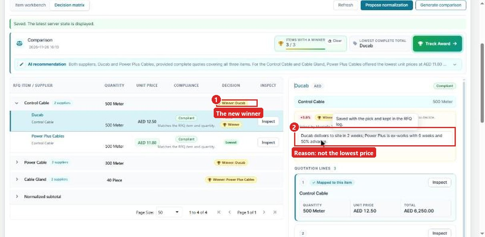

2. تأخذ بنود الحزمة سعر الفائز تلقائياً عند اختياره. في تبويب **WBS-CBS ← حزم طلبات الأسعار** في الفرصة، يفعل زر
   **Price from winners now** ذلك فوراً. لا يُسعَّر من جديد إلا البند الذي تغيّر فائزه، ومرة واحدة فقط. والسعر المُدخل
   يدوياً لا يُستبدل أبداً.

    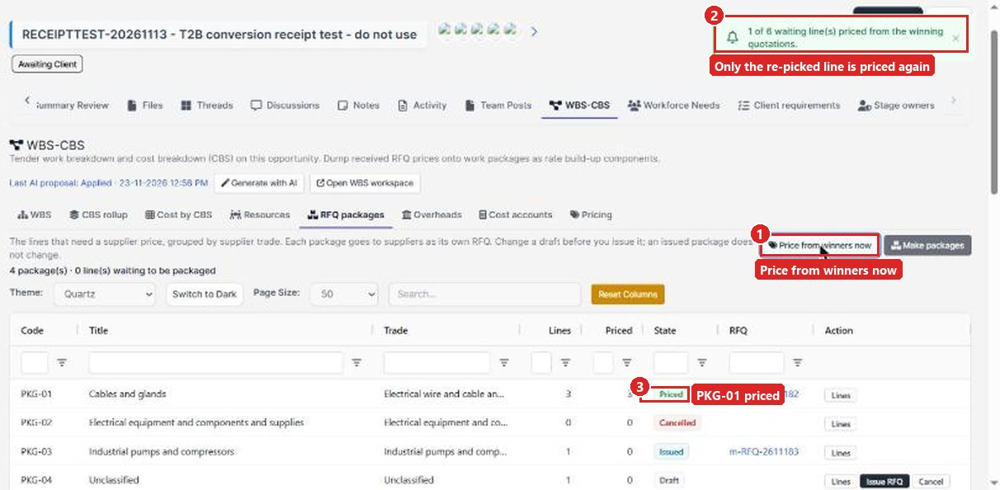

3. افتح **TenderOps ← البنود المسعّرة**. تعرض البطاقات عدد البنود المسعّرة، والإجمالي بالعملة الأساسية، والبنود التي
   لم يكن موردها الأرخص، وبنود الحزم التي ما زالت تنتظر. الجدول مجمّع حسب الحزمة، ولكل حزمة إجماليها. والبند الذي
   ينتظر سعراً يوضّح السبب: لا يوجد فائز بعد، أو الحزمة لم تُصدر.

    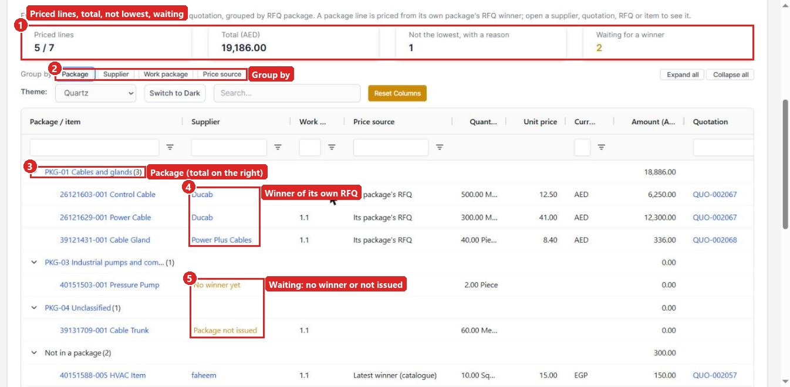

4. مرّر لليمين لترى عرض السعر، وطلب الأسعار، وهل كان المورد الأرخص، وسبب المشتري. المورد وعرض السعر وطلب الأسعار
   والصنف والحزمة كلها تفتح شاشاتها.

    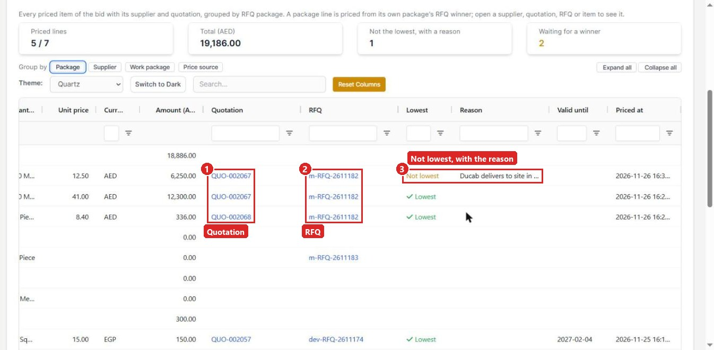

5. **التجميع حسب** يعرض البنود نفسها حسب المورد أو حزمة العمل أو مصدر السعر، ولكل مجموعة إجماليها.

    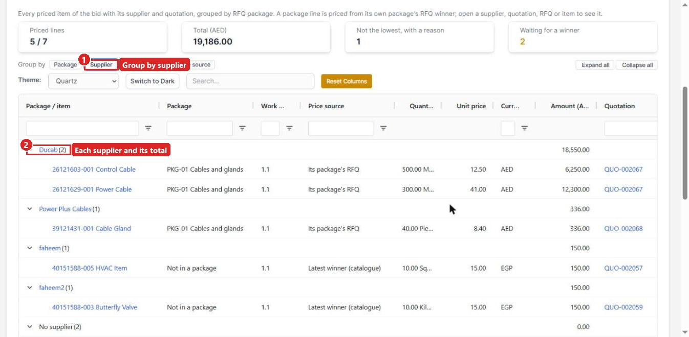

### اعتماد العطاء وتقديمه (حزمة العطاء)

في تبويب **حزمة العطاء** في TenderOps يُجمع العرض ويُعتمد ويُقدَّم.

1. **مسودة حزمة عطاء.** أضف مستندات العرض، كل مستند في جزئه (فني أو تجاري أو قانوني) مع دوره، يُختار من قائمة أدوار
   ذلك الجزء، مثل بيان طريقة العمل أو جدول الكميات المسعّر أو نموذج المناقصة. المسودة الجديدة تبدأ بمستندات الحزمة السابقة.
2. **طلبات الاستيضاح المفتوحة.** لكل طلب استيضاح لم يجب عليه العميل، اذكر الافتراض الذي يقوم عليه العرض والجزء
   الذي يخصه. ومعتمد الإطلاق يؤكده.
3. **الفحوصات.** تحتاج الحزمة مراجعة لجدول الكميات، ولقطة تكلفة حالية، وسعراً معتمداً على تلك اللقطة، والبنود
   المسعّرة، ومستنداً واحداً على الأقل في كل جزء.
4. **تثبيت وإرسال للاعتماد.** تُثبت الحزمة بالبصمة ويذهب كل جزء إلى **الاعتمادات**. الجزء الذي لم يتغير منذ الحزمة
   السابقة يحتفظ باعتماده، فلا يُعاد اعتماد إلا الأجزاء المتغيرة. عندما تُعتمد كل الأجزاء يذهب الإطلاق للاعتمادات.
5. **تسجيل التقديم.** في الحزمة المُطلقة سجّل طريقة التقديم (اعتماد أو البريد أو بوابة أخرى أو باليد) والمرجع والوقت،
   وأرفق الإيصال: إيصال البوابة أو إشعار التسليم المختوم أو البريد المرسل. يُحفظ الإيصال ببصمته ويُودع في طبقة
   الإرسال. الحزمة تُقدَّم مرة واحدة؛ وإعادة التقديم تحتاج حزمة جديدة.

### إدارة أدوار مستندات العطاء (للمسؤولين)

قائمة **Role** في نافذة إضافة مستند تأتي من **الفرص ← الإعدادات ← TenderOps ← أدوار مستندات العطاء**. تبدأ القائمة
بـ 16 دوراً: 7 فنية و4 تجارية و5 قانونية.

- **إضافة دور:** أدخل الكود (حروف إنجليزية كبيرة وأرقام و _، مثل ZAKAT_CERT)، والجزء، والاسم الإنجليزي والعربي،
  والترتيب. لا يتغير الكود لاحقاً لأن حزم العطاء تحتفظ به.
- **تعديل:** غيّر الأسماء أو الجزء أو الترتيب.
- **إيقاف:** لا يُعرض الدور بعدها للمستندات الجديدة، والحزمة التي استخدمته تبقى تعرضه. و**تفعيل** يعيد عرضه. ولا يُحذف
  الدور أبداً.

يرى هذا التبويب المسؤول أو مدير إعدادات TenderOps فقط، ويُسجَّل كل تغيير في سجل النشاط.

### اتخاذ قرار في اعتماد (المعتمد أو المسؤول)

استفسارات RFI وتغييرات جدول الكميات ومراجعات السعر وحزم العطاء يُتخذ فيها القرار من صفحة واحدة في موديول **Approvals**.

1. افتح **Approvals ← My Approvals**. كل صف خطوة تنتظرك، أو تنتظر شخصاً تنوب عنه أثناء غيابه.
2. اضغط على **Step**. يعرض تبويب **Decision** المستند، ومن رفعه، والخطوة والمعتمد، مع **Approve** و**Reject** (الرفض يحتاج سبباً).
3. يعرض تبويب **Chain** كل الخطوات: المعتمد، والقرار، ومن اتخذه ومتى.

يستطيع **المسؤول (Administrator)** اتخاذ القرار في أي خطوة منتظرة بنفس الأزرار:

- في **My Approvals** اختر **Everyone (as administrator)** في فلتر المقعد. يعرض عمود **Seat** معتمد كل خطوة.
- افتح الخطوة. يظهر تنبيه بأنك تتخذ القرار نيابةً عن المعتمد.
- يبقى الاعتماد باسم المعتمد. يعرض تبويب Chain مثلاً "Approved by Mustafa Zaroug on behalf of Osama hassan"، ويُسجَّل
  القرار في سجل النشاط.

**Reassign** ينقل الخطوة إلى شخص آخر فقط، ولا يتخذ القرار فيها.

### خطوة بخطوة: اعتماد مراجعة سعر

جُرّب هذا المثال على ms_dev يوم 26 نوفمبر 2026 على الفرصة OPP-262866: مناقصة فيها 5 بنود في جدول الكميات ولقطة
تكلفة بقيمة 10,195.76 درهم. الأرقام الحمراء على كل صورة تطابق الخطوات. الصور من الواجهة الإنجليزية.

1. في **WBS-CBS ← Pricing** افتح مسودة مراجعة السعر. حدّد **Margin %** لكل البنود (1). هنا 5%، أقل من الحد الأدنى 8%،
   فيظهر على كل بند **Under the floor** (2)، و**الفرق المطلوب اعتماده** 350 درهماً (3).

   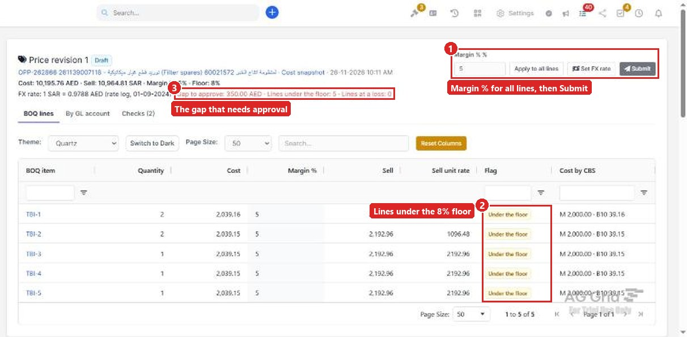

2. افتح **Checks** (1). لا تُقدَّم المراجعة ما دام فحص واحد لا ينجح. هنا كودان في الـ CBS، هما B10 وM، بدون حساب GL (2).

   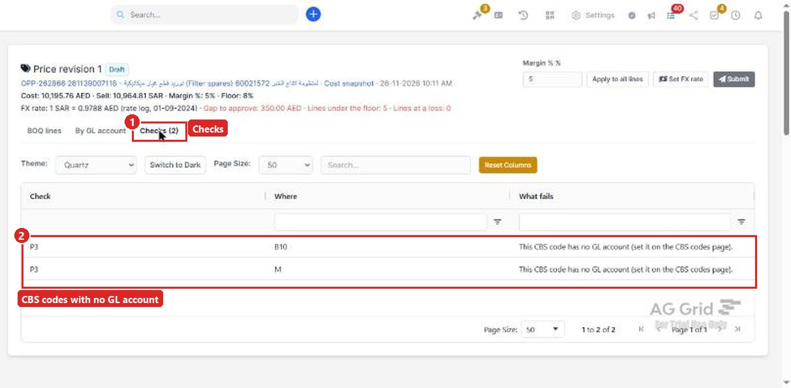

3. في صفحة **CBS codes** حدّد حساب الـ GL على الكود **الأب**. الأكواد الأدنى تأخذ حساب الأب ما لم يكن لها حساب خاص.
   اختر الحساب (1) واكتب السبب (2) واحفظ (3). هنا يأخذ B (تكاليف العطاء) حساب **Commissions and fees**.

   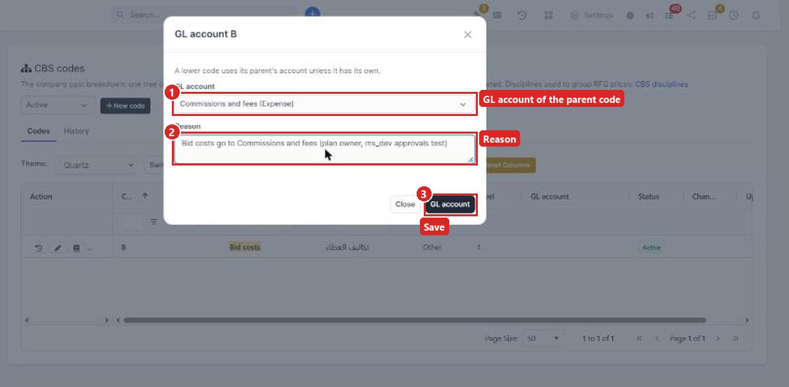

   ويأخذ M (المواد) حساب **Cost of materials - COS** (1).

   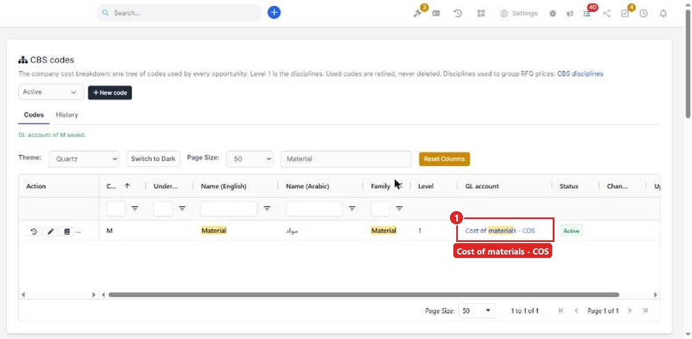

4. في المراجعة، **Checks (0)** (1) تعني أن كل الفحوصات نجحت. اضغط **Submit** (2).

   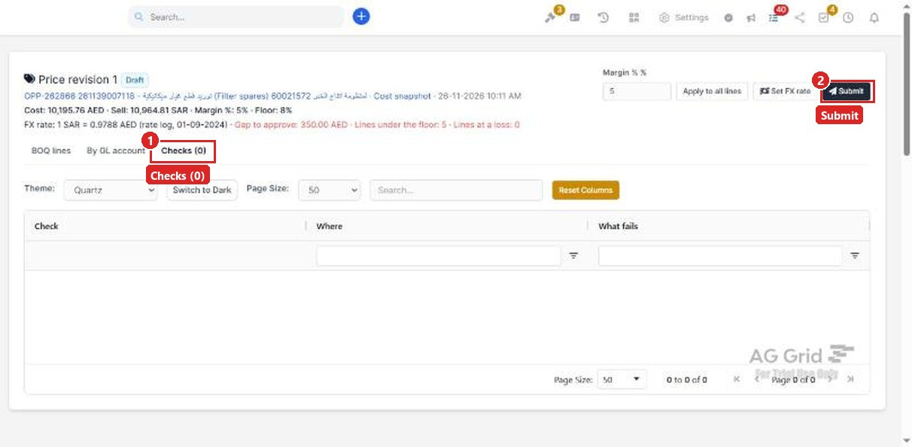

5. أصبحت المراجعة **In approval** (1) لأن بنوداً تحت الحد الأدنى. ورابط **Approvals** (2) يفتح طلبها.

   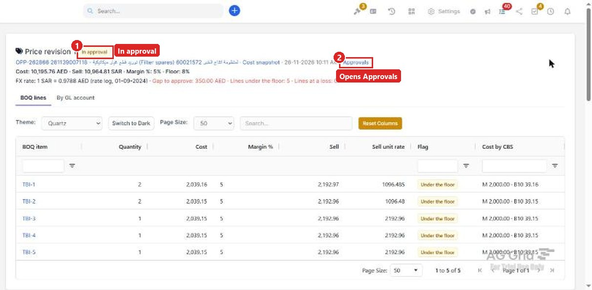

6. يجد المعتمد الخطوة في **Approvals ← My Approvals**. والمسؤول يختار **Everyone (as administrator)** (1) ليرى كل
   الخطوات المنتظرة. عمود **Seat** يذكر المعتمد (2).

   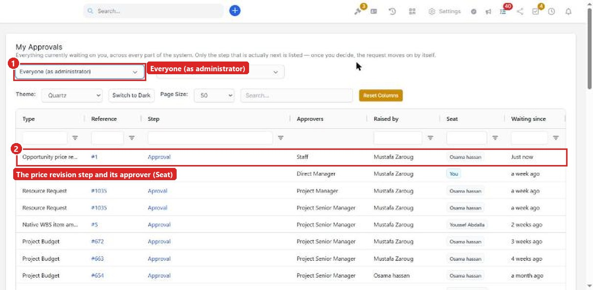

7. افتح الخطوة. يرى المسؤول تنبيهاً بأن القرار يُتخذ نيابةً عن المعتمد (1). اضغط **Approve** (2)، أو **Reject** مع سبب.

   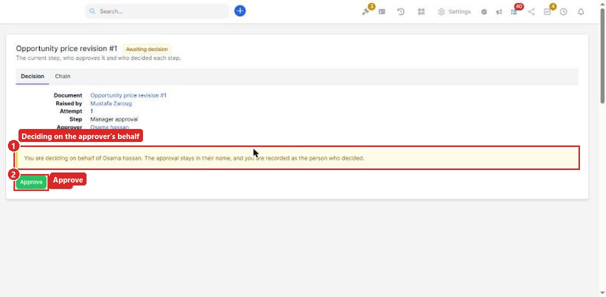

8. أصبحت الخطوة **Approved** (1). ويعرض تبويب **Chain** من اتخذ القرار ومتى (2).

   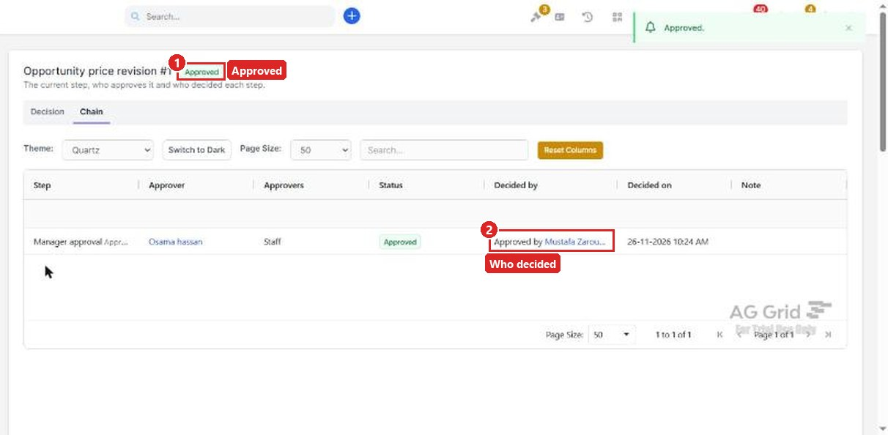

9. في Pricing أصبحت المراجعة **Approved** (1) و**Sent to TenderOps for the proposal** (2). العرض وحزمة العطاء
   يستخدمان هذا السعر.

   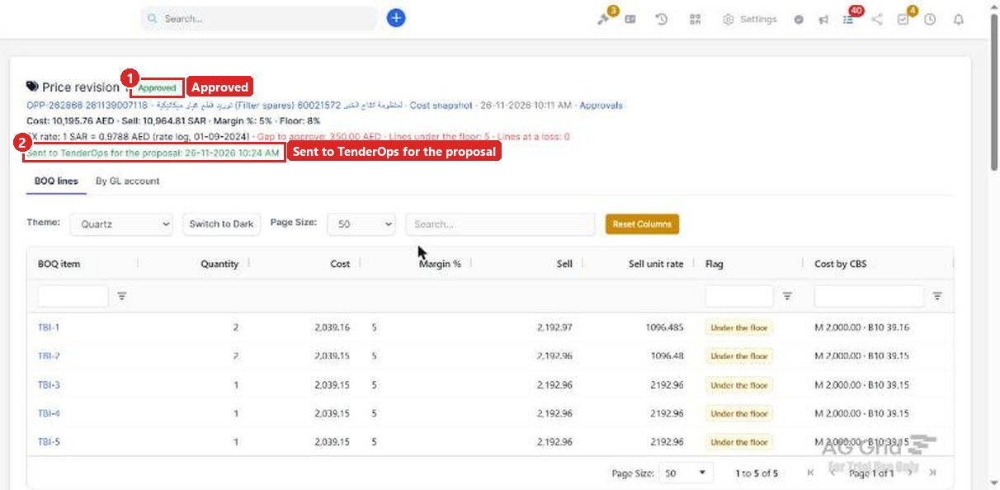

### خطوة بخطوة: اعتماد حزمة عطاء وتقديمها

جُرّب على ms_dev يوم 26 نوفمبر 2026 على الفرصة نفسها بعد اعتماد مراجعة سعرها.

1. في الفرصة افتح **Virtual Tendering Team ← Bid pack** (1) واضغط **Draft bid pack** (2).

   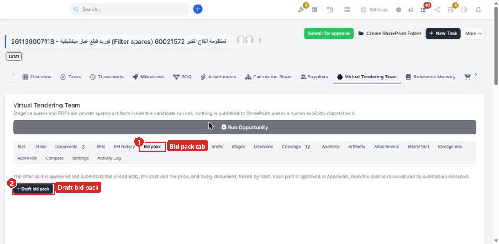

2. اضغط **Add document**. اختر المستند (1) وجزأه ودوره (2)، ثم **Add document** (3). قائمة **Role** تعرض فقط الأدوار
   المفعّلة للجزء المختار. أضف مستنداً واحداً على الأقل لكل جزء: فني وتجاري وقانوني. وتعرض الفحوصات كل جزء ليس فيه مستند بعد.

   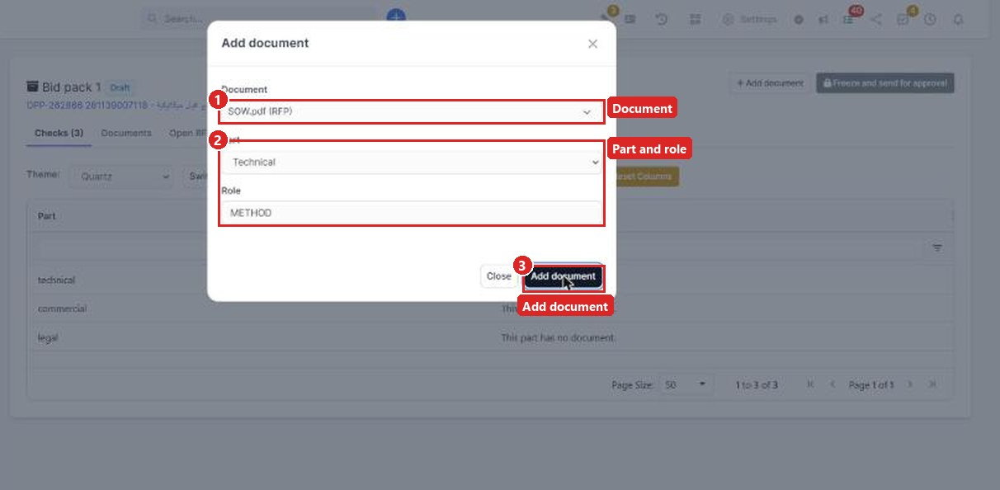

3. عندما تظهر **Checks (0)** (1) ويكون في كل جزء مستنده (2)، اضغط **Freeze and send for approval** (3).

   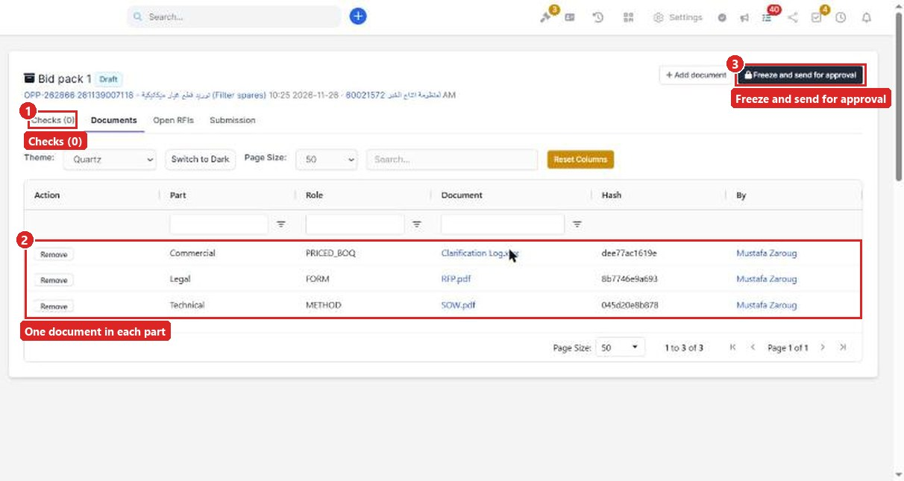

4. أصبحت الحزمة **In approval** (1). في **Parts and approvals** ينتظر كل جزء في الاعتمادات (2). ورابط **Open in
   Approvals** (3) يفتح صفحة القرار لذلك الجزء.

   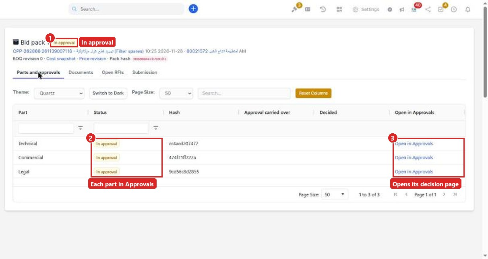

5. في **My Approvals** تظهر اعتمادات الأجزاء الثلاثة (2). والمسؤول يستخدم **Everyone (as administrator)** (1).

   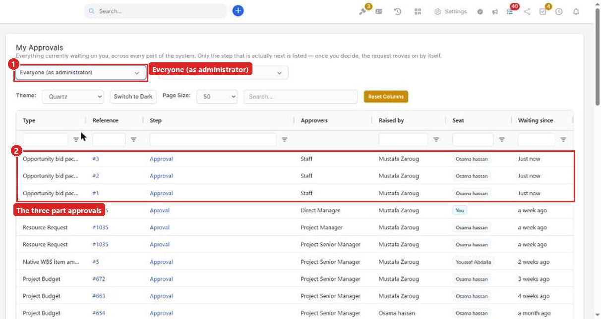

6. افتح كل جزء واضغط **Approve** (2). يظهر التنبيه (1) عندما يتخذ المسؤول القرار نيابةً عن المعتمد.

   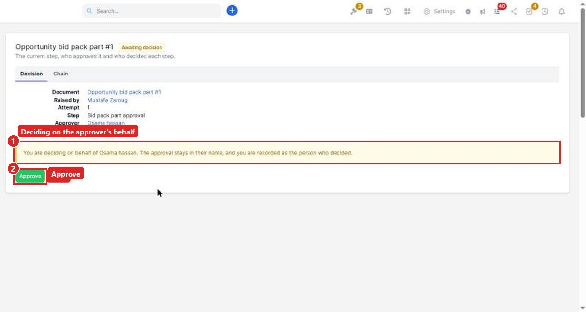

7. عندما تصبح كل الأجزاء **Approved** (1)، مع وقت كل قرار (2)، يُفتح **الإطلاق** في الاعتمادات تلقائياً.

   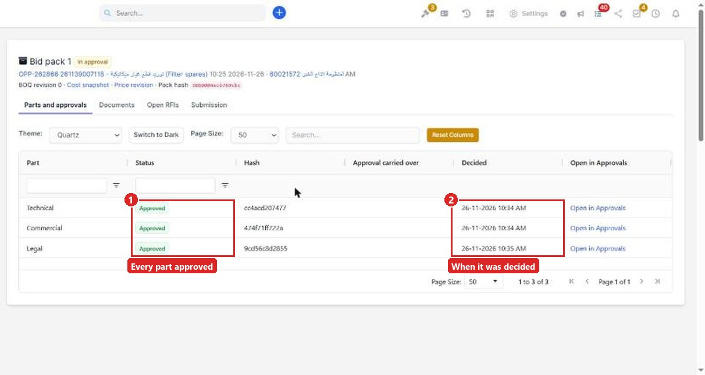

8. يرفع الإطلاقَ (1) الشخصُ الذي ثبّت الحزمة. اعتمده بنفس الطريقة.

   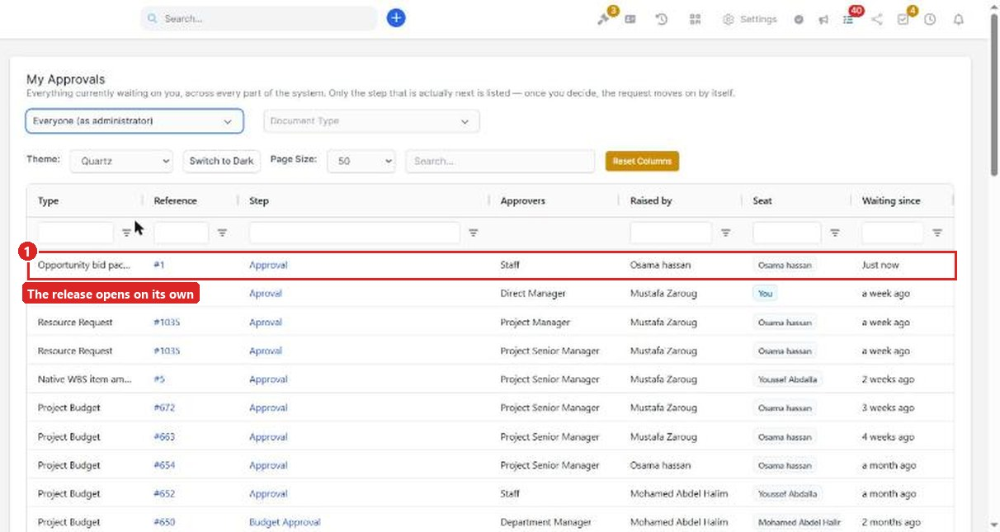

9. أصبحت الحزمة **Released** (1). اضغط **Record submission** (2).

   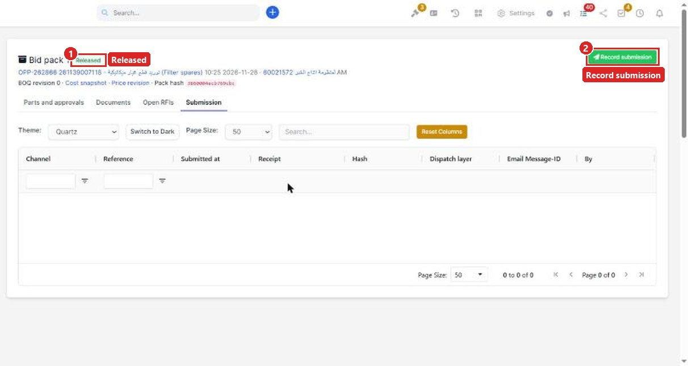

10. اختر قناة التقديم وأدخل المرجع والوقت (1)، وأرفق الإيصال (2)، واضغط **Record submission** (3). الحزمة تُقدَّم
    مرة واحدة.

    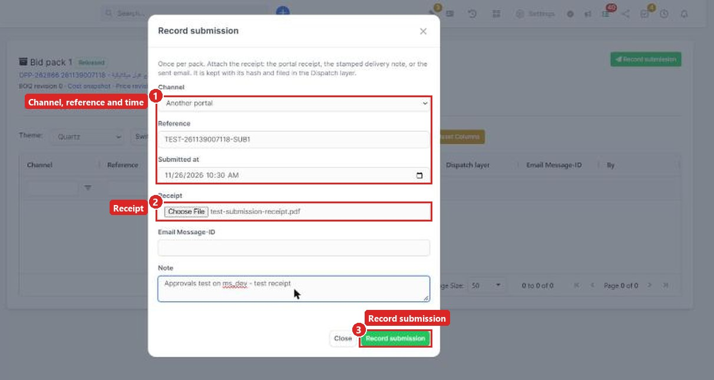

11. أصبحت الحزمة **Submitted** (1). يُحفظ الإيصال ببصمته ويُودع في طبقة الإرسال (Dispatch) للفرصة (2).

    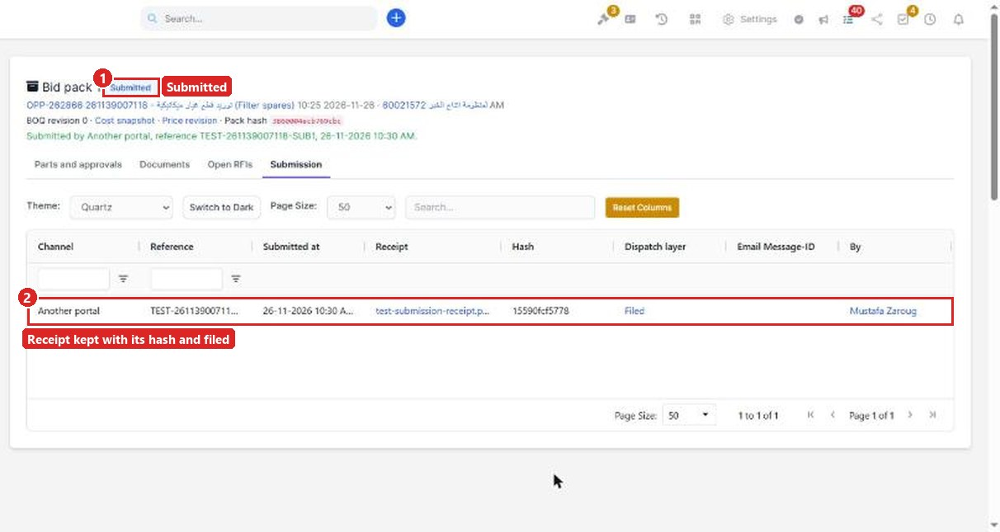

### خطوة بخطوة: اعتماد تعديل جدول الكميات من المناقصة

جُرّب على ms_dev يوم 26 نوفمبر 2026 على الفرصة OPP-262866، بعد أن أضاف ملحق العميل بندين إلى جدول كميات المناقصة.

1. خلال ساعة يعرض تبويب **BOQ** في الفرصة أن **جدول كميات المناقصة تغيّر** (1). اضغط **Apply now** (2)، أو انتظر: يُطبَّق
   تلقائياً.

   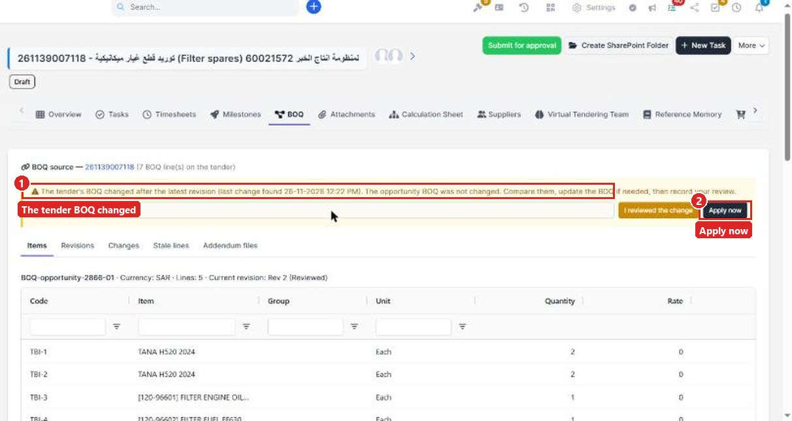

2. يعرض **Changes** (1) المراجعة الجديدة مقارنة بالسابقة. لا تظهر إلا التغييرات الحقيقية: هنا البندان المضافان (2). البنود
   التي لم تتغير، حتى لو تشابه وصف بندين، لا تظهر.

   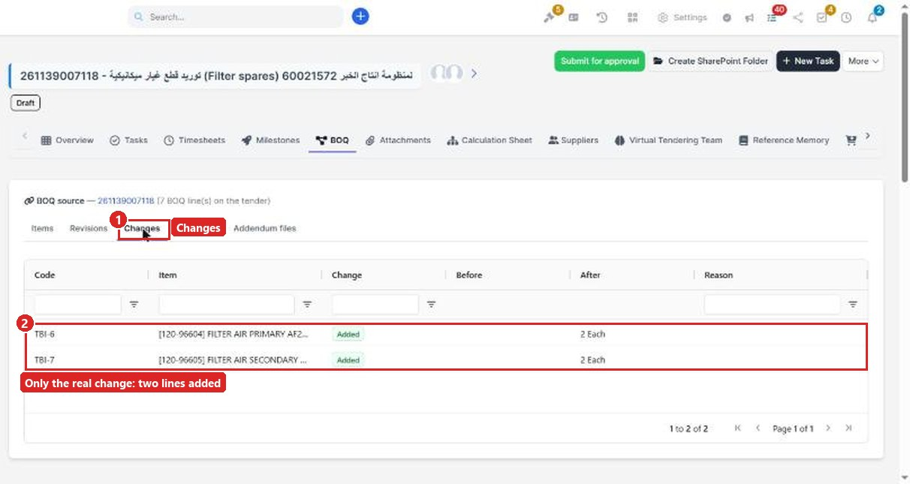

3. تذهب المراجعة إلى **الاعتمادات**. في **My Approvals** (والمسؤول يستخدم **Everyone (as administrator)** (1)) ينتظر
   تعديل جدول الكميات معتمده (2).

   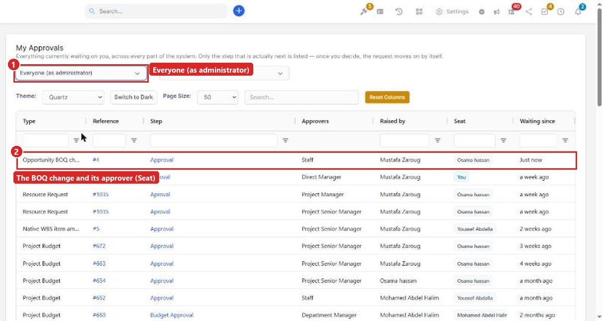

4. افتحه. **Approve** (2) يُبقي التعديل. و**Reject** (3) مع سبب يعيد جدول الكميات كما كان، كمراجعة جديدة، ولا يُحذف شيء.
   يظهر التنبيه (1) عندما يتخذ المسؤول القرار نيابةً عن المعتمد.

   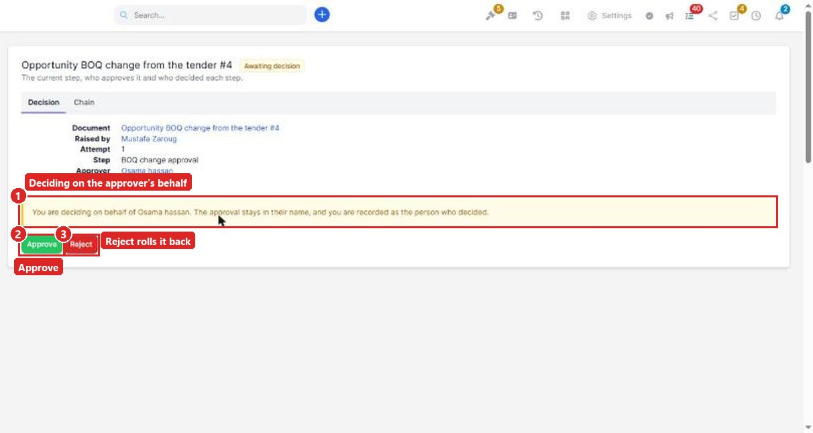

5. أصبح التعديل **Approved** (1)، مع من اتخذ القرار ومتى (2).

   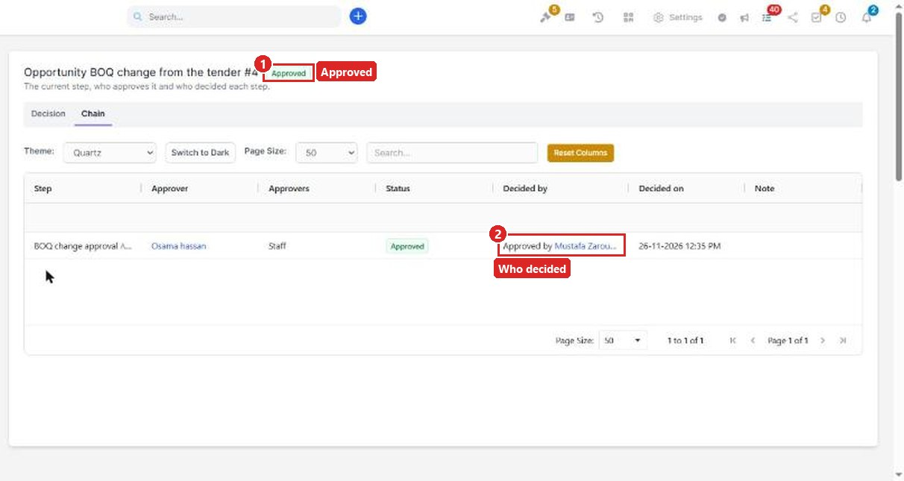

6. في **Revisions** أصبحت المراجعة الجديدة **Reviewed** ببنودها السبعة (1). والتعديل السابق الذي رُفض يظهر **Rolled back**،
   وبعده مراجعة الرجوع (2).

   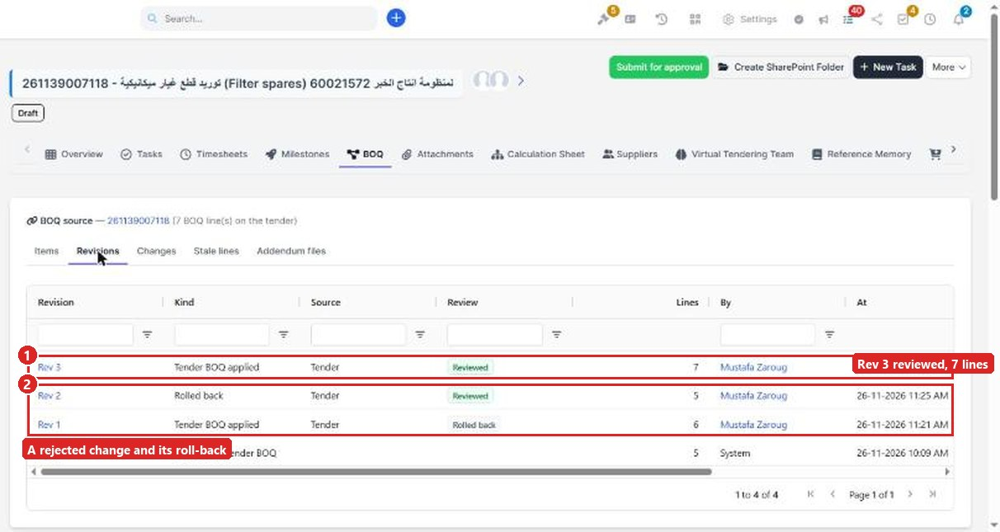

7. في **WBS-CBS ← Cost accounts** أصبحت لقطة التكلفة **Out of date** لأن جدول الكميات تغيّر (1). وتذكر الفحوصات البنود
   الجديدة التي تحتاج حزمة عمل (2). اربطها ثم خذ لقطة جديدة قبل التسعير مرة أخرى.

   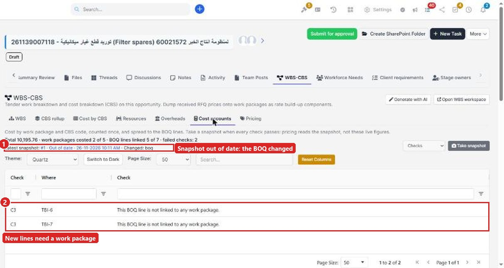

### فرصة بدون جدول كميات من مناقصة: أول جدول كميات من ملف العميل

عندما لا يكون للفرصة جدول كميات (بدون مناقصة، أو مناقصة بدون جدول كميات)، يأتي أول جدول من ملفات العميل:

- عندما يصل ملف من العميل نوعه BOQ، يقرأه الذكاء الاصطناعي. إذا كان الملف يعطي الجدول كاملاً، تصبح بنوده جدول كميات
  الفرصة كـ **Rev 0** للمراجعة في **الاعتمادات**. الملف الذي يذكر تغييرات فقط لا يبدأ جدولاً.
- العملة هي التي يذكرها الملف، وإلا عملة العميل. وإذا لم تُعرف أي منهما ينتظر الملف شخصاً.
- ما دام الجدول فارغاً، يعرض تبويب جدول الكميات كل ملفات العميل مع **قراءة جدول الكميات من هذا الملف**، لجدول جاء بنوع آخر.
- إذا رُفضت المراجعة تُخفى بنوده، ويمكن لملف جدول الكميات التالي أن يبدأه من جديد. والملفات اللاحقة تُقرأ كتغييرات كما سبق.
- كل بند في جدول الكميات يُربط بصنفه في الكتالوج: يُستخدم الصنف إذا كان موجوداً، وإلا يُضاف صنف عميل جديد عن طريق
  موديول المواد.
- تفتح لوحة جدول الكميات على **البنود**: كل بند مع صنفه في الكتالوج، و**الدليل** (ملف العميل الذي جاء منه، أو جدول كميات
  المناقصة)، و**المراجعة** التي أضافته أو غيّرته آخر مرة. اضغط المراجعة لترى تغييراتها.

### اختر كيف يستخدم التحليل الراق

في تبويب **متطلبات العميل** بالفرصة، للإعداد **How the analysis uses RAG** ثلاثة خيارات (يحتاج صلاحية *TenderOps edit*):

| الخيار | ماذا يحدث |
|---|---|
| **Off** | تُقرأ ملفات العميل مباشرة. يستمر الراق في الخلفية، لكن التحليل لا ينتظره أبداً. |
| **Companion** | تُقرأ الملفات مباشرة، وتُضاف نتائج الراق كسياق داعم. |
| **Primary** | يُقرأ الملف من الراق بعد التحقق من الـ embedding الخاص به؛ وتُقرأ بقية الملفات مباشرة. |

**Default** يتبع إعداد **How the analysis of client files uses RAG** في **Opportunities → Settings → TenderOps**.

### تابع خطوات الراق لكل ملف

افتح **Tenders → Tender Indexing** ثم تبويب **RAG register**، أو **Open the RAG register** من الفرصة.
لكل ملف من ملفات العميل ولكل معلومة من معلومات الفرصة صف لكل خطوة من خطوات الراق مع حالتها:
**done** أو **waiting** أو **skipped** (مع السبب) أو **failed** (مع الخطأ) أو **not reported** (أجهزة الفهرسة لا تبلّغ عن هذه الخطوة بعد).

- صفِّ حسب **Step** و **State** لتجد ما هو متوقف.
- **Refresh now** يعيد حساب سجل فرصة واحدة؛ و **Retry** يرسل ملفاً فاشلاً إلى الراق مرة أخرى.

### حسّن برومبتات الذكاء الاصطناعي التي تقرأ ملفات العميل

البرومبتان اللذان يحددان نوع ملف العميل ويقرآن متطلباته أصبحا في **AI Gateway → Prompts**
(الموديول *tenderops*: *requirements_classify* و *requirements_extract*). النسخة 1 هي النص نفسه
السابق، فلا تتغير النتائج. بصلاحية **Prompts** يمكنك:

1. فتح البرومبت وإنشاء مسودة.
2. تعديل النص و **Test** على القيم النموذجية؛ تظهر الإجابة وعدد التوكنات والتكلفة.
3. **Publish** للمسودة المختبرة. كل تحليل بعدها يستخدمها، وسجل الطلبات يوضح النسخة.
4. إذا كانت النسخة الجديدة أسوأ، انشر النسخة الأقدم مرة أخرى.

### الـ WBS يتجمّد عند الفوز بالعطاء

عند تحويل فرصة مُرسّاة إلى مشروع، يتجمّد الـ WBS الخاص بها ويُنسخ إلى المشروع ثلاث مرات:
**Level 0 (award)** (مجمّد، ما تم الفوز به)، ونسخة عمل، و baseline 0 (معتمد). أجرِ التعديلات في
نسخة العمل الخاصة بالمشروع. الحفظ على WBS مجمّد يُظهر *This WBS is frozen*.

### تنقّل في صفحة TenderOps

افتح الفرصة ثم تبويب **Virtual Tendering Team**. يبقى زر **Run Opportunity** في الأعلى، وتحته صف واحد من التبويبات،
كل تبويب لموضوع واحد: التبويبات تنزل لسطر ثانٍ في الشاشة الضيقة فلا يختفي أي منها.

| التبويب | ما فيه |
|---|---|
| **Run** | حالة التشغيل، وما يمنع التشغيل، وبطاقات المراحل الـ 11. اختر بطاقة لتفتح تلك المرحلة. |
| **Intake** | لوحة السياق وحالة الفهرسة والـ embedding. |
| **Documents** | سجل المستندات. |
| **Scope gate & ITP** | بوابة النطاق ومصفوفة الـ ITP. |
| **Briefs** | ملخص الاستلام والملخص التنفيذي. |
| **Stages** | مراحل التحليل الـ 11، كل مرحلة في تبويب. |
| **Decisions** و **Coverage** و **Anatomy** و **Artifacts** و **Attachments** و **Compare** | كما كانت. |
| **SharePoint** | لوحة مرفقات الفرصة نفسها: نفس ملفات SharePoint وإجراءاتها في تبويب المرفقات (TenderOps 2.62.0). |
| **Storage Box** | قائمة عمل الدكيومنت كنترول (الفرز، المراجعة اليدوية، اقتراحات الذكاء الاصطناعي)، وتحتها نفس لوحة الملفات على الـ Storage Box (TenderOps 2.62.0). |
| **Approvals** | طلبات الحفظ التي تنتظر الموافقة وملفاتها، وعداد أصفر بعددها. |
| **Settings** | تبويب واحد فيه تبويب فرعي لكل موضوع: إعدادات المراحل، والإعدادات المحفوظة، والأدلة، ومدخلات PRIZM، و Consulto، وفهرس المستندات، والبرومبتات (TenderOps 2.61.0؛ قبله كانا تبويبين: VTO settings و Settings). |

إعادة التحميل أو الرابط المشارَك يحتفظ بالتبويب المفتوح.

### اختر موديل كل مرحلة تحليل

يوجد إعداد مركزي واحد ونسخة لكل فرصة:

1. **لكل فرصة جديدة** (يحتاج صلاحية *TenderOps manage settings*): افتح **Opportunities → Settings → TenderOps →
   Stage settings**. كل مرحلة تُظهر الموديل الذي تعمل عليه، والمعروض فقط موديلات المزودين الذين لـ TenderOps مفتاح خاص
   بهم في AI Gateway. اختر **Submit**؛ يُحفظ الإعداد كنسخة جديدة.
2. **لفرصة واحدة**: افتح الفرصة، ثم **Virtual Tendering Team → Settings → Stage settings**. نفس الجدول، منسوخ من
   الإعداد المركزي عند فتح الفرصة، ومعه عضو الفريق الافتراضي لكل مرحلة. التغيير هنا يخص هذه الفرصة فقط.

### عدّل برومبتات الذكاء الاصطناعي في TenderOps

كل برومبتات TenderOps في مكان واحد: **Opportunities → Settings → TenderOps → Prompts** (يحتاج صلاحية **Prompts** في
AI Gateway). لكل مرحلة تحليل برومبتان، *open art* و *structured*، فيهما نص النظام ونص المستخدم؛ وبرومبتات متطلبات العميل
موجودة أيضاً.

1. الجدول يُظهر كل برومبت مع جزء من نصه. اختر السهم بجانب النص لقراءته كاملاً.
2. اختر عنوان البرومبت لتفتح شاشة تعديله في نفس المكان. **Back to the prompts** يعيدك إلى الجدول.
3. غيّر ما تحتاج: العناوين، ونص النظام ونص المستخدم، والمتغيرات، والموديل، والمعاملات، والمخرجات، والأدوات، والتخزين
   المؤقت، والملفات التي يأخذها البرومبت. ما لا يأخذه مزوّد الموديل المختار يظهر معطلاً.
4. اختر **Save draft** ثم **Test**. **Publish** يجعل المسودة النسخة التي يستخدمها كل تشغيل جديد. للتراجع، انشر النسخة
   الأقدم مرة أخرى من AI Gateway → Prompts.
5. **New prompt** يضيف برومبتاً بمفتاحه وعنوانه ونصه.

في مراحل التحليل، الموديل يأتي من إعدادات المراحل؛ موديل البرومبت ومعاملاته تُستخدم فقط حيث لا يوجد إعداد للمرحلة.

### اقبل ملف مدخلات PRIZM كدليل

افتح **Virtual Tendering Team → Settings → PRIZM Input**. الجدول يعرض ملفات الحقائق الخاصة المرسلة لهذه الفرصة، مع
البحث والفلاتر. لملف ما زال خاصاً، اختر **Fact class** ثم **Admit to evidence**؛ بعدها يُفهرس كدليل. لا يُنسخ شيء إلى
SharePoint.

### احفظ ملفات الفرصة على الـ Storage Box

*متاح في نظام التطوير والإنتاج منذ 21 نوفمبر 2026 (TenderOps 2.62.0؛ والنقل إلى الـ Storage Box منذ 2.58.0).*

افتح الفرصة، ثم **Virtual Tendering Team ← Storage Box**. تبويب المرفقات يبقى صفحة SharePoint كما هو، لا يتغير فيه
شيء. و**Virtual Tendering Team ← SharePoint** يعرض لوحة المرفقات نفسها داخل TenderOps.

1. **انقل الفرصة.** زر **Move to Storage Box** يظهر فقط ما دامت ملفات الفرصة على SharePoint، ولمن لديه صلاحية
   *TenderOps edit*. اضغطه وأكّد.

   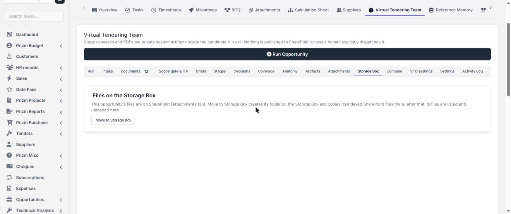

   يُنشأ مجلد الفرصة، وتدخل ملفاتها المفهرسة على SharePoint، من كل الطبقات، قائمة نسخ. لا يوجد زر ثانٍ: النسخ يعمل
   وحده في الخلفية، مرة كل دقيقة تقريباً. كل ملف يُنزَّل ويُطابَق مع بصمة SharePoint، ثم يُكتب في `11 - Triage`
   ويُطابَق مرة أخرى. والملف الذي يصل SharePoint بعد النقل يُنسخ بنفس الطريقة.

   العدادات تتابع النسخ: **Waiting to copy** ينقص و**Copied** يزيد. الملفات في **Failed** تُعاد وحدها بضع مرات، ثم
   يعيدها زر **Retry failed**. الملفات المستبعدة (المكررة وملفات النظام) تظهر تحت **Not copied** في الشجرة، وزر
   **Copy anyway** ينسخ أحدها. عندما تفرغ القائمة يظهر **Switch complete** ويختفي الزر.
2. يحمل المجلد كود الفرصة الكامل، مثلاً `documentcontrol/opportunities/OPP-262865`. منذ TenderOps 2.62.0 فيه مجلدات
   الفرصة نفسها، مثل طبقاتها في SharePoint، ومعها مجلدا الدكيومنت كنترول: `01 - Customer Documents`
   و`02 - Internal Technical` و`03 - Internal Commercial` و`05 - Dispatch` و`10 - Manual Review` و`11 - Triage`.
   الملفات المحفوظة في المجلدات السابقة (`00 - Client Files` و`01 - Award & Contract` … `09 - Financials`) ينقلها
   النظام إلى الجديدة.
3. الملف `00 - Overview.md` داخل المجلد يعرض رقم الفرصة في النظام، وكودها، وكود الـ Document Control (`O262865`)،
   والعنوان، والعميل، والحالة، والتواريخ. النظام يكتبه ويحدّثه عند تغيّر الفرصة؛ لا تعدّله.
4. تظهر الملفات في نفس لوحة تبويب المرفقات، قسم لكل مجلد، ومعها **Private (only you)**. كل قسم يظهر فقط لمن لديه
   صلاحية عرضه، مثل SharePoint (الفني الداخلي والتجاري الداخلي لكل منهما صلاحيته). المعاينة والتنزيل وسجل النسخ
   والمفضلة وقائمة الزر الأيمن تعمل كما في SharePoint.
5. لإضافة ملفات استخدم **Upload** أو زر الرفع في القسم: كل ملف يصل إلى **11 - Triage** (يُحفظ كما وصل ثم يرتّبه
   الـ Document Control)، موسوماً بالقسم الذي رفعته منه. الرفع من **Private** يبقى خاصاً (لا يراه إلا أنت والمدير).
   ملفات SharePoint وOutlook تصل إلى Triage وحدها.
6. فوق اللوحة، قائمة الدكيومنت كنترول تعرض `11 - Triage` و`10 - Manual Review` مع اقتراح الذكاء الاصطناعي لكل ملف،
   و**Not copied** مع السبب، و**Copy anyway** حيث يُسمح.

الفرصة الجديدة تُنشأ مجلداتها بعد دقائق من إنشائها.

**الـ Document Control هو من يرتّب الملفات** (المدير، أو من لديه صلاحية *issue* أو *administer* في الـ Document
Control): اسحب الملف إلى قسم، أو اختر **Move to** أو **Copy to** عليه في اللوحة، أو **File to…** في القائمة أعلاها.
الملف في `11 - Triage` يبقى مكانه وتذهب نسخة مرتبطة به إلى المجلد، والملف في مجلد آخر ينتقل. لا يُنسخ نفس الملف مرتين
إلى نفس المجلد، ولا يُنقل ملف إلى Triage يدوياً ولا إلى فرصة أو مشروع آخر، وكل نسخ ونقل يُسجَّل.

### دع الذكاء الاصطناعي يصنّف ملفات الترياج ثم وافق

*متاح في نظام التطوير منذ 20 نوفمبر 2026 وفي الإنتاج (TenderOps 2.61.0؛ وأرقام المجلدات حسب 2.62.0).*

في **Virtual Tendering Team ← Storage Box**، الأيقونات فوق قائمة الدكيومنت كنترول (مرّر الماوس على أي منها لترى ما
تفعله) والقائمة التي تظهر بالزر الأيمن على ملف فيها فيهما نفس الإجراءات: التنزيل، و File to…، والتصنيف، وتغيير المجلد
المقترح، والإرسال للموافقة، و Copy anyway، وإعادة المحاولة، والتحديث. الإجراء الذي لا تملك صلاحيته لا يظهر. الرفع في
لوحة الملفات تحت القائمة (TenderOps 2.62.0).

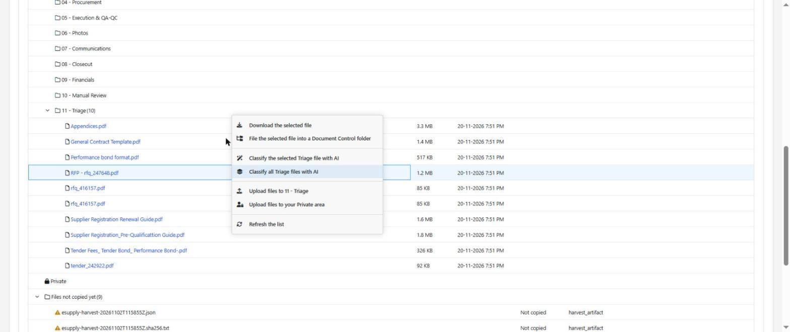

1. **صنّف.** الدكيومنت كنترول (المدير، أو من لديه صلاحية *issue* أو *administer* في الدكيومنت كنترول) يحدد ملفاً في
   `11 - Triage` ويختار **Classify the selected Triage file with AI**، أو **Classify all Triage files with AI**. يقرأ
   الذكاء الاصطناعي كل ملف وحده ويقترح مجلداً (`01` أو `02` أو `03` أو `05` أو `10`) مع عنوان المستند ومصدره وأرقامه، وإذا لم يكن متأكداً
   يقترح `10 - Manual Review`. يظهر الاقتراح في عمودي **Proposed folder** و **AI proposal**.
2. **راجع.** لتغيير اقتراح، حدد الملف واختر **Change the folder the AI proposed**.
3. **أرسل للموافقة.** اختر **Send the AI proposals for approval**، فتذهب كل الملفات المقترحة للفرصة في طلب واحد إلى
   موديول الموافقات.
4. **وافق.** يظهر الطلب في تبويب **Approvals** مع عداد أصفر ما دام ينتظر. المعتمد (أو المدير نيابة عنه) يختار
   **Approve** أو **Reject**.
5. **النتيجة.** بعد الموافقة يُنسخ كل ملف إلى مجلده ويبقى الأصل في `11 - Triage`، وبعد الرفض لا يُنسخ شيء. كل خطوة
   مسجّلة في سجل النشاط.

البرومبت الذي يستخدمه الذكاء الاصطناعي في **Opportunities ← Settings ← TenderOps ← Prompts** (*Document Control:
classify a Triage file*). يحدد المدير من يوافق في **Approvals ← Policies**، نوع المستند **Document Control filing (AI
proposals)**.

### الفلترة والفتح من قوائم TenderOps

كل قوائم TenderOps (المستندات، والمشاكل، ومدخلات PRIZM، وسجل النشاط، و Tender Indexing، وسجل RAG، والمتطلبات، و Where
bids wait) تعمل بنفس الطريقة: الفلتر تحت عنوان العمود فيه *يحتوي*، و*لا يحتوي*، و*يساوي*، و*يبدأ بـ*، و*ينتهي بـ*. اسم
الملف يفتح الملف (أو تفاصيله)، واسم الشخص يفتح صفحته كموظف. والتسميات مثل إجراء النشاط وحالته، والمرحلة في *Where bids
wait*، تظهر بلغتك.

*في نظام التطوير والإنتاج من 21 نوفمبر 2026 (TenderOps 2.63.0):* باقي قوائم TenderOps بقت تعمل بنفس الطريقة، مع الترتيب
وصفحات من 50 سطر:

- **Tender Indexing** فيه تاب **Documents**: اضغط عدد مستندات الفرصة لتشوف مستنداتها هناك.
- **نسخ** المستند، و**Artifacts** (اختر اثنين ثم **Compare selected**)، و**Attachments** (ملفات PDF الخاصة بالـ VTO)،
  و**الافتراضات** في Anatomy › Coverage & Decisions، و**Document index**، وبنود **Benchmark** ومشاهداتها.
- **Supply lane** في مرحلة التسعير يعرض الصنف والاستفسار الفني والـ RFQ وعرض السعر بأسمائها، وكل واحد يفتح شاشته.
- **مصفوفة ضوابط ITP** قائمة واحدة فيها فلتر **المرحلة**؛ اختر مرحلة لتضبط كل ضوابطها مرة واحدة.
- صفحة **Scope gate** فيها تاب لكل قائمة (العوائق، المصادر، خطة التحميل، الفجوات، الأدوار، المراجعات، الإيصالات)؛
  وصفحة **Supply gate** فيها **البنود المسعّرة** و**سجل القرارات**.
- في **Generate Stage Output** اختر الملفات المرسلة من القائمة؛ و**إظهار النسخ الأقدم** يضيف النسخ السابقة.

### اقرأ ملفات العميل ملفاً ملفاً

في **Stage settings** لكل مرحلة خيار **How files are read**:

- **All files in one call**: كل الملفات في طلب واحد (كما كان).
- **One file per AI job, then merge**: كل ملف على الـ Storage Box يُتحقق من بصمته ويُقرأ في مهمة خاصة به؛ الملف
  الذي يفشل يُعاد مرة واحدة ويُذكر في نتيجة المرحلة، ثم تدمج المرحلة نتائج الملفات. الملف الذي قُرئ قبل ذلك بنفس
  البرومبت والموديل لا يُرسل مرة أخرى، وتكلفة كل ملف تظهر في الـ AI Gateway.

## أسئلة شائعة

**لماذا عُلّمت بعض المراحل كقديمة بعد تغيّر مستند؟**
لأنها استخدمت النسخة القديمة من ذلك المستند. أعد تشغيلها لتستخدم النسخة الجديدة. والمراحل التي لم
تستخدم المستند لا تُعلَّم.

**هل أستطيع حذف نسخة قديمة من مستند؟**
لا. تُحفظ كل النسخ لكي تعرف دائماً على ماذا بُني أي مخرج سابق.

**أستطيع فتح فرز العطاءات لكن لا توجد أزرار إجراءات.**
لديك صلاحية **View** فقط. اطلب من مدير صلاحية **Edit** تحت *Tenders - Tender Triage*.

**لماذا لا أستطيع التراجع عن قرار؟**
لا يستطيع التراجع إلا من اتخذ آخر قرار، أو مدير.

**وافقت على نقطة التوقف هذه من قبل. لماذا تطلب الموافقة مرة أخرى؟**
إما أن الفرصة شُغّلت مرة أخرى (كل تشغيل يحتاج موافقته)، أو أن موافقتك أُعطيت قبل إصلاح الضوابط (وعندها
تقول نقطة التوقف "Re-approval required after control fix").

**هل أستطيع جعل التوقيعات النهائية Auto لتوفير الوقت؟**
لا. التوقيعات النهائية تبقى على Hold في كل الإعدادات الجاهزة. وهذا مقصود.

**ماذا يحدث إذا اخترت "Keep on hold"؟**
يبقى التشغيل متوقفاً. لا يتحرك شيء حتى يفك أحد نقطة التوقف.

**لا أرى "Where bids wait" في القائمة.**
تظهر للمديرين وللموظفين الذين لديهم صلاحية TenderOps *view audit*. اطلب الصلاحية من مدير.

**وصلني تنبيه قرار لكن لا أستطيع الرد عليه.**
لا يرد على القرار إلا صاحب الصلاحية المسمّى فيه والمديرون. بصفتك المسؤول، تُبلَّغ لتعرف أن العرض ينتظر.
تابع مع صاحب الصلاحية المذكور في القرار.

**تم الرد على القرار. لماذا لم أعد أرى التنبيه؟**
بمجرد الرد على القرار تُعلَّم تنبيهاته كمقروءة تلقائياً. يبقى الرد في تبويب **Decisions**.

**فشلت المرحلة بسبب عطل تقني. لماذا لا توجد تذكرة عند تقنية المعلومات بعد؟**
تُرسل التذكرة فقط بعد أن يجيب صاحب صلاحية المرحلة على **Send this fault to IT?** بـ **Send this ticket to
IT**. راجع تبويب **Decisions** في الفرصة. إذا عرضت البطاقة **لم تُرسل**، اقرأ السبب واستخدم **إعادة
الإرسال**.

**ضغطت Convert وظهرت لي "This tender is being converted by another request".**
شخص آخر، أو الـ API، يحوّل نفس العطاء الآن. انتظر قليلاً وأعد المحاولة؛ ستصل إلى نفس الفرصة.

**الإيصال يقول "needs attention". ماذا أفعل؟**
انظر إلى الخطوة المعلَّمة ⚠ أو ✗ وإلى التحذيرات، وأبلغ مديراً. يمكنه تشغيل الخطوات مرة أخرى دون إنشاء
فرصة ثانية.

**لماذا لم ينتقل عطائي المختار إلى Converted وحده؟**
إما لا توجد فرصة تحمل رقمه بعد، أو توجد أكثر من واحدة. في الحالة الثانية يصلك Tender Alert بها؛ اربط
الصحيحة يدوياً.

**لماذا يظهر التشغيل الفاشل بمدة انتظار غير معروفة؟**
التشغيل الفاشل يتوقف فوراً، ولا شيء يسجّل متى تحرك العرض مرة أخرى، لذلك لا يمكن قياس مدة انتظاره.
يُحتسب في العدد لكنه لا يدخل في حساب الوسيط.

**عدّلت نص البرومبت لإحدى المراحل. هل يستخدمه تشغيل فريق الذكاء الاصطناعي؟**
نعم. منذ TenderOps 2.52.1 يقرأ التشغيل البرومبت المحفوظ في شاشات برومبتات TenderOps. قبل ذلك كان يستمر
في استخدام النص المدمج، لذلك تبدأ البرومبتات المحفوظة سابقاً بالعمل الآن. اترك البرومبت فارغاً للرجوع إلى
النص المدمج.

**أوقف المزوّد نموذج الذكاء الاصطناعي الذي تستخدمه مرحلة ما. هل عليّ فعل شيء؟**
لا. قبل التاريخ بأسبوعين يختار النظام البديل الأقل تكلفة دون أن يكون أضعف من النموذج القديم، ويتحوّل إليه
في التاريخ. يرى المسؤولون هذا الاختيار ويمكنهم تغييره في **AI Gateway → Provider facts**.
